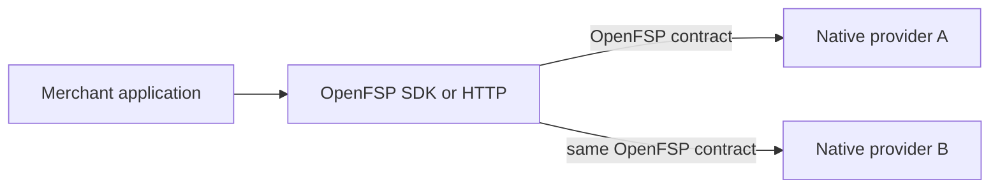

OpenFSP defines the interface between a merchant application server and a payment service. In a native integration, the provider exposes the common HTTP contract in its own system. The application uses the merchant’s credentials and can communicate directly over HTTP or through a client library.

## The application-to-provider layer

OpenFSP covers the exchange between a merchant application server and a provider, and nothing upstream or downstream; [decision 0001](/en/docs/decisions#0001) gives the rationale. Each merchant retains its account and agreement with each provider.

## Native architecture

The application selects the payment service and uses the corresponding credentials and configuration. The client library prepares exchanges according to the interface contract. It talks to the provider directly, with no central service.

## Contract and invariants

| Design decision                                                                                   | Reference                                       |
| ------------------------------------------------------------------------------------------------- | ----------------------------------------------- |
| A payment has an integer amount in gourde cents, a currency and distinct identifiers.             | [Data model](/en/docs/spec/data-model)             |
| The merchant's reference allows correlation, including after a lost response.                     | [Merchant reference](/en/docs/spec/data-model#6.2) |
| Payment states are explicit; terminal states cannot be left.                                      | [Lifecycle](/en/docs/spec/lifecycle)               |
| Replayed creation follows idempotency rules; an indeterminate outcome is not turned into success. | [Idempotency](/en/docs/spec/idempotency)           |
| The API exposes payment creation and retrieval over HTTP and JSON.                                | [Payments API](/en/docs/spec/payments-api)         |
| Errors distinguish, in particular, no effect from an unknown effect.                              | [Errors and effect](/en/docs/spec/payments-api#10) |
| Notifications have verifiable signatures, ordering and deduplication rules.                       | [Webhooks](/en/docs/spec/webhooks)                 |
| Access to the contract is authenticated and restricted by scopes.                                 | [Authentication](/en/docs/spec/authentication)     |

The [design decisions](/en/docs/decisions) document the selected approaches, their rationale and the alternatives considered.

## Capability discovery

Each server declares the capabilities it supports. The application discovers these capabilities to determine applicable flows; unsupported functions are not emulated.

[Capability discovery](/en/docs/spec/capabilities) defines endpoints, declared limits and applicable rejection behaviour. Available operations depend on the specification version and the target implementation’s capabilities. Refunds remain a reserved extension and are not specified in the current version.

## Verifying conformance

A conformance claim identifies a target, a level and a protocol version. The `client` and `server` targets, the Core level and capability profiles are defined in the [conformance specification](/en/docs/spec/conformance).

An [attestation](/en/docs/verify) records the results of a particular suite execution.

## Versions

The project uses semantic versioning. The API path includes the major version (`/v1`); capabilities expose available additions. Before `1.0.0`, a minor release may introduce incompatible changes. Behavioural changes are documented in the [published decisions](/en/docs/decisions).

## Standards

The specification draws on RFCs 2119 and 8174 for normative keywords, RFC 9457 for errors, RFC 3339 for UTC timestamps, ISO 4217 for the HTG currency and ITU-T E.164 for phone numbers. Other references include RFC 9562 for version 7 UUIDs, RFC 9421 for HTTP message signatures, the IETF `Idempotency-Key` draft, OpenAPI 3.1, the RFC 9110 `Bearer` scheme ([authentication 3](/en/docs/spec/authentication#3)) and RFC 8615 for discovery endpoints. Switching mechanisms, such as Mojaloop or PRONAP in Haiti, address a separate layer: payment exchange between services. Their integration with OpenFSP requires an architecture broader than the merchant interface.

## Security

- Exchanges use TLS ([API 1.1](/en/docs/spec/payments-api#1.1), [webhooks 7.2](/en/docs/spec/webhooks#7.2)).
- API keys are retained as digests and excluded from logs ([authentication 4](/en/docs/spec/authentication#4)).
- Transitions are timestamped through `updated_at` and `completed_at`. The API does not allow the client to set payment state ([lifecycle 6.1](/en/docs/spec/lifecycle#6.1)).

## Out of scope

The scope is justified in [decision 0001](/en/docs/decisions#0001). Extending this scope requires a new design decision.

- The specification provides for no holding, transfer or custody of funds by the project.
- The project does not operate a hosted payment service. Any hosted offering based on OpenFSP is the responsibility of its operator under the applicable regulatory obligations.
- OpenFSP is not a licensed payment institution and does not replace required licences or agreements with providers.
- Switching, clearing and settlement are outside the defined scope.
- The project does not issue provider certifications.
- The specification does not prescribe a user interface.

The extension to proximity payments belongs to a [later phase](/en/docs#phases).

## Reference implementations

The reference mock server answers like a provider; the conformance suite assesses observable requirements in the scenarios executed. The [implementation guide](/en/docs/implement) describes how to build an OpenFSP server.
