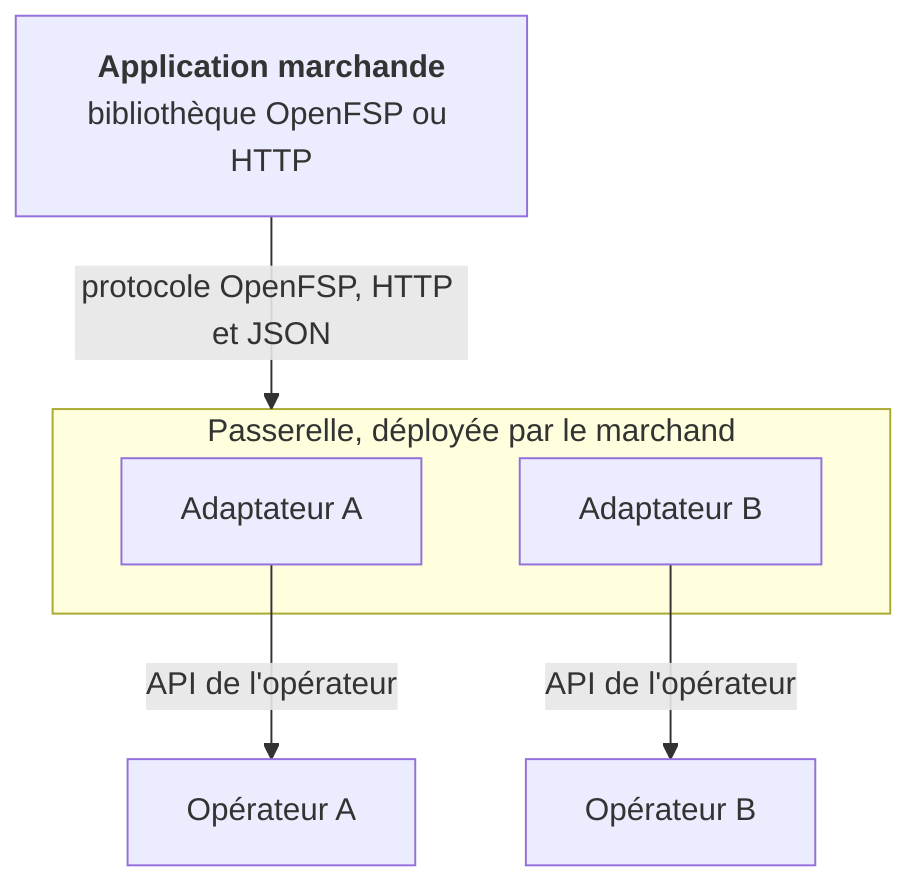

Informatif. Je justifie ce cadrage dans les [décisions](/fr/docs/decisions#0001).

## Hors périmètre

Lever l'une de ces limites exige une ADR.

- OpenFSP ne détient, ne déplace ni ne conserve de fonds. La passerelle instruit les opérateurs et n'est jamais partie à une transaction.
- OpenFSP n'exploite aucun service hébergé. Une offre hébergée fondée sur OpenFSP relève de son exploitant et de ses propres obligations réglementaires.
- OpenFSP n'est pas un établissement de paiement agréé et ne remplace aucun agrément ni aucun contrat avec un opérateur.
- OpenFSP n'est ni un commutateur, ni une chambre de compensation, ni un système de règlement.
- OpenFSP ne certifie pas les opérateurs.
- OpenFSP ne spécifie aucune interface utilisateur.

## Composants

| Composant              | Rôle                                                                                                          | Technologie                                                    |
| ---------------------- | ------------------------------------------------------------------------------------------------------------- | -------------------------------------------------------------- |
| Spécification          | Règles normatives : modèle de données, cycle de vie, capacités, erreurs, idempotence, webhooks.               | Markdown ; description OpenAPI à publier avec l'implémentation |
| Passerelle             | Serveur auto-hébergé : protocole OpenFSP d'un côté, API des opérateurs de l'autre.                            | Kotlin, Spring Boot                                            |
| Serveur simulé         | Imite les opérateurs, défaillances comprises.                                                                 | Kotlin, Spring Boot                                            |
| Bibliothèques clientes | Clients légers du protocole.                                                                                  | TypeScript, PHP, Python                                        |
| Suite de conformité    | Tests exécutables contre une implémentation, rapport reproductible ([conformité](/fr/docs/spec/conformance)). | Non arrêtée                                                    |

## Trajet d'une requête

L'application appelle la passerelle en protocole OpenFSP et désigne l'opérateur : la passerelle n'en choisit jamais un. Elle tient l'enregistrement de paiement,
le magasin d'idempotence, les transitions d'état et l'audit, et confie chaque appel à l'adaptateur de l'opérateur visé. Rappels, consultations et relevés
reviennent par ce même adaptateur. En développement et en intégration continue, le [serveur simulé](/fr/docs/spec/conformance#9) remplace les opérateurs.

Un opérateur natif expose lui-même l'API OpenFSP et se passe d'adaptateur. Une passerelle qui crée un paiement chez lui dérive la clé d'idempotence de
l'identifiant de commande ([idempotence 2.2](/fr/docs/spec/idempotency#2.2)).

## Déploiement et confiance

- L'exploitant, le marchand ou son mandataire, déploie la passerelle et détient ses secrets d'opérateur ; le projet ne les détient jamais.
- La relation entre le marchand et son opérateur est inchangée. Le marchand a un compte chez chaque opérateur accepté : aucune valeur ne circule entre
  opérateurs, aucune compensation n'est requise.
- Aucun service multi-locataire. Une passerelle compromise n'expose qu'un seul marchand.
- La passerelle est distribuée en un binaire unique accompagné de sa base de données, avec des réglages par défaut sûrs et un guide de durcissement.

## Principes de conception

| Principe                                                                                                                             | Règle détaillée                                                                            |
| ------------------------------------------------------------------------------------------------------------------------------------ | ------------------------------------------------------------------------------------------ |
| Une opération absente est déclarée absente, jamais émulée ; la capacité de base se limite à créer, lire et synchroniser un paiement. | [Capacités](/fr/docs/spec/capabilities)                                                    |
| Un montant est un entier en centimes de gourde, avec devise explicite.                                                               | [Modèle de données 3](/fr/docs/spec/data-model#3)                                          |
| Toute création est idempotente ; seule la synchronisation en est exemptée.                                                           | [Idempotence](/fr/docs/spec/idempotency)                                                   |
| La référence du marchand est la clé de corrélation.                                                                                  | [Modèle de données 6.2](/fr/docs/spec/data-model#6.2)                                      |
| Les états forment une machine explicite ; un état terminal n'est jamais quitté.                                                      | [Cycle de vie](/fr/docs/spec/lifecycle)                                                    |
| Les erreurs sont neutres, l'erreur de l'opérateur est conservée.                                                                     | [API 10](/fr/docs/spec/payments-api#10)                                                    |
| La passerelle ne choisit pas l'opérateur ; une erreur porte `effect`.                                                                | [API 5.1.1](/fr/docs/spec/payments-api#5.1.1), [API 10.6](/fr/docs/spec/payments-api#10.6) |
| Protocole standard : HTTP, JSON, codes de statut et en-têtes standard.                                                               | [API 1](/fr/docs/spec/payments-api#1)                                                      |

## Normes

RFC 2119 et RFC 8174 (mots-clés), RFC 9457 (erreurs), RFC 3339 en UTC (horodatages), ISO 4217 (HTG), UIT-T E.164 (téléphone), RFC 9562 UUID version 7
(identifiants), RFC 9421 (signature des webhooks), brouillon IETF `Idempotency-Key`, OpenAPI 3.1, schéma `Bearer` de la RFC 9110
([authentification 3](/fr/docs/spec/authentication#3)), RFC 8615 (découverte). Mojaloop et le processeur national PRONAP relèvent de la couche du commutateur,
complémentaire : seul un commutateur permet à un payeur chez A de payer un marchand qui n'accepte que B.

## Conformité

| Cible           | Vérification                                                               |
| --------------- | -------------------------------------------------------------------------- |
| Client          | Suite jouant la passerelle.                                                |
| Passerelle      | Suite jouant le client, serveur simulé jouant les opérateurs.              |
| Opérateur natif | L'opérateur expose l'API OpenFSP ; aucun adaptateur n'est requis pour lui. |

Niveaux : Core et profils par capacité. Règles : [conformité](/fr/docs/spec/conformance).

## Cadre réglementaire

La loi de 2012 définit l'institution financière par la réception de fonds du public avec obligation de restitution. OpenFSP ne reçoit aucun fonds, et ni
l'éditeur ni le marchand qui déploie ne relèvent de la circulaire BRH-121. Cette position vaut en l'état du droit sans être acquise : la BRH peut étendre la loi
aux activités assimilables. La ressource `Payment` et les relevés ([cycle de vie 10](/fr/docs/spec/lifecycle#10)) portent les données qu'exigent les
circulaires BRH-121, 126 et 131, ce qui n'atteste pas qu'un déploiement les satisfait.

## Versions

Versionnement sémantique, version majeure dans le chemin (`/v1`), ajouts découverts par les capacités. Avant `1.0.0`, une version mineure peut rompre la
compatibilité.

## Sécurité

- Transport TLS partout ([API 1.1](/fr/docs/spec/payments-api#1.1), [webhooks 7.2](/fr/docs/spec/webhooks#7.2)).
- Secrets d'opérateur hors des fichiers versionnés, jamais journalisés ([authentification 9](/fr/docs/spec/authentication#9)).
- Un rappel ne fonde une transition que dans les cas (a) et (c) du [cycle de vie 6.5](/fr/docs/spec/lifecycle#6.5).
- Toute transition est horodatée (`updated_at`, `completed_at`) ; une attestation est attribuée à une personne ([cycle de vie 6.8](/fr/docs/spec/lifecycle#6.8)).
- L'implémentation de référence est distribuée en artefact signé, reproductible, accompagné d'une nomenclature logicielle (SBOM).

## Adaptateurs d'opérateur

### 1. Rôle

**1.1.** Un adaptateur traduit une opération OpenFSP vers l'API d'un opérateur et retraduit la réponse. Il ne détient ni l'enregistrement de paiement, ni le
magasin d'idempotence, ni les transitions d'état, ni l'audit.

**1.2.** Un adaptateur rapporte la réponse de l'opérateur, ou l'absence de réponse exploitable.

**1.3.** L'adaptateur est le seul composant qui détient un secret d'opérateur ([authentification 9](/fr/docs/spec/authentication#9)).

### 2. Opérations

| Opération                         | Règle                                                                                            | Obligatoire |
| --------------------------------- | ------------------------------------------------------------------------------------------------ | ----------- |
| Créer un paiement                 | [API 5.1](/fr/docs/spec/payments-api#5.1)                                                        | oui         |
| Lire un paiement chez l'opérateur | [API 5.3](/fr/docs/spec/payments-api#5.3), `payments.lookup`                                     | non         |
| Ingérer un rappel                 | [cycle de vie 6.3](/fr/docs/spec/lifecycle#6.3), [cycle de vie 6.6](/fr/docs/spec/lifecycle#6.6) | non         |
| Lire un relevé                    | [cycle de vie 6.7](/fr/docs/spec/lifecycle#6.7), `payments.statement`                            | non         |

**2.1.** Lire un paiement dans le magasin de la passerelle n'est pas une opération d'adaptateur.

**2.2.** Une opération que l'opérateur ne sait pas faire n'est ni implémentée ni déclarée ; pas d'implémentation partielle qui renvoie une erreur.

### 3. Refus

**3.1.** Aucune capacité inventée : l'adaptateur déclare ce que fait l'opérateur, jamais ce que la passerelle pourrait émuler
([capacités 1.3](/fr/docs/spec/capabilities#1.3), [capacités 5.3](/fr/docs/spec/capabilities#5.3)).

**3.2.** Aucune terminalité inventée : un statut inconnu ne correspond à rien et le paiement reste `pending` ([cycle de vie 1.1](/fr/docs/spec/lifecycle#1.1)) ;
un motif incertain donne `unspecified` ([cycle de vie 7.3](/fr/docs/spec/lifecycle#7.3)).

**3.3.** Aucun renvoi invérifiable après un dénouement indéterminé : [idempotence 7.1 à 7.3](/fr/docs/spec/idempotency#7.1).

### 4. Déclaration

**4.1.** L'adaptateur déclare les capacités du [registre](/fr/docs/spec/capabilities) qu'il prend en charge.

**4.2.** La déclaration de l'adaptateur est fixe par opérateur ; la passerelle en retire une capacité suspendue ([capacités 4.5](/fr/docs/spec/capabilities#4.5)).

**4.3.** Elle inclut le profil de paiement : types de `next_action`, `payer` exigé, `return_url` exigée, expiration garantie
([capacités 3.2.2](/fr/docs/spec/capabilities#3.2.2)).

### 5. Correspondances

**5.1.** La correspondance des statuts de l'opérateur est totale, ou documentée comme partielle ; chaque statut observé correspond à un état OpenFSP ou à rien.

**5.2.** Elle va de l'opérateur vers OpenFSP, jamais l'inverse.

**5.3.** Un statut ambigu de l'opérateur (« pas encore agi » ou « inconnu ») correspond à `pending`.

**5.4.** `failure_detail` porte le code et le message de l'opérateur, caviardés ([authentification 9.5](/fr/docs/spec/authentication#9.5)).

**5.5.** Choix entre `provider-unavailable` et `provider-timeout` : [API 10.9.6.1](/fr/docs/spec/payments-api#10.9.6.1).

### 6. Rappels

**6.1.** Rappel signé : vérifier. Une signature invalide ne fonde rien ; le rappel peut au plus déclencher une consultation
([cycle de vie 6.3](/fr/docs/spec/lifecycle#6.3)).

**6.2.** Rappel non signé hors URL propre au paiement : signal de consultation d'une source faisant foi, contenu ignoré
([cycle de vie 6.3](/fr/docs/spec/lifecycle#6.3), [cycle de vie 6.5](/fr/docs/spec/lifecycle#6.5)).

**6.3.** Sans consultation, l'adaptateur déclare les sources restantes (URL propre au paiement, relevé) ; sans aucune, chaque paiement attend une attestation
([cycle de vie 6.5](/fr/docs/spec/lifecycle#6.5)).

**6.4.** Un rappel rejoué ne peut pas modifier un état terminal ([cycle de vie 3.1](/fr/docs/spec/lifecycle#3.1)). Une signature sans horodatage ni nonce, comme
celle de NatCash, n'offre pas d'autre protection.

### 7. Document publié par adaptateur

Chaque adaptateur publie : ses capacités et son profil de paiement ; sa correspondance des statuts, statuts sans correspondance compris ; sa correspondance de
`failure_reason` ; sa stratégie d'idempotence, [idempotence 7.2 ou 7.3](/fr/docs/spec/idempotency#7.2), exigée par
[idempotence 7.4](/fr/docs/spec/idempotency#7.4) ; la nature de ses rappels, signés, non signés ou absents ; ses pertes connues ; les secrets d'opérateur requis
et leur mode de fourniture ([authentification 9.1](/fr/docs/spec/authentication#9.1)) ; l'identifiant d'opérateur du
[registre](https://github.com/openfspht/openfsp/blob/main/registries/providers.md).

### 8. Profils observés

J'ai établi ces profils d'après la documentation des opérateurs (MonCash REST API, NatCash Merchant Online Integration 2.0) et mes propres intégrations de ces
deux opérateurs ; je liste au 8.5 les points non confirmés.

#### 8.1. Correspondance

|                  | MonCash                                                                                                                                                                     | NatCash                                                                                                                                      |
| ---------------- | --------------------------------------------------------------------------------------------------------------------------------------------------------------------------- | -------------------------------------------------------------------------------------------------------------------------------------------- |
| Authentification | OAuth 2 `client_credentials`, jeton de 59 s                                                                                                                                 | Identifiant, mot de passe et HMAC-SHA256 à chaque requête                                                                                    |
| Création         | `amount`, `orderId`                                                                                                                                                         | `amount`, `orderNumber`, `callbackUrl`, `msisdn`, `language`                                                                                 |
| Expiration       | Date absolue sans fuseau, échéance du jeton de paiement                                                                                                                     | Durée relative (`expiredAt`, unité non documentée)                                                                                           |
| URL de retour    | Fixe, déclarée au portail marchand : relais [API 7.4](/fr/docs/spec/payments-api#7.4), par `orderId` ou, à défaut, `RetrieveTransactionPayment` sur le `transactionId` reçu | Non documentée : `return_url_required` à `false` ; page en WebView, dont l'origine reste visible ([API 4.4](/fr/docs/spec/payments-api#4.4)) |
| Rappel           | Non documenté                                                                                                                                                               | Par paiement, signé sur `orderNumber` et `code`                                                                                              |
| Consultation     | `RetrieveOrderPayment`                                                                                                                                                      | `checkTransaction`, sous la même base que la création                                                                                        |

#### 8.2. Capacités annonçables

|                            | MonCash                                                                                     | NatCash                                                   |
| -------------------------- | ------------------------------------------------------------------------------------------- | --------------------------------------------------------- |
| `payments`                 | oui                                                                                         | oui                                                       |
| `payments.lookup`          | oui                                                                                         | oui                                                       |
| `webhooks.verify`          | non                                                                                         | oui ([cycle de vie 6.3.1](/fr/docs/spec/lifecycle#6.3.1)) |
| `webhooks.per_payment_url` | non                                                                                         | oui                                                       |
| `payments.statement`       | non : relevé de la passerelle seulement ([cycle de vie 10.9](/fr/docs/spec/lifecycle#10.9)) | non : relevé de la passerelle seulement                   |
| `payments.fee`             | non                                                                                         | non                                                       |

Stratégie d'idempotence pour les deux : recherche par identifiant de commande ([idempotence 7.2](/fr/docs/spec/idempotency#7.2)).

#### 8.3. Statuts

| Opérateur | Valeur                                            | OpenFSP                                                                                                                                                      |
| --------- | ------------------------------------------------- | ------------------------------------------------------------------------------------------------------------------------------------------------------------ |
| MonCash   | `message: "successful"`                           | `succeeded`                                                                                                                                                  |
| MonCash   | `message: "failed"`                               | `failed`, `unspecified`                                                                                                                                      |
| MonCash   | `message: "pending"`                              | aucune : `pending`                                                                                                                                           |
| MonCash   | Consultation sans paiement (format non documenté) | aucune tant que le format n'est pas observé en bac à sable ; `expired` par attestation de l'exploitant ([cycle de vie 5.3](/fr/docs/spec/lifecycle#5.3) (e)) |
| NatCash   | `1`                                               | `succeeded`                                                                                                                                                  |
| NatCash   | `-1`                                              | `failed`, `unspecified`                                                                                                                                      |
| NatCash   | `-3`                                              | aucune : `pending`, nouvelle consultation                                                                                                                    |
| NatCash   | `ERR_TRANSACTION_EXPIRED`                         | aucune tant qu'on ignore s'il vise le jeton ou le paiement                                                                                                   |
| NatCash   | `ERR_TRANSACTION_NOT_FOUND`                       | aucune ; un paiement abandonné devient `expired` par attestation de l'exploitant ([cycle de vie 5.3](/fr/docs/spec/lifecycle#5.3) (e))                       |
| NatCash   | `ERR_DUPLICATE_REQUEST_ID`                        | aucune : doublon de requête, pas un dénouement ([idempotence 7.2.1](/fr/docs/spec/idempotency#7.2.1))                                                        |

#### 8.4. Pertes connues

- Aucun motif d'échec : `failure_reason` vaut `unspecified`.
- `cost` chez MonCash est le montant du paiement : il alimente le contrôle de montant du [cycle de vie 6.3.2](/fr/docs/spec/lifecycle#6.3.2), jamais `fee`.
- NatCash peut écrire un montant avec un séparateur de milliers (`3,162.00`) et un `responseCode` en nombre ou en chaîne.
- Aucuns frais : `fee` reste absent.
- Montants en décimal ou en chaîne, numéros sans `+`, dates MonCash sans fuseau : conversions du [modèle de données 3.9](/fr/docs/spec/data-model#3.9),
  [5.5](/fr/docs/spec/data-model#5.5) et [7.5](/fr/docs/spec/data-model#7.5).
- Refus des centimes non confirmé : `amount_step` reste absent tant que l'exploitant ne l'a pas constaté ([capacités 6.3](/fr/docs/spec/capabilities#6.3)).

#### 8.5. À vérifier en bac à sable

1. Alphabet et longueur de l'`orderId` MonCash ([idempotence 7.2](/fr/docs/spec/idempotency#7.2)).
2. Réponse de `RetrieveOrderPayment` pour un paiement inexistant ou inachevé.
3. Réponses d'échec de MonCash.
4. Réservé.
5. Refus des centimes par l'un ou l'autre opérateur.
6. Rappel MonCash et paramètres transmis à l'URL de retour (`orderId` ou `transactionId`).
7. Unité d'`expiredAt` chez NatCash.
8. Portée d'`ERR_TRANSACTION_EXPIRED` : jeton ou paiement.

### 9. Tests

**9.1.** Sans accès à l'opérateur, la correspondance est testée sur des données et les refus sur des réponses enregistrées.

**9.2.** La fidélité des réponses enregistrées à l'opérateur réel n'est pas testable ainsi.
