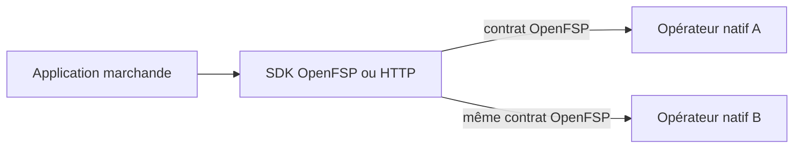

OpenFSP se place entre le serveur marchand et l'opérateur de paiement. Chaque opérateur compatible expose le même contrat HTTP. Le marchand choisit son opérateur et utilise ses propres identifiants, directement ou avec les SDK Kotlin, Java et TypeScript.

## Le segment application vers opérateur

Le problème traité est le coût d'intégration applicative : sans langage commun, chaque application développe une intégration propre à chaque opérateur. Un contrat partagé vise à passer de `opérateurs × applications` à `opérateurs + applications`. Le gain dépend de l'adoption.

L'interopérabilité porte ici sur l'interface marchande. Le marchand garde son compte et son contrat chez chaque fournisseur. La norme ne fournit ni transfert entre opérateurs, ni compensation, ni règlement.

## Architecture native

L'application choisit sa contrepartie et utilise ses identifiants et sa configuration. La bibliothèque cliente met en forme les échanges ; elle ne crée pas un service central et ne remplace pas le système de l'opérateur.

## Contrat et invariants

| Décision de conception                                                                                       | Document de référence                                 |
| ------------------------------------------------------------------------------------------------------------ | ----------------------------------------------------- |
| Un paiement possède un montant entier en centimes de gourde, une devise et des identifiants distincts.       | [Modèle de données](/fr/docs/spec/data-model)         |
| La référence choisie par le marchand permet la corrélation, y compris après la perte d'une réponse.          | [Référence du marchand](/fr/docs/spec/data-model#6.2) |
| Les états du paiement sont explicites ; un état terminal n'est pas quitté.                                   | [Cycle de vie](/fr/docs/spec/lifecycle)               |
| Une création rejouée suit les règles d'idempotence ; un résultat indéterminé n'est pas transformé en succès. | [Idempotence](/fr/docs/spec/idempotency)              |
| L'API expose la création, la lecture et la synchronisation par HTTP et JSON.                                 | [API des paiements](/fr/docs/spec/payments-api)       |
| Une erreur distingue notamment l'absence d'effet d'un effet inconnu.                                         | [Erreurs et effet](/fr/docs/spec/payments-api#10)     |
| Les notifications possèdent une signature vérifiable, des règles d'ordre et de déduplication.                | [Webhooks](/fr/docs/spec/webhooks)                    |
| L'accès au contrat est authentifié et limité par des portées.                                                | [Authentification](/fr/docs/spec/authentication)      |

Les [décisions](/fr/docs/decisions) expliquent mes choix et les solutions que j'ai écartées. Les règles normatives et leurs numéros restent dans les chapitres correspondants.

## Découverte des capacités

Un langage commun ne signifie pas que tous les opérateurs proposent les mêmes fonctions. Chacun annonce les capacités qu'il offre réellement. Le client découvre ces capacités et adapte son parcours ; une fonction absente n'est pas émulée.

La [découverte](/fr/docs/spec/capabilities) décrit les points d'accès, les limites annoncées et les comportements de refus. La disponibilité d'un remboursement, d'un relevé ou d'une consultation faisant autorité dépend des capacités de l'implémentation visée.

## Vérification de conformité

Une affirmation de conformité porte sur une cible, un niveau et une version du protocole. La norme distingue deux cibles : client et serveur. Le niveau Core et les profils de capacité sont définis par la [spécification de conformité](/fr/docs/spec/conformance).

Une attestation consigne une exécution ; elle ne certifie pas une implémentation.

## Versions

Versionnement sémantique, version majeure dans le chemin (`/v1`), ajouts découverts par les capacités. Avant `1.0.0`, une version mineure peut rompre la
compatibilité. Les changements de comportement passent par les [décisions publiées](/fr/docs/decisions).

## Normes

RFC 2119 et RFC 8174 (mots-clés), RFC 9457 (erreurs), RFC 3339 en UTC (horodatages), ISO 4217 (HTG), UIT-T E.164 (téléphone), RFC 9562 UUID version 7
(identifiants), RFC 9421 (signature des webhooks), projet IETF `Idempotency-Key`, OpenAPI 3.1, schéma `Bearer` de la RFC 9110
([authentification 3](/fr/docs/spec/authentication#3)), RFC 8615 (découverte). Mojaloop et le processeur national PRONAP travaillent au niveau du commutateur et
complètent OpenFSP, car seul un commutateur permet à un payeur chez A de payer un marchand qui n'accepte que B.

## Sécurité

- Transport TLS partout ([API 1.1](/fr/docs/spec/payments-api#1.1), [webhooks 7.2](/fr/docs/spec/webhooks#7.2)).
- Clés d'API stockées sous forme de condensé, jamais journalisées ([authentification 4](/fr/docs/spec/authentication#4)).
- Toute transition est horodatée (`updated_at`, `completed_at`), et l'API n'offre aucun moyen de fixer un état ([cycle de vie 6.1](/fr/docs/spec/lifecycle#6.1)).

## Cadre réglementaire

La conformité au protocole n'est pas une conformité réglementaire. Les données du paiement et des relevés servent au rapprochement et à l’audit ; elles ne prouvent pas qu’un déploiement satisfait les obligations de son exploitant.

## Hors périmètre

Je justifie ce cadrage dans les [décisions](/fr/docs/decisions#0001). Lever l'une de ces limites exige une nouvelle décision.

- OpenFSP ne détient, ne déplace ni ne conserve de fonds.
- OpenFSP n’exploite aucun service de paiement hébergé. Une offre hébergée fondée sur OpenFSP relève de son exploitant et de ses propres obligations réglementaires.
- OpenFSP n'est pas un établissement de paiement agréé et ne remplace aucun agrément ni aucun contrat avec un opérateur.
- OpenFSP n'est ni un commutateur, ni une chambre de compensation, ni un système de règlement.
- OpenFSP ne certifie pas les opérateurs.
- OpenFSP ne spécifie aucune interface utilisateur.

Le paiement de proximité relève d'une [phase](/fr/docs#phases) ultérieure.

## Implémentations de référence

La spécification est indépendante d'un langage de programmation. Le serveur simulé de référence et la suite de conformité permettent de l'essayer et de tester une implémentation. Pour construire votre propre serveur, suivez le [guide d'implémentation](/fr/docs/native-operator).
