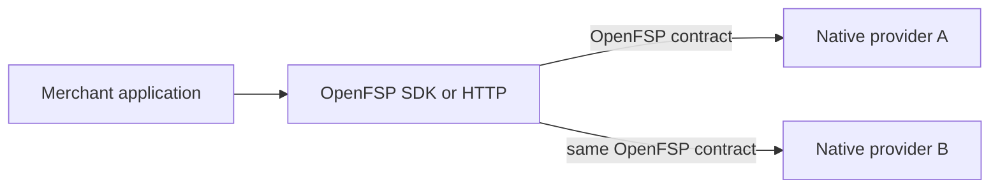

OpenFSP defines a contract between merchant applications and payment service providers. Its target architecture is distributed: each provider implements the protocol in its own system; each application uses the same contract, directly over HTTP or through a client library.

The transition implementation and its adapters are documented under [Transition gateway](/docs/gateway).

## The application-to-provider layer

The problem is application integration cost: without a shared language, every application writes a separate integration for every provider. A shared contract aims to move from `providers × applications` to `providers + applications`. The benefit depends on adoption.

Interoperability here concerns the merchant interface. The merchant keeps an account and agreement with each provider. The standard supplies neither inter-provider transfers, clearing nor settlement.

## Native architecture

The application chooses its counterparty and uses its credentials and configuration. The client library formats exchanges; it does not create a central service or replace the provider's system.

A provider implementing the contract natively makes translation of its API unnecessary.

## Contract and invariants

| Design decision                                                                                   | Reference                                       |
| ------------------------------------------------------------------------------------------------- | ----------------------------------------------- |
| A payment has an integer amount in gourde cents, a currency and distinct identifiers.             | [Data model](/docs/spec/data-model)             |
| The merchant's reference allows correlation, including after a lost response.                     | [Merchant reference](/docs/spec/data-model#6.2) |
| Payment states are explicit; terminal states cannot be left.                                      | [Lifecycle](/docs/spec/lifecycle)               |
| Replayed creation follows idempotency rules; an indeterminate outcome is not turned into success. | [Idempotency](/docs/spec/idempotency)           |
| The API exposes creation, retrieval and synchronization over HTTP and JSON.                       | [Payments API](/docs/spec/payments-api)         |
| Errors distinguish, in particular, no effect from an unknown effect.                              | [Errors and effect](/docs/spec/payments-api#10) |
| Notifications have verifiable signatures, ordering and deduplication rules.                       | [Webhooks](/docs/spec/webhooks)                 |
| Access to the contract is authenticated and restricted by scopes.                                 | [Authentication](/docs/spec/authentication)     |

The [decisions](/docs/decisions) explain the choices and the alternatives I set aside. Normative rules and their identifiers remain in their respective chapters.

## Capability discovery

A shared language does not mean every provider offers the same functions. Each implementation announces the capabilities it actually offers. The client discovers these capabilities and adapts its flow; an absent function is not emulated.

[Discovery](/docs/spec/capabilities) defines endpoints, announced limits and refusal behavior. Refunds, statements and authoritative lookup depend on the target implementation's capabilities.

## Verifying conformance

A conformance claim names a target, level and protocol version. The standard distinguishes three targets: client, native provider and transition gateway. Core and capability profiles are defined in the [conformance specification](/docs/spec/conformance).

The native-provider target exercises a direct contract implementation without a translation adapter. An attestation records one run; it does not certify an implementation.

## Versions

Semantic versioning, with the major version in the path (`/v1`) and additions discovered through capabilities. Before `1.0.0`, a minor version may break
compatibility. Behavioral changes go through [published decisions](/docs/decisions).

## Standards

RFC 2119 and RFC 8174 (keywords), RFC 9457 (errors), RFC 3339 in UTC (timestamps), ISO 4217 (HTG), ITU-T E.164 (phone numbers), RFC 9562 UUID version 7
(identifiers), RFC 9421 (webhook signatures), the IETF `Idempotency-Key` draft, OpenAPI 3.1, the `Bearer` scheme of RFC 9110
([authentication 3](/docs/spec/authentication#3)), RFC 8615 (discovery). Mojaloop and the national processor PRONAP work at the switch layer and complement
OpenFSP, since only a switch lets a payer at provider A pay a merchant that accepts only B.

## Security

- TLS everywhere ([API 1.1](/docs/spec/payments-api#1.1), [webhooks 7.2](/docs/spec/webhooks#7.2)).
- Provider secrets outside versioned files, never logged ([authentication 9](/docs/spec/authentication#9)).
- A callback grounds a transition only in cases (a) and (c) of [lifecycle 6.5](/docs/spec/lifecycle#6.5).
- Every transition is timestamped (`updated_at`, `completed_at`); an attestation is attributed to a person ([lifecycle 6.8](/docs/spec/lifecycle#6.8)).

## Regulation

Under the 2012 law, a financial institution receives funds from the public with an obligation to return them. A gateway receives no funds, and neither the
OpenFSP publisher nor a merchant that deploys a gateway is covered by BRH circular 121. This reading holds under current law but is not settled, since the BRH
can extend the law to similar activities. The `Payment` resource and the statements ([lifecycle 10](/docs/spec/lifecycle#10)) carry the data BRH circulars 121, 126 and 131 ask for;
carrying that data does not attest that a deployment satisfies them.

## Out of scope

I explain this scope in [Decisions](/docs/decisions#0001). Lifting any of these limits requires a new decision.

- OpenFSP does not hold, move or keep funds. A gateway instructs providers and is never a party to a transaction.
- OpenFSP runs no hosted service. A hosted offer built on OpenFSP is the responsibility of its operator, under that operator's own regulatory obligations.
- OpenFSP is not a licensed payment institution and replaces no license and no contract with a provider.
- OpenFSP is not a switch, a clearing house or a settlement system.
- OpenFSP does not certify providers.
- OpenFSP specifies no user interface.

Proximity payments belong to a later [phase](/docs#phases).

## Reference implementations

The specification is independent of a programming language. The simulator and the conformance suite let you try it and test an implementation. The [transition gateway](/docs/gateway) makes the contract usable with existing APIs. To build your own target, follow the [native provider path](/docs/native-operator).

<LegacyArchitectureReferences locale="en" />
