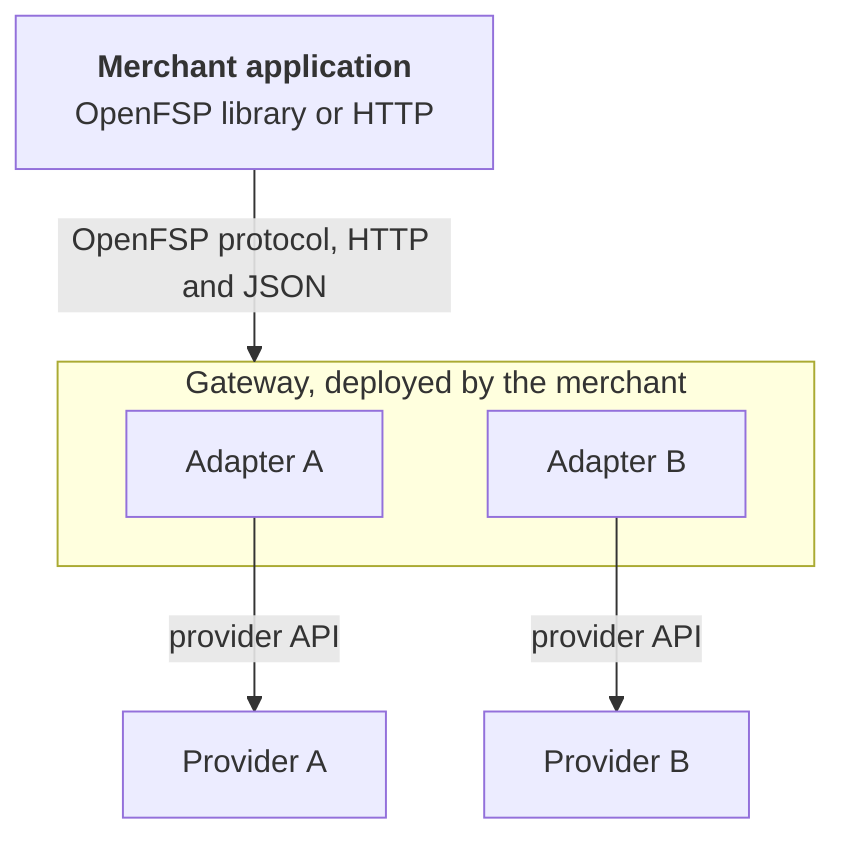

Informative. The reasons behind this scope are in [Decisions](/docs/decisions#0001).

## Out of scope

Lifting any of these limits requires a decision record.

- OpenFSP does not hold, move or keep funds. The gateway instructs providers and is never a party to a transaction.
- OpenFSP runs no hosted service. A hosted offer built on OpenFSP belongs to its operator and to that operator's own regulatory obligations.
- OpenFSP is not a licensed payment institution and replaces no license and no contract with a provider.
- OpenFSP is not a switch, a clearing house or a settlement system.
- OpenFSP does not certify providers.
- OpenFSP specifies no user interface.

## Components

| Component         | Role                                                                                                     | Technology                                                            |
| ----------------- | -------------------------------------------------------------------------------------------------------- | --------------------------------------------------------------------- |
| Specification     | Normative rules: data model, lifecycle, capabilities, errors, idempotency, webhooks.                     | Markdown; OpenAPI description to be published with the implementation |
| Gateway           | Self-hosted server: the OpenFSP protocol on one side, the provider APIs on the other.                    | Kotlin, Spring Boot                                                   |
| Simulator         | Imitates the providers, failures included.                                                               | Kotlin, Spring Boot                                                   |
| Client libraries  | Thin protocol clients.                                                                                   | TypeScript, PHP, Python                                               |
| Conformance suite | Executable tests against an implementation, reproducible report ([conformance](/docs/spec/conformance)). | Not settled                                                           |

## Request path

The application calls the gateway with the OpenFSP protocol and names the provider: the gateway never picks one. The gateway holds the payment record, the
idempotency store, the state transitions and the audit, and hands each provider call to that provider's adapter. Callbacks, lookups and statements come back
through the same adapter. In development and in continuous integration, the [simulator](/docs/spec/conformance#9) replaces the providers.

A native provider exposes the OpenFSP API itself and needs no adapter. A gateway that creates a payment there derives the idempotency key from the order
identifier ([idempotency 2.2](/docs/spec/idempotency#2.2)).

## Deployment and trust

- The operator (the merchant or its agent) deploys the gateway and holds its provider secrets. The project never holds them.
- The relationship between the merchant and its provider is unchanged. The merchant has an account with each accepted provider: no value moves between
  providers and no clearing is needed.
- No multi-tenant service. A compromised gateway exposes a single merchant.
- The gateway ships as a single binary with its database, safe defaults and a hardening guide.

## Design principles

| Principle                                                                                                               | Detailed rule                                                                        |
| ----------------------------------------------------------------------------------------------------------------------- | ------------------------------------------------------------------------------------ |
| A missing operation is declared missing, never emulated. The base capability is create, read and synchronize a payment. | [Capabilities](/docs/spec/capabilities)                                              |
| An amount is an integer in gourde cents, with an explicit currency.                                                     | [Data model 3](/docs/spec/data-model#3)                                              |
| Every creation is idempotent; only synchronization is exempt.                                                           | [Idempotency](/docs/spec/idempotency)                                                |
| The merchant reference is the correlation key.                                                                          | [Data model 6.2](/docs/spec/data-model#6.2)                                          |
| States form an explicit machine; a terminal state is never left.                                                        | [Lifecycle](/docs/spec/lifecycle)                                                    |
| Errors are neutral; the provider error is kept.                                                                         | [API 10](/docs/spec/payments-api#10)                                                 |
| The gateway does not choose the provider; an error carries `effect`.                                                    | [API 5.1.1](/docs/spec/payments-api#5.1.1), [API 10.6](/docs/spec/payments-api#10.6) |
| Standard protocol: HTTP, JSON, standard status codes and headers.                                                       | [API 1](/docs/spec/payments-api#1)                                                   |

## Standards

RFC 2119 and RFC 8174 (keywords), RFC 9457 (errors), RFC 3339 in UTC (timestamps), ISO 4217 (HTG), ITU-T E.164 (phone numbers), RFC 9562 UUID version 7
(identifiers), RFC 9421 (webhook signatures), the IETF `Idempotency-Key` draft, OpenAPI 3.1, the `Bearer` scheme of RFC 9110
([authentication 3](/docs/spec/authentication#3)), RFC 8615 (discovery). Mojaloop and the national processor PRONAP work at the switch layer and are
complementary: only a switch lets a payer at provider A pay a merchant that accepts only B.

## Conformance

| Target          | Verification                                                         |
| --------------- | -------------------------------------------------------------------- |
| Client          | The suite plays the gateway.                                         |
| Gateway         | The suite plays the client, the simulator plays the providers.       |
| Native provider | The provider exposes the OpenFSP API; no adapter is required for it. |

Levels: Core and one profile per capability. Rules: [conformance](/docs/spec/conformance).

## Regulation

Under the 2012 law, a financial institution receives funds from the public with an obligation to return them. OpenFSP receives no funds, and neither its
publisher nor a merchant that deploys it is covered by BRH circular 121. This holds under current law and is not settled: the BRH can extend the law to similar
activities. The `Payment` resource and the statements ([lifecycle 10](/docs/spec/lifecycle#10)) carry the data BRH circulars 121, 126 and 131 ask for, which
does not attest that a deployment satisfies them.

## Versions

Semantic versioning, with the major version in the path (`/v1`) and additions discovered through capabilities. Before `1.0.0`, a minor version may break
compatibility.

## Security

- TLS everywhere ([API 1.1](/docs/spec/payments-api#1.1), [webhooks 7.2](/docs/spec/webhooks#7.2)).
- Provider secrets outside versioned files, never logged ([authentication 9](/docs/spec/authentication#9)).
- A callback grounds a transition only in cases (a) and (c) of [lifecycle 6.5](/docs/spec/lifecycle#6.5).
- Every transition is timestamped (`updated_at`, `completed_at`); an attestation is attributed to a person ([lifecycle 6.8](/docs/spec/lifecycle#6.8)).
- The reference implementation ships as a signed, reproducible artifact with a software bill of materials (SBOM).

## Provider adapters

### 1. Role

**1.1.** An adapter translates an OpenFSP operation into a provider's API and translates the response back. It holds neither the payment record, nor the
idempotency store, nor the state transitions, nor the audit.

**1.2.** An adapter reports the provider's response, or the absence of a usable response.

**1.3.** The adapter is the only component that holds a provider secret ([authentication 9](/docs/spec/authentication#9)).

### 2. Operations

| Operation                      | Rule                                                                                 | Required |
| ------------------------------ | ------------------------------------------------------------------------------------ | -------- |
| Create a payment               | [API 5.1](/docs/spec/payments-api#5.1)                                               | yes      |
| Read a payment at the provider | [API 5.3](/docs/spec/payments-api#5.3), `payments.lookup`                            | no       |
| Ingest a callback              | [lifecycle 6.3](/docs/spec/lifecycle#6.3), [lifecycle 6.6](/docs/spec/lifecycle#6.6) | no       |
| Read a statement               | [lifecycle 6.7](/docs/spec/lifecycle#6.7), `payments.statement`                      | no       |

**2.1.** Reading a payment from the gateway store is not an adapter operation.

**2.2.** An operation the provider cannot perform is neither implemented nor declared; no partial implementation that returns an error.

### 3. Refusals

**3.1.** No invented capability: the adapter declares what the provider does, never what the gateway could emulate
([capabilities 1.3](/docs/spec/capabilities#1.3), [capabilities 5.3](/docs/spec/capabilities#5.3)).

**3.2.** No invented terminality: an unknown status maps to nothing and the payment stays `pending` ([lifecycle 1.1](/docs/spec/lifecycle#1.1)); an uncertain
reason gives `unspecified` ([lifecycle 7.3](/docs/spec/lifecycle#7.3)).

**3.3.** No unverifiable resend after an indeterminate outcome: [idempotency 7.1 to 7.3](/docs/spec/idempotency#7.1).

### 4. Declaration

**4.1.** The adapter declares the capabilities of the [registry](/docs/spec/capabilities) it supports.

**4.2.** The adapter's declaration is fixed per provider; the gateway removes a suspended capability from it ([capabilities 4.5](/docs/spec/capabilities#4.5)).

**4.3.** It includes the payment profile: `next_action` types, required `payer`, required `return_url`, guaranteed expiration
([capabilities 3.2.2](/docs/spec/capabilities#3.2.2)).

### 5. Mappings

**5.1.** The mapping of provider statuses is total, or documented as partial; each observed status maps to an OpenFSP state or to nothing.

**5.2.** It goes from the provider to OpenFSP, never the reverse.

**5.3.** An ambiguous provider status ("not acted yet" or "unknown") maps to `pending`.

**5.4.** `failure_detail` carries the provider's code and message, redacted ([authentication 9.5](/docs/spec/authentication#9.5)).

**5.5.** Choice between `provider-unavailable` and `provider-timeout`: [API 10.9.6.1](/docs/spec/payments-api#10.9.6.1).

### 6. Callbacks

**6.1.** Signed callback: verify it. An invalid signature grounds nothing; the callback can at most trigger a lookup ([lifecycle 6.3](/docs/spec/lifecycle#6.3)).

**6.2.** Unsigned callback outside a per-payment URL: a signal to look up an authoritative source, content ignored ([lifecycle 6.3](/docs/spec/lifecycle#6.3),
[lifecycle 6.5](/docs/spec/lifecycle#6.5)).

**6.3.** Without lookup, the adapter declares the remaining sources (per-payment URL, statement); with none, each payment waits for an attestation
([lifecycle 6.5](/docs/spec/lifecycle#6.5)).

**6.4.** A replayed callback cannot change a terminal state ([lifecycle 3.1](/docs/spec/lifecycle#3.1)). A signature with neither timestamp nor nonce, like
NatCash's, offers no other protection.

### 7. Document published per adapter

Each adapter publishes: its capabilities and payment profile; its status mapping, unmapped statuses included; its `failure_reason` mapping; its idempotency
strategy, [idempotency 7.2 or 7.3](/docs/spec/idempotency#7.2), as [idempotency 7.4](/docs/spec/idempotency#7.4) requires; whether callbacks are signed,
unsigned or absent; its known losses; the provider secrets it needs and how they are supplied ([authentication 9.1](/docs/spec/authentication#9.1)); the
provider identifier from the [registry](https://github.com/openfspht/openfsp/blob/main/registries/providers.md).

### 8. Observed profiles

I built these profiles from the providers' documentation (MonCash REST API, NatCash Merchant Online Integration 2.0) and from my own integrations of both
providers. Unconfirmed points are listed in 8.5.

#### 8.1. Mapping

|                | MonCash                                                                                                                                                                   | NatCash                                                                                                                                |
| -------------- | ------------------------------------------------------------------------------------------------------------------------------------------------------------------------- | -------------------------------------------------------------------------------------------------------------------------------------- |
| Authentication | OAuth 2 `client_credentials`, 59 s token                                                                                                                                  | Username, password and HMAC-SHA256 on each request                                                                                     |
| Creation       | `amount`, `orderId`                                                                                                                                                       | `amount`, `orderNumber`, `callbackUrl`, `msisdn`, `language`                                                                           |
| Expiration     | Absolute date without time zone, end of the payment token                                                                                                                 | Relative duration (`expiredAt`, unit not documented)                                                                                   |
| Return URL     | Fixed, declared on the merchant portal: relay ([API 7.4](/docs/spec/payments-api#7.4)) by `orderId`, or else `RetrieveTransactionPayment` on the received `transactionId` | Not documented: `return_url_required` is `false`; page in a WebView, its origin stays visible ([API 4.4](/docs/spec/payments-api#4.4)) |
| Callback       | Not documented                                                                                                                                                            | Per payment, signed over `orderNumber` and `code`                                                                                      |
| Lookup         | `RetrieveOrderPayment`                                                                                                                                                    | `checkTransaction`, under the same base as creation                                                                                    |

#### 8.2. Announceable capabilities

|                            | MonCash                                                                  | NatCash                                             |
| -------------------------- | ------------------------------------------------------------------------ | --------------------------------------------------- |
| `payments`                 | yes                                                                      | yes                                                 |
| `payments.lookup`          | yes                                                                      | yes                                                 |
| `webhooks.verify`          | no                                                                       | yes ([lifecycle 6.3.1](/docs/spec/lifecycle#6.3.1)) |
| `webhooks.per_payment_url` | no                                                                       | yes                                                 |
| `payments.statement`       | no: gateway statement only ([lifecycle 10.9](/docs/spec/lifecycle#10.9)) | no: gateway statement only                          |
| `payments.fee`             | no                                                                       | no                                                  |

Idempotency strategy for both: lookup by order identifier ([idempotency 7.2](/docs/spec/idempotency#7.2)).

#### 8.3. Statuses

| Provider | Value                                          | OpenFSP                                                                                                                             |
| -------- | ---------------------------------------------- | ----------------------------------------------------------------------------------------------------------------------------------- |
| MonCash  | `message: "successful"`                        | `succeeded`                                                                                                                         |
| MonCash  | `message: "failed"`                            | `failed`, `unspecified`                                                                                                             |
| MonCash  | `message: "pending"`                           | none: `pending`                                                                                                                     |
| MonCash  | Lookup with no payment (format not documented) | none until the format is observed in the sandbox; `expired` by operator attestation ([lifecycle 5.3](/docs/spec/lifecycle#5.3) (e)) |
| NatCash  | `1`                                            | `succeeded`                                                                                                                         |
| NatCash  | `-1`                                           | `failed`, `unspecified`                                                                                                             |
| NatCash  | `-3`                                           | none: `pending`, new lookup                                                                                                         |
| NatCash  | `ERR_TRANSACTION_EXPIRED`                      | none while it is unknown whether it targets the token or the payment                                                                |
| NatCash  | `ERR_TRANSACTION_NOT_FOUND`                    | none; an abandoned payment becomes `expired` by operator attestation ([lifecycle 5.3](/docs/spec/lifecycle#5.3) (e))                |
| NatCash  | `ERR_DUPLICATE_REQUEST_ID`                     | none: duplicate request, not an outcome ([idempotency 7.2.1](/docs/spec/idempotency#7.2.1))                                         |

#### 8.4. Known losses

- No failure reason: `failure_reason` is `unspecified`.
- MonCash `cost` is the payment amount: it feeds the amount check of [lifecycle 6.3.2](/docs/spec/lifecycle#6.3.2), never `fee`.
- NatCash may write an amount with a thousands separator (`3,162.00`) and a `responseCode` as a number or a string.
- No fees: `fee` stays absent.
- Amounts as decimals or strings, numbers without `+`, MonCash dates without time zone: conversions of [data model 3.9](/docs/spec/data-model#3.9),
  [data model 5.5](/docs/spec/data-model#5.5) and [data model 7.5](/docs/spec/data-model#7.5).
- Refusal of cents not confirmed: `amount_step` stays absent until the operator has observed it ([capabilities 6.3](/docs/spec/capabilities#6.3)).

#### 8.5. To check in the sandbox

1. Alphabet and length of the MonCash `orderId` ([idempotency 7.2](/docs/spec/idempotency#7.2)).
2. Response of `RetrieveOrderPayment` for a missing or unfinished payment.
3. MonCash failure responses.
4. Reserved.
5. Refusal of cents by either provider.
6. MonCash callback and parameters sent to the return URL (`orderId` or `transactionId`).
7. Unit of NatCash `expiredAt`.
8. Scope of `ERR_TRANSACTION_EXPIRED`: token or payment.

### 9. Tests

**9.1.** Without access to the provider, the mapping is tested on data and the refusals on recorded responses.

**9.2.** The fidelity of recorded responses to the real provider cannot be tested this way.
