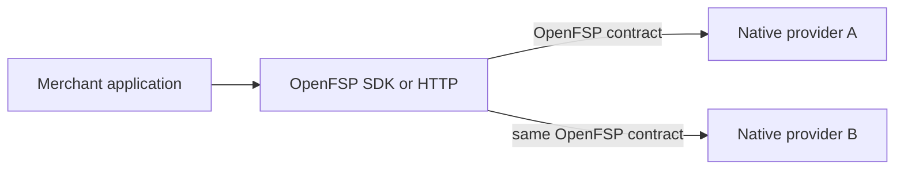

OpenFSP sits between the merchant server and the payment provider. Each compatible provider exposes the same HTTP contract. The merchant chooses its provider and uses its own credentials, directly or through the Kotlin, Java and TypeScript SDKs.

## The application-to-provider layer

The problem is application integration cost: without a shared language, every application writes a separate integration for every provider. A shared contract aims to move from `providers × applications` to `providers + applications`. The benefit depends on adoption.

Interoperability here concerns the merchant interface. The merchant keeps an account and agreement with each provider. The standard supplies neither inter-provider transfers, clearing nor settlement.

## Native architecture

The application chooses its counterparty and uses its credentials and configuration. The client library formats exchanges; it does not create a central service or replace the provider's system.

## Contract and invariants

| Design decision                                                                                   | Reference                                       |
| ------------------------------------------------------------------------------------------------- | ----------------------------------------------- |
| A payment has an integer amount in gourde cents, a currency and distinct identifiers.             | [Data model](/docs/spec/data-model)             |
| The merchant's reference allows correlation, including after a lost response.                     | [Merchant reference](/docs/spec/data-model#6.2) |
| Payment states are explicit; terminal states cannot be left.                                      | [Lifecycle](/docs/spec/lifecycle)               |
| Replayed creation follows idempotency rules; an indeterminate outcome is not turned into success. | [Idempotency](/docs/spec/idempotency)           |
| The API exposes creation, retrieval and synchronization over HTTP and JSON.                       | [Payments API](/docs/spec/payments-api)         |
| Errors distinguish, in particular, no effect from an unknown effect.                              | [Errors and effect](/docs/spec/payments-api#10) |
| Notifications have verifiable signatures, ordering and deduplication rules.                       | [Webhooks](/docs/spec/webhooks)                 |
| Access to the contract is authenticated and restricted by scopes.                                 | [Authentication](/docs/spec/authentication)     |

The [decisions](/docs/decisions) explain the choices and the alternatives I set aside. Normative rules and their identifiers remain in their respective chapters.

## Capability discovery

A shared language does not mean every provider offers the same functions. Each implementation announces the capabilities it actually offers. The client discovers these capabilities and adapts its flow; an absent function is not emulated.

[Discovery](/docs/spec/capabilities) defines endpoints, announced limits and refusal behavior. Refunds, statements and authoritative lookup depend on the target implementation's capabilities.

## Verifying conformance

A conformance claim names a target, level and protocol version. The standard distinguishes two targets: client and server. Core and capability profiles are defined in the [conformance specification](/docs/spec/conformance).

An attestation records one run; it does not certify an implementation.

## Versions

Semantic versioning, with the major version in the path (`/v1`) and additions discovered through capabilities. Before `1.0.0`, a minor version may break
compatibility. Behavioral changes go through [published decisions](/docs/decisions).

## Standards

RFC 2119 and RFC 8174 (keywords), RFC 9457 (errors), RFC 3339 in UTC (timestamps), ISO 4217 (HTG), ITU-T E.164 (phone numbers), RFC 9562 UUID version 7
(identifiers), RFC 9421 (webhook signatures), the IETF `Idempotency-Key` draft, OpenAPI 3.1, the `Bearer` scheme of RFC 9110
([authentication 3](/docs/spec/authentication#3)), RFC 8615 (discovery). Mojaloop and the national processor PRONAP work at the switch layer and complement
OpenFSP, since only a switch lets a payer at provider A pay a merchant that accepts only B.

## Security

- TLS everywhere ([API 1.1](/docs/spec/payments-api#1.1), [webhooks 7.2](/docs/spec/webhooks#7.2)).
- API keys stored as digests, never logged ([authentication 4](/docs/spec/authentication#4)).
- Every transition is timestamped (`updated_at`, `completed_at`), and the API offers no way to set a state ([lifecycle 6.1](/docs/spec/lifecycle#6.1)).

## Regulation

Protocol conformance is not regulatory compliance. Payment and statement data support reconciliation and audit; they do not establish that a deployment meets its operator’s obligations.

## Out of scope

I explain this scope in [Decisions](/docs/decisions#0001). Lifting any of these limits requires a new decision.

- OpenFSP does not hold, move or keep funds.
- OpenFSP runs no hosted payment service. A hosted offer built on OpenFSP is the responsibility of its operator, under that operator's own regulatory obligations.
- OpenFSP is not a licensed payment institution and replaces no license and no contract with a provider.
- OpenFSP is not a switch, a clearing house or a settlement system.
- OpenFSP does not certify providers.
- OpenFSP specifies no user interface.

Proximity payments belong to a later [phase](/docs#phases).

## Reference implementations

The specification is independent of a programming language. The reference mock server and the conformance suite let you try it and test an implementation. To build your own server, follow the [implementation guide](/docs/native-operator).
