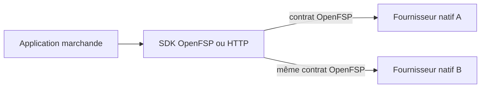

OpenFSP définit l’interface entre le serveur d’une application marchande et un service de paiement. Dans une intégration native, le fournisseur expose le contrat HTTP commun dans son propre système. L’application utilise les identifiants du marchand et peut effectuer les échanges directement en HTTP ou au moyen d’une bibliothèque cliente.

## Le segment application vers fournisseur

OpenFSP couvre l’échange entre le serveur d’une application marchande et un fournisseur, et rien en amont ni en aval ; la [décision 0001](/docs/decisions#0001) en donne la justification. Chaque marchand conserve son compte et son contrat auprès de chaque fournisseur.

## Architecture native

L’application sélectionne le service de paiement et utilise les identifiants et la configuration correspondants. La bibliothèque cliente prépare les échanges conformément au contrat d’interface. Elle parle directement au fournisseur, sans service central.

## Contrat et invariants

| Décision de conception                                                                                       | Document de référence                                 |
| ------------------------------------------------------------------------------------------------------------ | ----------------------------------------------------- |
| Un paiement possède un montant entier en centimes de gourde, une devise et des identifiants distincts.       | [Modèle de données](/docs/spec/data-model)         |
| La référence choisie par le marchand permet la corrélation, y compris après la perte d'une réponse.          | [Référence du marchand](/docs/spec/data-model#6.2) |
| Les états du paiement sont explicites ; un état terminal n'est pas quitté.                                   | [Cycle de vie](/docs/spec/lifecycle)               |
| Une création rejouée suit les règles d'idempotence ; un résultat indéterminé n'est pas transformé en succès. | [Idempotence](/docs/spec/idempotency)              |
| L'API expose la création et la lecture des paiements par HTTP et JSON.                                       | [API des paiements](/docs/spec/payments-api)       |
| Une erreur distingue notamment l'absence d'effet d'un effet inconnu.                                         | [Erreurs et effet](/docs/spec/payments-api#10)     |
| Les notifications possèdent une signature vérifiable, des règles d'ordre et de déduplication.                | [Webhooks](/docs/spec/webhooks)                    |
| L'accès au contrat est authentifié et limité par des portées.                                                | [Authentification](/docs/spec/authentication)      |

Les [décisions de conception](/docs/decisions) documentent les choix retenus, leurs justifications et les alternatives examinées.

## Découverte des capacités

Chaque serveur déclare les capacités qu’il prend en charge. L’application les découvre pour déterminer les parcours applicables ; une fonction non prise en charge n’est pas émulée.

La [découverte des capacités](/docs/spec/capabilities) définit les points d’accès, les limites annoncées et les refus applicables. Les opérations disponibles dépendent de la version de la spécification et des capacités de l’implémentation visée. Le remboursement reste une extension réservée et n’est pas spécifié dans la version actuelle.

## Vérification de conformité

Une déclaration de conformité identifie une cible, un niveau et une version du protocole. Les cibles `client` et `server`, le niveau Core et les profils associés aux capacités sont définis dans la [spécification de conformité](/docs/spec/conformance).

Une [attestation](/docs/verify) consigne les résultats d’une exécution donnée de la suite.

## Versions

Le projet utilise un versionnement sémantique. Le chemin de l’API contient la version majeure (`/v1`) ; les capacités permettent de découvrir les ajouts disponibles. Avant `1.0.0`, une version mineure peut introduire une rupture de compatibilité. Les modifications de comportement sont documentées dans les [décisions publiées](/docs/decisions).

## Normes

La spécification s’appuie notamment sur les RFC 2119 et 8174 pour les mots-clés normatifs, la RFC 9457 pour les erreurs, la RFC 3339 pour les horodatages UTC, ISO 4217 pour la devise HTG et la recommandation UIT-T E.164 pour les numéros de téléphone. Les autres références comprennent la RFC 9562 pour les UUID version 7, la RFC 9421 pour les signatures de messages HTTP, le projet IETF `Idempotency-Key`, OpenAPI 3.1, le schéma `Bearer` de la RFC 9110 ([authentification 3](/docs/spec/authentication#3)) et la RFC 8615 pour les points d’accès de découverte. Les mécanismes de commutation, tels que Mojaloop ou PRONAP en Haïti, traitent une couche distincte : l’échange de paiements entre services.

## Sécurité

- Les échanges utilisent TLS ([API 1.1](/docs/spec/payments-api#1.1), [webhooks 7.2](/docs/spec/webhooks#7.2)).
- Les clés d’API sont conservées sous forme de condensés et exclues des journaux ([authentification 4](/docs/spec/authentication#4)).
- Les transitions sont horodatées par `updated_at` et `completed_at`. L’API ne permet pas au client de fixer l’état du paiement ([cycle de vie 6.1](/docs/spec/lifecycle#6.1)).

## Hors périmètre

Le périmètre est justifié dans la [décision 0001](/docs/decisions#0001). Toute extension de ce périmètre nécessite une nouvelle décision de conception.

- La spécification ne prévoit ni détention, ni transfert, ni conservation de fonds par le projet.
- Le projet n’exploite pas de service de paiement hébergé. Toute offre hébergée fondée sur OpenFSP relève de son exploitant et des obligations réglementaires qui lui sont applicables.
- OpenFSP n’est pas un établissement de paiement agréé et ne se substitue ni aux agréments requis ni aux contrats avec les fournisseurs.
- La commutation, la compensation et le règlement sont extérieurs au périmètre défini.
- Le projet ne délivre pas de certification aux fournisseurs.
- La spécification ne prescrit pas d’interface utilisateur.

L’extension au paiement de proximité appartient à une [phase ultérieure](/docs#phases).

## Implémentations de référence

Le serveur simulé de référence répond comme un fournisseur ; la suite de conformité évalue les exigences observables dans les scénarios exécutés. Le [guide d’implémentation](/docs/implement) décrit la réalisation d’un serveur OpenFSP.
