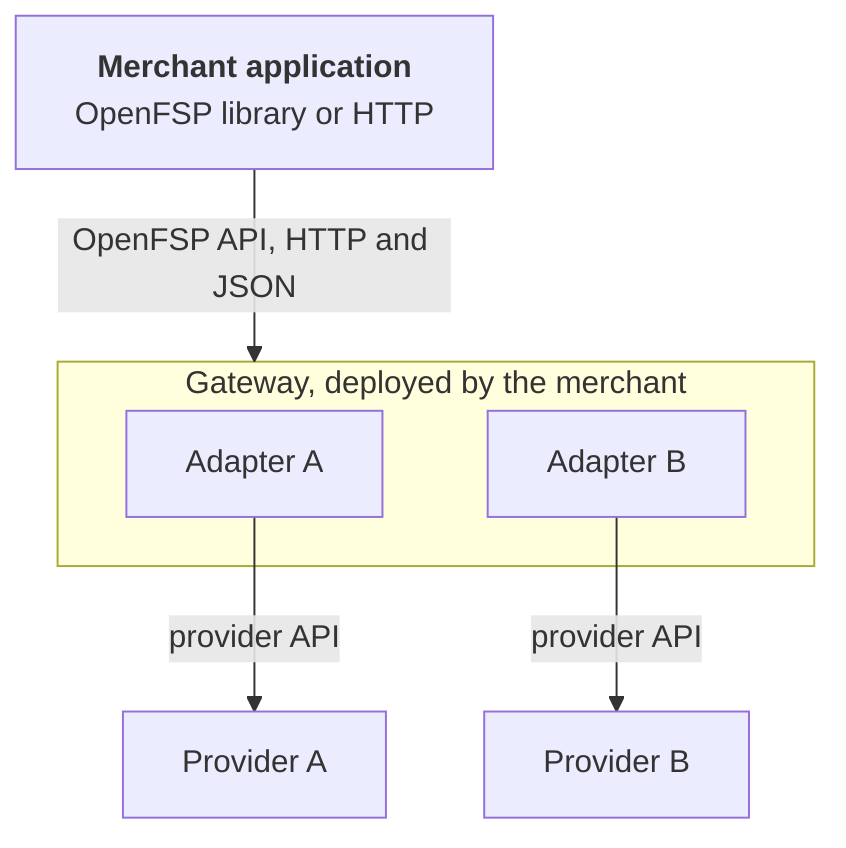

The reference gateway is an OpenFSP server that adapts exchanges to the existing MonCash and NatCash APIs. It provides a transitional integration method where these services have no native implementation. Its availability and verification limits are described in the project status.

The client-facing interface follows the [specification](/en/docs/spec). The mechanisms below concern this implementation’s internal operation. Translation of service-specific formats and behaviour belongs to the gateway and is not a general OpenFSP requirement.

## Components

| Component         | Role                                                    | Technology                                                |
| ----------------- | ------------------------------------------------------- | --------------------------------------------------------- |
| Gateway           | Merchant-hosted OpenFSP server for existing APIs.       | Kotlin and Spring Boot, PostgreSQL.                       |
| Simulator         | Reference mock server, plus the MonCash and NatCash dialects. | Kotlin and Spring Boot.                             |
| SDKs              | Client libraries and testing tools.                     | Kotlin, Java and TypeScript, in the `openfsp` repository. |
| Conformance suite | Reproducible tests and reports.                         | Kotlin engine and CLI, YAML scenarios and JSON schemas.   |

The [project status](/en/docs/status) specifies each component’s availability and testing scope.

## Request path



The application explicitly selects the payment service. The gateway maintains payments, idempotency records, state transitions and audit data. It delegates external calls to the selected service’s adapter; notifications, lookups and statements pass through the same adapter. When a service already exposes OpenFSP, a generic adapter is used without format translation. The gateway then sends `create-<order identifier>` as the `Idempotency-Key` value.

## Deployment and trust

The operator, either the merchant or its representative, deploys the gateway and manages the secrets required by the payment service APIs. These secrets are not entrusted to the project. This architecture transfers no value between services and introduces no clearing operation. Each deployment serves a single merchant account, limiting the scope of credentials and data exposed by gateway compromise to that account. Each version provides multi-platform container images with build provenance and a software bill of materials (SBOM).

## Adapters [#adapters]

An adapter translates an OpenFSP operation into the relevant service API and converts the response. Payment persistence, idempotency, state transitions and audit remain the gateway’s responsibility. The adapter is the only application component that holds the service secret.

- **Operations.** Creation is mandatory. Lookup and notification reception are exposed only when supported by the service. An unavailable operation is neither implemented nor declared ([capabilities 1.3](/en/docs/spec/capabilities#1.3)).
- **Declaration.** The adapter describes supported capabilities and the payment profile: `next_action` types, whether `payer` and `return_url` are required, and expiry guarantees. The gateway removes suspended capabilities ([capabilities 4.5](/en/docs/spec/capabilities#4.5)). Amount limits come from its per-service configuration.
- **States.** State mapping proceeds from the service to OpenFSP. An unknown or ambiguous state establishes no transition: the payment remains `pending`. An unestablished failure reason is represented by `unspecified` ([lifecycle 7.3](/en/docs/spec/lifecycle#7.3)).
- **Data.** Decimal amounts are parsed from their textual representation without conversion to fractional floating-point values. An amount that cannot be represented exactly in cents makes the response unusable (`provider-error`). Phone numbers are converted to E.164 according to the service’s documented format, or omitted. A timestamp without an offset uses the business-day time zone, `America/Port-au-Prince` by default; an ambiguous local time resolves to the later instant. A relative duration is measured from receipt. The service code and message are retained in `failure_detail` after secrets are redacted. An external timestamp never replaces `completed_at`.
- **Transmitted data.** The adapter sends neither the merchant’s `reference` nor its `metadata` to the service.
- **Documentation.** Each adapter documents its capabilities, payment profile, state and `failure_reason` mappings, idempotency strategy, notification properties, known information losses, required secrets and how they are supplied, and the service identifier in the [registry](/en/docs/registry).

## Order identifier and unknown outcomes [#order-identifier]

The order identifier sent to the service is derived from `reference` using HMAC-SHA256 with a deployment-specific key. It is encoded as 26 lowercase base32 characters and represents 128 bits. Stored with the payment, it remains valid after key rotation; the new key applies only to new payments. The same derivation is used for `mock_*` services. Any service restriction reducing the identifier below 128 bits is documented as a known loss.

Before retrying an operation with an indeterminate outcome, the gateway attempts to establish the result through the service’s idempotency mechanism or lookup by order identifier. A per-call identifier such as NatCash’s `requestId` does not constitute an idempotency guarantee. If neither mechanism exists, no automatic retry occurs: the payment remains `pending` and the operator is notified. Until the creation call has returned, the gateway may defer exposing the payment.

## Establishing the outcome [#outcome]

The gateway records a terminal state only from one of the following sources, listed in order of preference. At least one source remains available for each pending payment:

| Source                                                     | How the provider offers it   |
| ---------------------------------------------------------- | ---------------------------- |
| **(a)** callback whose provider signature is verified      | signed callbacks             |
| **(b)** state lookup at the provider                       | `payments.lookup`            |
| **(c)** callback received on a payment-specific URL        | per-payment callback URL     |
| **(d)** operator attestation                               | always available             |

- **Service notifications.** A notification qualifies as source (a) only if its signature covers at least the payment identifier and outcome. Otherwise, it triggers consultation of another source and its contents are not used to establish the state. Replay cannot change a terminal state. NatCash signatures contain neither a timestamp nor a nonce.
- **Payment-specific URL.** For source (c), the URL path contains a payment-specific token with at least 128 random bits. Comparison is performed in constant time. The token is excluded from all logs, including reverse proxy access logs. A token matching no pending payment is rejected without effect. A URL shared by multiple payments does not satisfy this mechanism.
- **Conflicts.** Information contradicting a terminal state or reporting a different amount does not modify the payment. The conflict is stored durably and reported to the operator for human resolution. A payment with a mismatched amount remains `pending`.
- **Background reconciliation.** The gateway periodically queries pending payments without a prior client request.
- **Expiry.** The `expired` state is recorded when the service reports expiry, when the service guarantees expiry and the retained `expires_at` has passed, or on attestation ([lifecycle 5](/en/docs/spec/lifecycle#5)).
- **Operator attestation.** Source (d) uses the gateway’s administration API, separate from the OpenFSP API. It records the attester’s identity, time, state and evidence reference. A shared administration token may protect access; the attester’s identity is then supplied in the request. A second approval is recommended above a threshold defined by the deployment.

## Return relay [#return-relay]

MonCash provides no per-payment return URL. The gateway therefore exposes one return endpoint per service, registered with the provider by the operator. On receipt, it looks up the payment by order identifier, looks its state up at the provider and returns a `303` redirect to the `return_url` stored with the payment. A URL supplied in the request is never used as the destination. Unknown or malformed identifiers produce `404` without redirection. This endpoint is unauthenticated and rate-limited.

## Members and endpoints beyond the standard [#extensions]

- **Service metadata.** The gateway adds its own `metadata` keys to each payment under [data model 9](/en/docs/spec/data-model#9): `gateway.order_id` for the order identifier sent to the service, and `gateway.provider_reference` for the transaction identifier once known. These keys do not count towards client limits and never replace a client-supplied key.
- **Service errors.** The external code and message are placed in the RFC 9457 error object’s `detail`; they are not used to derive `type`, `retryable` or `effect`. For a service exposing OpenFSP, the code is the last segment of its `type` and the message is its `detail`, or its `title` if unavailable. Secrets and tokens are redacted. Clients should avoid decisions based on `detail` and escape this content when displaying it.
- **Statement.** The `GET /v1/statements` endpoint is served from the successful payments the gateway recorded, by the date of `completed_at`, for every configured service. The gateway therefore declares `payments.statement` for all its services. Each entry carries `fee` when the service reported the fee of the payment. The console shows the same list and exports it as CSV for one day or a range of at most 31 days.
- **Health check.** The `/actuator/health` endpoint is unauthenticated and outside `/v1`.

Payment-specific notification URLs and signed callbacks apply only to exchanges between the gateway and external services. The gateway does not deliver events to the client’s `callback_url`. It therefore declares neither `webhooks.per_payment_url` nor the withdrawn `webhooks.verify` capability.

## Provider secrets [#secrets]

Service secrets are loaded from environment variables or a secrets manager, not exclusively from a configuration file. The gateway supports reloading them without a restart. No endpoint returns a secret, even partially; the health check reports only whether a service is reachable. Secrets are excluded from logs, traces, metrics, error reports, memory dumps and audit records. In error `detail` and `failure_detail`, values held as secrets are replaced with `[REDACTED]` by comparison with their actual values rather than by pattern matching.

## Observed profiles [#profiles]

These profiles draw on the service documentation (MonCash REST API and NatCash Merchant Online Integration 2.0) and on integration work carried out by the author. Observations are presented with their limitations. Items requiring confirmation are listed under [To check in the sandbox](#sandbox-checks).

### Mapping [#mapping]

| Property       | MonCash                                                                                                                     | NatCash                                                                                                                                |
| -------------- | --------------------------------------------------------------------------------------------------------------------------- | -------------------------------------------------------------------------------------------------------------------------------------- |
| Authentication | OAuth 2 `client_credentials`, 59 s token                                                                                    | Username, password and HMAC-SHA256 on each request                                                                                     |
| Creation       | `amount`, `orderId`                                                                                                         | `amount`, `orderNumber`, `callbackUrl`, `msisdn`, `language`                                                                           |
| Expiration     | Absolute date without time zone, end of the payment token                                                                   | Relative duration (`expiredAt`, unit not documented)                                                                                   |
| Return URL     | Fixed, declared on the merchant portal: [return relay](#return-relay) by `orderId`, or else `RetrieveTransactionPayment` on the received `transactionId` | Not documented: `return_url_required` is `false`; page in a WebView, its origin stays visible ([API 4.4](/en/docs/spec/payments-api#4.4)) |
| Callback       | Not documented                                                                                                              | Per payment, signed over `orderNumber` and `code`                                                                                      |
| Lookup         | `RetrieveOrderPayment`                                                                                                      | `checkTransaction`, under the same base as creation                                                                                    |

### Capabilities [#capabilities]

| Property                 | MonCash                                   | NatCash                       |
| ------------------------ | ----------------------------------------- | ----------------------------- |
| `payments`               | yes                                       | yes                           |
| `payments.lookup`        | yes                                       | yes                           |
| `payments.statement`     | yes: built by the gateway | yes: built by the gateway |
| `payments.fee`           | no                                        | no                            |
| Signed callbacks         | no                                        | yes, source (a)               |
| Per-payment callback URL | no                                        | yes, source (c)               |

For both services, the recovery strategy uses lookup by [order identifier](#order-identifier).

### Statuses [#statuses]

| Provider | Value                                          | OpenFSP                                                                       |
| -------- | ---------------------------------------------- | ----------------------------------------------------------------------------- |
| MonCash  | `message: "successful"`                        | `succeeded`                                                                   |
| MonCash  | `message: "failed"`                            | `failed`, `unspecified`                                                       |
| MonCash  | `message: "pending"`                           | none: `pending`                                                               |
| MonCash  | Lookup with no payment (format not documented) | none until the format is observed in the sandbox; `expired` by attestation    |
| NatCash  | `1`                                            | `succeeded`                                                                   |
| NatCash  | `-1`                                           | `failed`, `unspecified`                                                       |
| NatCash  | `-3`                                           | none: `pending`, new lookup                                                   |
| NatCash  | `ERR_TRANSACTION_EXPIRED`                      | none while it is unknown whether it targets the token or the payment          |
| NatCash  | `ERR_TRANSACTION_NOT_FOUND`                    | none; an abandoned payment becomes `expired` by attestation                   |
| NatCash  | `ERR_DUPLICATE_REQUEST_ID`                     | none: duplicate request, not an outcome                                       |

### Known losses [#losses]

- Without an established failure reason, `failure_reason` is `unspecified`.
- The MonCash `cost` field represents the payment amount. It is used for amount verification and never populates `fee`.
- NatCash may represent amounts with a thousands separator (`3,162.00`) and `responseCode` as either a number or a string.
- Without fee data, `fee` remains absent; absence does not mean zero fees.
- Rejection of cents has not been confirmed. The `amount_step` field remains absent until observed by the operator ([capabilities 6.3](/en/docs/spec/capabilities#6.3)).

### To check in the sandbox [#sandbox-checks]

1. Permitted character set and length of MonCash `orderId`.
2. `RetrieveOrderPayment` response for a missing or incomplete payment.
3. Formats of MonCash failure responses.
4. Acceptance or rejection of cents by each service.
5. Availability of MonCash callbacks and parameters sent to the return URL (`orderId` or `transactionId`).
6. Unit of the NatCash `expiredAt` duration.
7. Object addressed by `ERR_TRANSACTION_EXPIRED`: token or payment.

## Testing the gateway [#testing]

The gateway is assessed as an OpenFSP server ([conformance](/en/docs/spec/conformance)). Its adapters are tested against the simulator, which also exposes `mock_moncash` and `mock_natcash`. These services reproduce documented formats and sandbox observations; their identifiers carry the `mock_` prefix and their display names include “(mock)”. Their scenarios are limited to behaviours attributed to the real services. For the gateway’s own tests, the simulator also reproduces timeouts followed by success or by no answer, contradictory information and amount mismatches; these behaviours are internal to its tests and are not part of [conformance 4.9.3](/en/docs/spec/conformance#4.9.3). It selects scenarios from the order identifier computed with the derivation key and logs requests to verify that a call occurred or was withheld. A gateway connected to the simulator reports this at startup and uses the `test` environment. Connection refusal is reproduced by targeting a service on a closed port.

These tests assess adapter behaviour against simulated representations and failures. They do not establish compatibility with the real service or the accuracy of external documentation. Without service access, mappings are checked against datasets and rejections against recorded responses.

From the [openfsp](https://github.com/openfspht/openfsp) repository, run the following commands in three terminals:

```bash
make simulator             # terminal 1, port 8090
make gateway-conformance   # terminal 2, port 8080
make validate              # terminal 3
```

The `conformance` profile adds the test providers of [conformance 9.3.5](/en/docs/spec/conformance#9.3.5) and an unreachable service. The `make validate` command is given no key: the gateway prepares the run itself ([conformance 4.8](/en/docs/spec/conformance#4.8)), issues short-lived keys and registers the webhook receiver opened on port 8099. The report is saved to `backend/validator/infrastructure/build/conformance-report.json`.

`make dev-sandbox` connects the gateway to the MonCash and NatCash sandboxes. Credentials are read from shell variables or from `.env.sandbox`, located at the repository root and excluded from Git tracking, with one `NAME=value` per line:

```bash
MONCASH_CLIENT_ID=
MONCASH_CLIENT_SECRET=
NATCASH_USERNAME=
NATCASH_PASSWORD=
NATCASH_PARTNER_CODE=
NATCASH_PRIVATE_KEY=
NATCASH_FUNCTION_CODE=
```

Startup fails if any of these variables is empty. Completing a payment requires a sandbox wallet. Receiving external callbacks requires a gateway accessible from the Internet.
