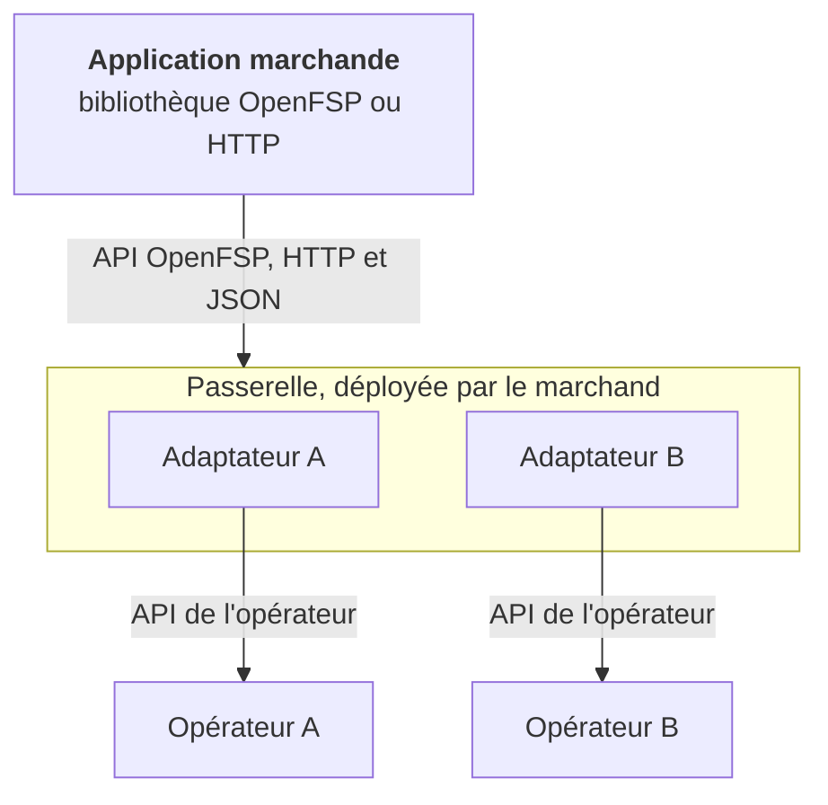

La passerelle est un serveur OpenFSP placé devant les API existantes de MonCash et NatCash, pour que les marchands puissent utiliser la norme dès aujourd'hui, avant que les opérateurs l'implémentent eux-mêmes. Elle tourne sur Kotlin, Spring Boot et PostgreSQL.

Côté clients, elle suit la [spécification](/fr/docs/spec) comme tout autre serveur. Cette page décrit ce qu'elle fait derrière cette API : la traduction du dialecte de chaque opérateur est une propriété de cet outil, pas une règle de la norme.

## Composants

| Composant           | Rôle                                                              | Technologie                                           |
| ------------------- | ----------------------------------------------------------------- | ----------------------------------------------------- |
| Passerelle          | Serveur OpenFSP hébergé par le marchand, devant les API existantes. | Kotlin et Spring Boot, PostgreSQL.                  |
| Serveur simulé      | Serveur simulé de référence, plus les dialectes MonCash et NatCash. | Kotlin et Spring Boot.                              |
| SDK                 | Bibliothèques clientes et outils de test.                         | Kotlin, Java et TypeScript, dans le dépôt `openfsp`.  |
| Suite de conformité | Tests et rapports reproductibles.                                 | Moteur et CLI Kotlin, scénarios YAML et schémas JSON. |

[L'état du projet](/fr/docs/status) donne l'état de chaque composant.

## Trajet d'une requête



L'application désigne l'opérateur ; la passerelle n'en choisit jamais. Elle tient l'enregistrement de paiement, les enregistrements d'idempotence, les transitions d'état et l'audit, et confie chaque appel à l'adaptateur de l'opérateur visé. Rappels, consultations et relevés reviennent par ce même adaptateur. Un opérateur qui expose déjà OpenFSP est atteint par un adaptateur générique, sans traduction de dialecte ; la passerelle envoie alors `create-<identifiant de commande>` comme `Idempotency-Key`.

## Déploiement et confiance

L'exploitant (le marchand ou son mandataire) déploie la passerelle et détient ses secrets d'opérateur ; le projet ne les détient jamais. La relation entre le marchand et son opérateur ne change pas. Le marchand a un compte chez chaque opérateur accepté, si bien qu'aucune valeur ne circule entre opérateurs et qu'aucune compensation n'est nécessaire. Chaque déploiement sert un seul compte marchand : une passerelle compromise n'expose que ce marchand. Chaque version publie des images de conteneur multiplateformes avec leur provenance de construction et une SBOM.

## Adaptateurs [#adapters]

Un adaptateur traduit une opération OpenFSP vers l'API d'un opérateur et la réponse en retour. Il ne tient ni l'enregistrement de paiement, ni les enregistrements d'idempotence, ni les transitions d'état, ni l'audit, et il est le seul composant à détenir un secret d'opérateur.

- **Opérations.** La création est obligatoire ; consultation, réception des rappels et lecture des relevés n'existent que si l'opérateur les offre. Une opération que l'opérateur ne sait pas faire n'est ni implémentée ni déclarée ([capacités 1.3](/fr/docs/spec/capabilities#1.3)).
- **Déclaration.** L'adaptateur déclare les capacités et le profil de paiement que l'opérateur prend en charge (types de `next_action`, `payer` exigé, `return_url` exigée, expiration garantie). La passerelle retire une capacité suspendue ([capacités 4.5](/fr/docs/spec/capabilities#4.5)). Les bornes de montant viennent de la configuration de la passerelle, par opérateur.
- **Statuts.** La correspondance va de l'opérateur vers OpenFSP, jamais l'inverse. Un statut inconnu ou ambigu ne correspond à rien et le paiement reste `pending` ; un motif incertain donne `unspecified` ([cycle de vie 7.3](/fr/docs/spec/lifecycle#7.3)).
- **Données.** Les montants décimaux sont lus sous leur forme textuelle, sans flottant ; un montant inexact au centime rend la réponse inexploitable (`provider-error`). Les numéros sont convertis en E.164 selon le format documenté de l'opérateur, ou omis. Un horodatage sans décalage se lit dans le fuseau de la journée comptable (`America/Port-au-Prince` par défaut), une heure ambiguë se résout vers l'instant le plus tardif, et une durée relative court à partir de la réception. `failure_detail` porte le code et le message de l'opérateur, caviardés ; un horodatage de l'opérateur ne remplace jamais `completed_at`.
- **Ce qui est transmis.** L'adaptateur ne transmet à l'opérateur ni la `reference` ni les `metadata`.
- **Document publié.** Chaque adaptateur publie ses capacités et son profil de paiement, ses correspondances de statuts et de `failure_reason`, sa stratégie d'idempotence, la nature de ses rappels, ses pertes connues, les secrets requis et leur mode de fourniture, et son identifiant du [registre](/fr/docs/registry).

## Identifiant de commande et issues indéterminées [#order-identifier]

La passerelle transmet à l'opérateur un identifiant de commande dérivé de la `reference` par HMAC-SHA256 sous une clé de dérivation propre au déploiement, encodé en 26 caractères base32 minuscules (128 bits). Il est stocké avec le paiement, reste valide après un changement de clé (la nouvelle clé ne sert qu'aux nouveaux paiements), et se dérive de la même façon pour les opérateurs `mock_*`. Un opérateur qui le plafonne sous 128 bits est documenté comme perte connue.

Avant de renvoyer une opération à l'issue indéterminée, la passerelle tente de l'établir chez l'opérateur : par son idempotence ou par consultation sur l'identifiant de commande. Un identifiant par appel comme le `requestId` de NatCash n'est pas de l'idempotence. Si l'opérateur n'offre ni l'un ni l'autre, la passerelle ne renvoie jamais automatiquement : le paiement reste `pending` et l'exploitant est prévenu. Tant que l'appel de création n'a pas répondu, la passerelle peut ne pas présenter le paiement.

## Établir l'issue [#outcome]

La passerelle n'enregistre un état terminal que d'après l'une de ces sources, dans cet ordre de préférence, et en garde au moins une pour tout paiement en attente :

| Source                                                       | Offerte par l'opérateur sous la forme |
| ------------------------------------------------------------ | ------------------------------------- |
| **(a)** rappel dont la signature de l'opérateur est vérifiée | rappels signés                        |
| **(b)** consultation de l'état chez l'opérateur              | `payments.lookup`                     |
| **(c)** rappel reçu sur une URL propre au paiement           | URL de rappel par paiement            |
| **(d)** relevé de l'opérateur par un canal authentifié       | `payments.statement`                  |
| **(e)** attestation de l'exploitant                          | toujours disponible                   |

- **Rappels.** Un rappel signé ne relève de (a) que si la signature couvre au moins l'identifiant du paiement et son issue. Tout autre rappel est un signal pour consulter une autre source, et son contenu est ignoré. Un rappel rejoué ne peut pas modifier un état terminal ; les signatures NatCash ne portent ni horodatage ni nonce.
- **URL propre au paiement.** Pour (c), chaque paiement reçoit dans le chemin de son URL de rappel un jeton d'au moins 128 bits aléatoires, comparé en temps constant, jamais journalisé et exclu des journaux d'accès du proxy inverse. Un jeton qui ne correspond à aucun paiement en attente est rejeté sans effet ; une URL commune à plusieurs paiements ne relève pas de (c).
- **Conflits.** Un rapport qui contredit un état terminal enregistré, ou un montant différent de celui du paiement, ne modifie jamais le paiement : la passerelle enregistre le conflit durablement, le signale à l'exploitant et en laisse la résolution à une personne. Un paiement au montant discordant reste `pending`.
- **Rapprochement en arrière-plan.** La passerelle relit périodiquement les paiements en attente, de sa propre initiative.
- **Expiration.** `expired` est enregistré quand l'opérateur rapporte le paiement expiré, quand une consultation après `expires_at` le montre inachevé, quand l'opérateur garantit l'expiration, quand un relevé couvrant une période postérieure à `expires_at` ne le mentionne pas comme achevé, ou sur attestation.
- **Attestation.** La source (e) relève de l'API d'administration de la passerelle, jamais de l'API OpenFSP. Elle consigne l'attestant, l'heure, l'état et la référence de la preuve ; un jeton d'administration partagé peut la protéger, l'attestant étant alors nommé dans la requête. Un déploiement devrait exiger une seconde validation au-delà d'un montant qu'il fixe.

## Relais de retour [#return-relay]

MonCash ne prend pas d'URL de retour par paiement. La passerelle expose un point de retour par opérateur, que l'exploitant déclare chez celui-ci. Il retrouve le paiement par l'identifiant de commande reçu, déclenche une synchronisation, redirige en `303` vers la `return_url` enregistrée du paiement (jamais vers une URL reçue dans la requête), et répond `404` sans redirection pour un identifiant inconnu ou mal formé. Il n'est pas authentifié et il est limité en débit.

## Membres et points d'accès hors norme [#extensions]

- **Données amont dans `metadata`.** La passerelle ajoute ses propres clés aux `metadata` de chaque paiement ([modèle de données 9](/fr/docs/spec/data-model#9)), à côté de celles du client : `gateway.order_id`, l'identifiant de commande qu'elle transmet à l'opérateur, et `gateway.provider_reference`, l'identifiant de transaction de l'opérateur une fois connu. Elles ne comptent pas dans les limites du client et n'écrasent jamais une clé du client.
- **Erreurs amont.** Sur une erreur venue de l'opérateur, le code et le message de l'opérateur figurent dans le `detail` du problem detail, sans jamais servir à en tirer `type`, `retryable` ou `effect`. Pour un opérateur qui parle OpenFSP, ce sont le dernier segment du `type` de son problem detail et son `detail`, à défaut son `title`. Secrets et jetons sont caviardés. Un client ne devrait pas fonder de décision sur `detail` et devrait l'échapper à l'affichage.
- **Relevé de la passerelle** sur `GET /gateway/statements?provider=…&business_date=…`, hors de `/v1` et absent du document de configuration, avec la portée `statements:read`. La console lit le même relevé par l'API d'administration. Établi d'après les propres enregistrements de la passerelle, pour tout opérateur et toute journée comptable, selon la date de `completed_at` : `payments` trié par `completed_at`, `totals` par état terminal, et `final` une fois la journée écoulée. Il sert la comptabilité du marchand ; il ne fonde jamais une transition, et seul un relevé de l'opérateur montre ce que la passerelle n'a pas vu.
- **Contrôle de santé** sur `/actuator/health`, non authentifié, hors de `/v1`.

La passerelle n'utilise les URL de rappel par paiement et les rappels signés que vers les opérateurs. Elle ne livre pas d'événements à la `callback_url` d'un client : elle n'annonce donc ni `webhooks.per_payment_url` ni `webhooks.verify`, retiré.

## Secrets d'opérateur [#secrets]

La passerelle charge les secrets d'opérateur depuis des variables d'environnement ou un gestionnaire de secrets, jamais seulement depuis un fichier de configuration, et peut les recharger sans redémarrage. Aucun point d'accès ne les renvoie, même partiellement ; un contrôle de santé peut seulement dire qu'un opérateur est joignable. Ils n'atteignent jamais un journal, une trace, une métrique, un rapport d'erreur ni un vidage mémoire. Toute valeur détenue comme secret d'opérateur est remplacée par `[REDACTED]` dans le `detail` du problem detail et dans `failure_detail`, par comparaison avec les valeurs détenues et non par motifs. Les enregistrements d'audit n'en contiennent jamais.

## Profils observés [#profiles]

J'ai établi ces profils d'après la documentation des opérateurs (MonCash REST API, NatCash Merchant Online Integration 2.0) et mes propres intégrations de ces deux opérateurs. Les points non confirmés figurent sous [À vérifier en bac à sable](#sandbox-checks).

### Correspondance [#mapping]

| Propriété        | MonCash                                                                                                                         | NatCash                                                                                                                                      |
| ---------------- | ------------------------------------------------------------------------------------------------------------------------------- | -------------------------------------------------------------------------------------------------------------------------------------------- |
| Authentification | OAuth 2 `client_credentials`, jeton de 59 s                                                                                     | Identifiant, mot de passe et HMAC-SHA256 à chaque requête                                                                                    |
| Création         | `amount`, `orderId`                                                                                                             | `amount`, `orderNumber`, `callbackUrl`, `msisdn`, `language`                                                                                 |
| Expiration       | Date absolue sans fuseau, échéance du jeton de paiement                                                                         | Durée relative (`expiredAt`, unité non documentée)                                                                                           |
| URL de retour    | Fixe, déclarée au portail marchand : [relais de retour](#return-relay) par `orderId` ou, à défaut, `RetrieveTransactionPayment` sur le `transactionId` reçu | Non documentée : `return_url_required` à `false` ; page en WebView, dont l'origine reste visible ([API 4.4](/fr/docs/spec/payments-api#4.4)) |
| Rappel           | Non documenté                                                                                                                   | Par paiement, signé sur `orderNumber` et `code`                                                                                              |
| Consultation     | `RetrieveOrderPayment`                                                                                                          | `checkTransaction`, sous la même base que la création                                                                                        |

### Capacités [#capabilities]

| Propriété                  | MonCash                                              | NatCash                                 |
| -------------------------- | ---------------------------------------------------- | --------------------------------------- |
| `payments`                 | oui                                                  | oui                                     |
| `payments.lookup`          | oui                                                  | oui                                     |
| `payments.statement`       | non : [relevé de la passerelle](#extensions) seulement | non : relevé de la passerelle seulement |
| `payments.fee`             | non                                                  | non                                     |
| Rappels signés             | non                                                  | oui, source (a)                         |
| URL de rappel par paiement | non                                                  | oui, source (c)                         |

Stratégie d'idempotence pour les deux : consultation par [identifiant de commande](#order-identifier).

### Statuts [#statuses]

| Opérateur | Valeur                                            | OpenFSP                                                                            |
| --------- | ------------------------------------------------- | ---------------------------------------------------------------------------------- |
| MonCash   | `message: "successful"`                           | `succeeded`                                                                        |
| MonCash   | `message: "failed"`                               | `failed`, `unspecified`                                                            |
| MonCash   | `message: "pending"`                              | aucune : `pending`                                                                 |
| MonCash   | Consultation sans paiement (format non documenté) | aucune tant que le format n'est pas observé en bac à sable ; `expired` par attestation |
| NatCash   | `1`                                               | `succeeded`                                                                        |
| NatCash   | `-1`                                              | `failed`, `unspecified`                                                            |
| NatCash   | `-3`                                              | aucune : `pending`, nouvelle consultation                                          |
| NatCash   | `ERR_TRANSACTION_EXPIRED`                         | aucune tant qu'on ignore s'il vise le jeton ou le paiement                         |
| NatCash   | `ERR_TRANSACTION_NOT_FOUND`                       | aucune ; un paiement abandonné devient `expired` par attestation                   |
| NatCash   | `ERR_DUPLICATE_REQUEST_ID`                        | aucune : doublon de requête, pas un dénouement                                     |

### Pertes connues [#losses]

- Aucun motif d'échec : `failure_reason` vaut `unspecified`.
- `cost` chez MonCash est le montant du paiement : il alimente le contrôle de montant, jamais `fee`.
- NatCash peut écrire un montant avec un séparateur de milliers (`3,162.00`) et un `responseCode` en nombre ou en chaîne.
- Aucuns frais : `fee` reste absent.
- Refus des centimes non confirmé : `amount_step` reste absent tant que l'exploitant ne l'a pas constaté ([capacités 6.3](/fr/docs/spec/capabilities#6.3)).

### À vérifier en bac à sable [#sandbox-checks]

1. Alphabet et longueur de l'`orderId` MonCash.
2. Réponse de `RetrieveOrderPayment` pour un paiement inexistant ou inachevé.
3. Réponses d'échec de MonCash.
4. Refus des centimes par l'un ou l'autre opérateur.
5. Rappel MonCash et paramètres transmis à l'URL de retour (`orderId` ou `transactionId`).
6. Unité d'`expiredAt` chez NatCash.
7. Portée d'`ERR_TRANSACTION_EXPIRED` : jeton ou paiement.

## Tester la passerelle [#testing]

La passerelle se teste comme un serveur OpenFSP ([conformité](/fr/docs/spec/conformance)). Ses adaptateurs se testent contre le serveur simulé, qui joue aussi `mock_moncash` et `mock_natcash` : leurs dialectes suivent la documentation de chaque opérateur et les observations de son bac à sable, portent le préfixe `mock_` et la mention « (mock) », et n'offrent que les scénarios que l'opérateur réel peut produire. Pour ces exécutions, le serveur simulé reproduit aussi les expirations en amont (`TIMEOUT_THEN_SUCCESS`, `TIMEOUT_THEN_NOTHING`), les contradictions (`CONTRADICT`), les écarts de montant (`AMOUNT_MISMATCH`) et l'écho d'identifiants (`CREDENTIAL_ECHO`), choisit les scénarios par l'identifiant de commande calculé avec la clé de dérivation, et journalise les requêtes reçues pour qu'un test vérifie un appel ou son absence. Une passerelle pointée vers le serveur simulé l'indique dans son journal de démarrage et s'exécute en environnement `test`. La connexion refusée se teste avec un opérateur sur un port fermé.

Rien de cela ne prouve qu'un adaptateur correspond à son opérateur, ni qu'un opérateur se comporte comme sa documentation le dit. Sans accès à l'opérateur, les correspondances se testent sur des données et les refus sur des réponses enregistrées.

Depuis le dépôt [openfsp](https://github.com/openfspht/openfsp) :

```bash
make simulator             # terminal 1, port 8090
make gateway-conformance   # terminal 2, port 8080
make validate              # terminal 3
```

Le profil `conformance` ajoute les opérateurs de test `mock_no_source`, `mock_statement_only` et `mock_unreachable`. `make validate` émet par l'API d'administration les clés dont les scénarios ont besoin et enregistre un récepteur de webhooks sur le port 8099 le temps de l'exécution, puis les révoque et le retire. Le rapport est écrit dans `backend/validator/infrastructure/build/conformance-report.json`.

`make dev-sandbox` démarre la passerelle sur les bacs à sable de MonCash et NatCash. Les identifiants viennent de `.env.sandbox` à la racine du dépôt (ignoré par git), un `NOM=valeur` par ligne, ou du shell :

```bash
MONCASH_CLIENT_ID=
MONCASH_CLIENT_SECRET=
NATCASH_USERNAME=
NATCASH_PASSWORD=
NATCASH_PARTNER_CODE=
NATCASH_PRIVATE_KEY=
NATCASH_FUNCTION_CODE=
```

La passerelle refuse de démarrer si l'une de ces variables est vide. Mener un paiement à terme demande un portefeuille de bac à sable, et les rappels des opérateurs exigent une passerelle joignable depuis Internet.
