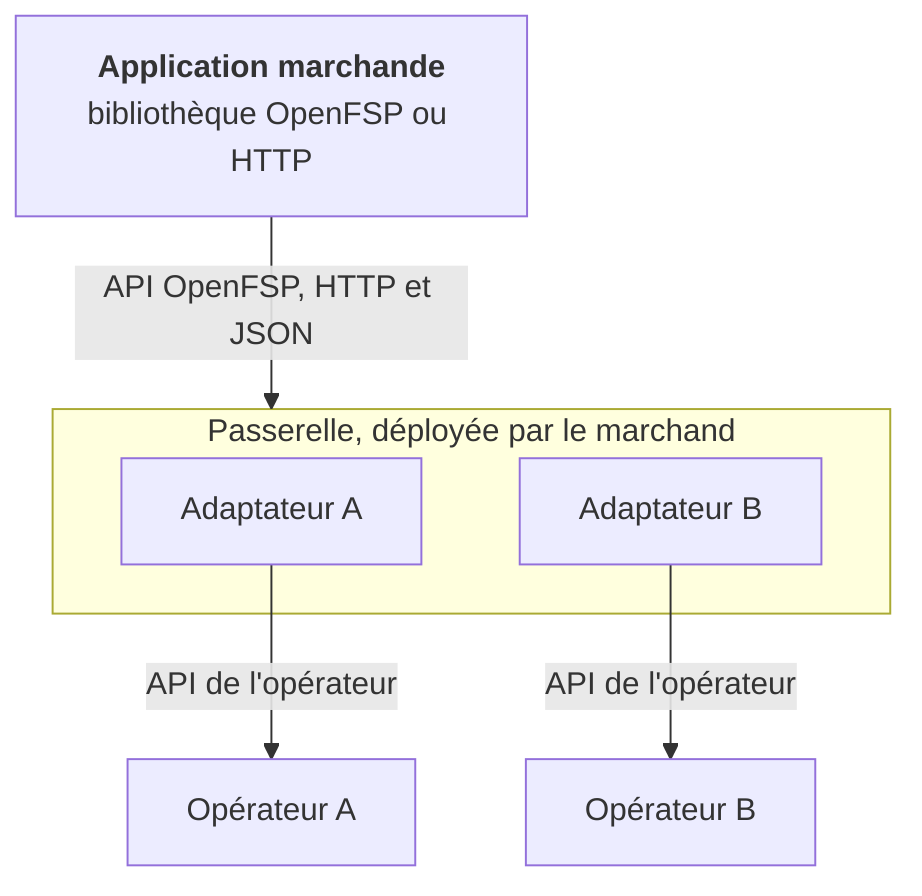

La passerelle de référence est un serveur OpenFSP qui adapte les échanges aux API existantes de MonCash et NatCash. Elle constitue un mode d’intégration transitoire en l’absence d’implémentation native par ces services. Sa disponibilité et les limites de ses vérifications sont décrites dans l’état du projet.

L’interface exposée aux clients suit la [spécification](/fr/docs/spec). Les mécanismes décrits ci-dessous concernent le fonctionnement interne de cette implémentation. La traduction des formats et des comportements propres à chaque service relève de la passerelle ; elle ne constitue pas une exigence générale d’OpenFSP.

## Composants

| Composant           | Rôle                                                              | Technologie                                           |
| ------------------- | ----------------------------------------------------------------- | ----------------------------------------------------- |
| Passerelle          | Serveur OpenFSP hébergé par le marchand, devant les API existantes. | Kotlin et Spring Boot, PostgreSQL.                  |
| Serveur simulé      | Serveur simulé de référence, plus les dialectes MonCash et NatCash. | Kotlin et Spring Boot.                              |
| SDK                 | Bibliothèques clientes et outils de test.                         | Kotlin, Java et TypeScript, dans le dépôt `openfsp`.  |
| Suite de conformité | Tests et rapports reproductibles.                                 | Moteur et CLI Kotlin, scénarios YAML et schémas JSON. |

[L’état du projet](/fr/docs/status) précise la disponibilité et le périmètre de test de chaque composant.

## Trajet d'une requête



L’application sélectionne explicitement le service de paiement. La passerelle conserve les paiements, les enregistrements d’idempotence, les transitions d’état et les données d’audit. Elle délègue les appels externes à l’adaptateur du service sélectionné ; les notifications, les consultations et les relevés sont traités par ce même adaptateur. Lorsqu’un service expose déjà OpenFSP, un adaptateur générique est utilisé sans traduction de formats. La passerelle transmet alors `create-<identifiant de commande>` comme valeur de `Idempotency-Key`.

## Déploiement et confiance

L’exploitant, marchand ou mandataire, déploie la passerelle et gère les secrets nécessaires aux API des services de paiement. Ces secrets ne sont pas confiés au projet. Le marchand conserve sa relation contractuelle et son compte auprès de chaque fournisseur accepté. Cette architecture ne transfère aucune valeur entre services et n’introduit aucune opération de compensation. Chaque déploiement sert un seul compte marchand, ce qui limite à ce compte le périmètre des identifiants et des données exposés par la compromission de la passerelle. Chaque version fournit des images de conteneur multiplateformes accompagnées de leur provenance de construction et d’une nomenclature des composants logiciels (SBOM).

## Adaptateurs [#adapters]

L’adaptateur traduit une opération OpenFSP vers l’API du service concerné et convertit la réponse reçue. La persistance des paiements, l’idempotence, les transitions d’état et l’audit restent à la charge de la passerelle. L’adaptateur est le seul composant applicatif qui détient le secret du service.

- **Opérations.** La création est obligatoire. La consultation, la réception des notifications et la lecture des relevés sont exposées uniquement si le service les prend en charge. Une opération absente n’est ni implémentée ni déclarée ([capacités 1.3](/fr/docs/spec/capabilities#1.3)).
- **Déclaration.** L’adaptateur décrit les capacités et le profil de paiement pris en charge : types de `next_action`, présence exigée de `payer`, présence exigée de `return_url` et garantie d’expiration. La passerelle retire les capacités suspendues ([capacités 4.5](/fr/docs/spec/capabilities#4.5)). Les bornes de montant proviennent de sa configuration par service.
- **États.** La correspondance est établie du service vers OpenFSP. Un état inconnu ou ambigu ne permet aucune transition : le paiement reste `pending`. Un motif non établi est représenté par `unspecified` ([cycle de vie 7.3](/fr/docs/spec/lifecycle#7.3)).
- **Données.** Les montants décimaux sont analysés depuis leur représentation textuelle, sans conversion fractionnaire en virgule flottante. Une valeur non exacte au centime rend la réponse inexploitable (`provider-error`). Les numéros sont convertis en E.164 selon le format documenté du service, ou omis. Un horodatage sans décalage utilise le fuseau de la journée comptable, `America/Port-au-Prince` par défaut ; une heure ambiguë est résolue vers l’instant le plus tardif. Une durée relative est calculée depuis la réception. Le code et le message du service sont conservés dans `failure_detail` après masquage des secrets. L’horodatage externe ne remplace jamais `completed_at`.
- **Données transmises.** L’adaptateur ne transmet au service ni la `reference` ni les `metadata` du marchand.
- **Documentation.** Chaque adaptateur documente ses capacités, son profil de paiement, les correspondances d’états et de `failure_reason`, sa stratégie d’idempotence, les propriétés des notifications, les pertes d’information connues, les secrets requis et leur mode de fourniture, ainsi que l’identifiant du service dans le [registre](/fr/docs/registry).

## Identifiant de commande et issues indéterminées [#order-identifier]

L’identifiant de commande transmis au service est dérivé de la `reference` par HMAC-SHA256 avec une clé propre au déploiement. Il est encodé sur 26 caractères base32 minuscules et représente 128 bits. Conservé avec le paiement, il reste valide après une rotation de clé ; la nouvelle clé s’applique uniquement aux nouveaux paiements. La même dérivation est utilisée pour les services `mock_*`. Toute restriction du service réduisant cet identifiant à moins de 128 bits est documentée parmi les pertes connues.

Avant de réémettre une opération au résultat indéterminé, la passerelle cherche à établir son résultat auprès du service, au moyen de l’idempotence fournie par celui-ci ou d’une consultation par identifiant de commande. Un identifiant d’appel tel que le `requestId` de NatCash ne constitue pas une garantie d’idempotence. Si aucun de ces mécanismes n’existe, aucune réémission automatique n’a lieu : le paiement reste `pending` et l’exploitant est informé. Tant que l’appel de création n’a pas répondu, la passerelle peut différer l’exposition du paiement.

## Établir l'issue [#outcome]

La passerelle enregistre un état terminal uniquement à partir de l’une des sources suivantes, classées par ordre de préférence. Au moins une de ces sources reste disponible pour chaque paiement en attente :

| Source                                                       | Offerte par l'opérateur sous la forme |
| ------------------------------------------------------------ | ------------------------------------- |
| **(a)** rappel dont la signature de l'opérateur est vérifiée | rappels signés                        |
| **(b)** consultation de l'état chez l'opérateur              | `payments.lookup`                     |
| **(c)** rappel reçu sur une URL propre au paiement           | URL de rappel par paiement            |
| **(d)** relevé de l'opérateur par un canal authentifié       | `payments.statement`                  |
| **(e)** attestation de l'exploitant                          | toujours disponible                   |

- **Notifications du service.** Une notification relève de la source (a) uniquement si sa signature couvre au moins l’identifiant du paiement et son résultat. Dans les autres cas, elle déclenche la consultation d’une autre source et son contenu n’est pas utilisé pour établir l’état. Un rejeu ne modifie aucun état terminal. Les signatures NatCash ne contiennent ni horodatage ni nonce.
- **URL propre au paiement.** Pour la source (c), le chemin de l’URL contient un jeton d’au moins 128 bits aléatoires propre au paiement. La comparaison est effectuée en temps constant. Le jeton est exclu des journaux, notamment de ceux du proxy inverse. Un jeton ne correspondant à aucun paiement en attente est rejeté sans effet. Une URL partagée entre plusieurs paiements ne satisfait pas ce mécanisme.
- **Conflits.** Une information contredisant un état terminal, ou signalant un montant différent, ne modifie pas le paiement. Le conflit est conservé durablement et signalé à l’exploitant pour résolution humaine. Un paiement dont le montant est discordant reste `pending`.
- **Rapprochement en arrière-plan.** La passerelle consulte périodiquement les paiements en attente sans requête préalable du client.
- **Expiration.** L’état `expired` est enregistré lorsque le service confirme l’expiration, lorsqu’une consultation après `expires_at` établit que le paiement est inachevé, lorsque le service garantit l’expiration, lorsqu’un relevé couvrant une période postérieure à `expires_at` ne présente pas le paiement comme achevé, ou sur attestation.
- **Attestation de l’exploitant.** La source (e) utilise l’API d’administration de la passerelle, distincte de l’API OpenFSP. Elle consigne l’identité de l’attestant, l’instant, l’état et la référence de la preuve. Un jeton d’administration partagé peut protéger cet accès ; l’identité de l’attestant est alors fournie dans la requête. Une seconde validation est recommandée au-delà d’un seuil défini par le déploiement.

## Relais de retour [#return-relay]

MonCash ne prévoit pas d’URL de retour propre à chaque paiement. La passerelle expose donc un point de retour par service, enregistré par l’exploitant auprès du fournisseur. À réception, elle recherche le paiement par l’identifiant de commande, déclenche sa synchronisation et retourne une redirection `303` vers la `return_url` conservée avec le paiement. Une URL transmise dans la requête n’est jamais utilisée comme destination. Un identifiant inconnu ou mal formé produit une réponse `404` sans redirection. Ce point d’accès est non authentifié et soumis à une limitation de débit.

## Membres et points d'accès hors norme [#extensions]

- **Métadonnées du service.** La passerelle ajoute à chaque paiement ses propres clés `metadata`, conformément au [modèle de données 9](/fr/docs/spec/data-model#9) : `gateway.order_id` pour l’identifiant de commande transmis au service et `gateway.provider_reference` pour l’identifiant de transaction lorsqu’il est connu. Ces clés ne comptent pas dans les limites du client et ne remplacent jamais une clé fournie par celui-ci.
- **Erreurs du service.** Le code et le message externes sont inscrits dans le membre `detail` de l’objet d’erreur RFC 9457 ; ils ne servent pas à déduire `type`, `retryable` ou `effect`. Pour un service exposant OpenFSP, le code correspond au dernier segment de son `type` et le message à son `detail`, ou à son `title` à défaut. Les secrets et les jetons sont masqués. Le client devrait éviter toute décision fondée sur `detail` et échapper ce contenu lors de l’affichage.
- **Relevé de la passerelle.** Le point d’accès `GET /gateway/statements?provider=…&business_date=…` est extérieur à `/v1`, absent du document de configuration et protégé par la portée `statements:read`. La console consulte ce même relevé via l’API d’administration. Pour chaque service et journée comptable, il est construit à partir des enregistrements internes selon la date de `completed_at`. Il contient `payments`, trié par `completed_at`, `totals` par état terminal et `final` après la fin de la journée. Il sert au suivi comptable du marchand et ne justifie aucune transition d’état. Seul un relevé du service peut révéler des opérations non observées par la passerelle.
- **Contrôle de santé.** Le point d’accès `/actuator/health` est non authentifié et extérieur à `/v1`.

Les URL de notification propres au paiement et les notifications signées concernent uniquement les échanges entre la passerelle et les services externes. La passerelle ne livre pas d’événements à la `callback_url` du client. Elle ne déclare donc pas `webhooks.per_payment_url`, ni l’ancienne capacité retirée `webhooks.verify`.

## Secrets d'opérateur [#secrets]

Les secrets des services sont chargés depuis des variables d’environnement ou un gestionnaire de secrets, et non exclusivement depuis un fichier de configuration. La passerelle permet leur rechargement sans redémarrage. Aucun point d’accès ne retourne un secret, même partiellement ; le contrôle de santé indique uniquement si un service est joignable. Les secrets sont exclus des journaux, traces, métriques, rapports d’erreur, vidages mémoire et enregistrements d’audit. Dans le `detail` des erreurs et dans `failure_detail`, les valeurs détenues comme secrets sont remplacées par `[REDACTED]` au moyen d’une comparaison avec les valeurs effectives, plutôt que par reconnaissance de motifs.

## Profils observés [#profiles]

Ces profils reposent sur la documentation des services (MonCash REST API et NatCash Merchant Online Integration 2.0) ainsi que sur les travaux d’intégration réalisés par l’auteur. Les observations sont présentées avec leurs limites. Les points restant à confirmer figurent dans la liste [À vérifier en bac à sable](#sandbox-checks).

### Correspondance [#mapping]

| Propriété        | MonCash                                                                                                                         | NatCash                                                                                                                                      |
| ---------------- | ------------------------------------------------------------------------------------------------------------------------------- | -------------------------------------------------------------------------------------------------------------------------------------------- |
| Authentification | OAuth 2 `client_credentials`, jeton de 59 s                                                                                     | Identifiant, mot de passe et HMAC-SHA256 à chaque requête                                                                                    |
| Création         | `amount`, `orderId`                                                                                                             | `amount`, `orderNumber`, `callbackUrl`, `msisdn`, `language`                                                                                 |
| Expiration       | Date absolue sans fuseau, échéance du jeton de paiement                                                                         | Durée relative (`expiredAt`, unité non documentée)                                                                                           |
| URL de retour    | Fixe, déclarée au portail marchand : [relais de retour](#return-relay) par `orderId` ou, à défaut, `RetrieveTransactionPayment` sur le `transactionId` reçu | Non documentée : `return_url_required` à `false` ; page en WebView, dont l'origine reste visible ([API 4.4](/fr/docs/spec/payments-api#4.4)) |
| Rappel           | Non documenté                                                                                                                   | Par paiement, signé sur `orderNumber` et `code`                                                                                              |
| Consultation     | `RetrieveOrderPayment`                                                                                                          | `checkTransaction`, sous la même base que la création                                                                                        |

### Capacités [#capabilities]

| Propriété                  | MonCash                                              | NatCash                                 |
| -------------------------- | ---------------------------------------------------- | --------------------------------------- |
| `payments`                 | oui                                                  | oui                                     |
| `payments.lookup`          | oui                                                  | oui                                     |
| `payments.statement`       | non : [relevé de la passerelle](#extensions) seulement | non : relevé de la passerelle seulement |
| `payments.fee`             | non                                                  | non                                     |
| Rappels signés             | non                                                  | oui, source (a)                         |
| URL de rappel par paiement | non                                                  | oui, source (c)                         |

Pour les deux services, la stratégie de reprise utilise la consultation par [identifiant de commande](#order-identifier).

### Statuts [#statuses]

| Opérateur | Valeur                                            | OpenFSP                                                                            |
| --------- | ------------------------------------------------- | ---------------------------------------------------------------------------------- |
| MonCash   | `message: "successful"`                           | `succeeded`                                                                        |
| MonCash   | `message: "failed"`                               | `failed`, `unspecified`                                                            |
| MonCash   | `message: "pending"`                              | aucune : `pending`                                                                 |
| MonCash   | Consultation sans paiement (format non documenté) | aucune tant que le format n'est pas observé en bac à sable ; `expired` par attestation |
| NatCash   | `1`                                               | `succeeded`                                                                        |
| NatCash   | `-1`                                              | `failed`, `unspecified`                                                            |
| NatCash   | `-3`                                              | aucune : `pending`, nouvelle consultation                                          |
| NatCash   | `ERR_TRANSACTION_EXPIRED`                         | aucune tant qu'on ignore s'il vise le jeton ou le paiement                         |
| NatCash   | `ERR_TRANSACTION_NOT_FOUND`                       | aucune ; un paiement abandonné devient `expired` par attestation                   |
| NatCash   | `ERR_DUPLICATE_REQUEST_ID`                        | aucune : doublon de requête, pas un dénouement                                     |

### Pertes connues [#losses]

- En l’absence de motif d’échec exploitable, `failure_reason` vaut `unspecified`.
- Le champ MonCash `cost` représente le montant du paiement. Il intervient dans la vérification du montant et ne renseigne jamais `fee`.
- NatCash peut représenter un montant avec un séparateur de milliers (`3,162.00`) et `responseCode` sous forme de nombre ou de chaîne.
- En l’absence de données sur les frais, `fee` reste absent ; cette absence ne signifie pas que les frais sont nuls.
- Le refus des centimes n’est pas confirmé. Le champ `amount_step` reste absent jusqu’à observation par l’exploitant ([capacités 6.3](/fr/docs/spec/capabilities#6.3)).

### À vérifier en bac à sable [#sandbox-checks]

1. Jeu de caractères et longueur autorisés pour `orderId` chez MonCash.
2. Réponse de `RetrieveOrderPayment` pour un paiement inexistant ou inachevé.
3. Formats des réponses d’échec de MonCash.
4. Acceptation ou refus des centimes par chacun des services.
5. Disponibilité des notifications MonCash et paramètres transmis à l’URL de retour (`orderId` ou `transactionId`).
6. Unité de la durée `expiredAt` chez NatCash.
7. Objet visé par `ERR_TRANSACTION_EXPIRED` : jeton ou paiement.

## Tester la passerelle [#testing]

La passerelle est évaluée comme un serveur OpenFSP ([conformité](/fr/docs/spec/conformance)). Ses adaptateurs sont testés contre le simulateur, qui expose également `mock_moncash` et `mock_natcash`. Ces services reproduisent les formats documentés et les observations en bac à sable ; leurs identifiants portent le préfixe `mock_` et leurs noms la mention « (mock) ». Leurs scénarios sont limités aux comportements attribués aux services réels. Pour évaluer la passerelle, le simulateur reproduit les dépassements de délai (`TIMEOUT_THEN_SUCCESS`, `TIMEOUT_THEN_NOTHING`), les contradictions (`CONTRADICT`), les écarts de montant (`AMOUNT_MISMATCH`) et les réponses contenant des identifiants secrets (`CREDENTIAL_ECHO`). Il sélectionne les scénarios à partir de l’identifiant de commande calculé avec la clé de dérivation et journalise les requêtes pour vérifier la présence ou l’absence d’un appel. Une passerelle connectée au simulateur le signale au démarrage et utilise l’environnement `test`. Le refus de connexion est reproduit par un service ciblé sur un port fermé.

Ces tests évaluent le comportement de l’adaptateur face aux représentations et aux défaillances simulées. Ils ne suffisent pas à établir sa compatibilité avec le service réel ni l’exactitude de la documentation externe. En l’absence d’accès au service, les correspondances sont vérifiées sur des jeux de données et les refus sur des réponses enregistrées.

Depuis le dépôt [openfsp](https://github.com/openfspht/openfsp), exécutez les commandes suivantes dans trois terminaux :

```bash
make simulator             # terminal 1, port 8090
make gateway-conformance   # terminal 2, port 8080
make validate              # terminal 3
```

Le profil `conformance` ajoute les services de test `mock_no_source`, `mock_statement_only` et `mock_unreachable`. La commande `make validate` crée les clés nécessaires par l’API d’administration et enregistre un récepteur de webhooks sur le port 8099 pour la durée de l’exécution. Elle révoque ensuite les clés et retire le récepteur. Le rapport est enregistré dans `backend/validator/infrastructure/build/conformance-report.json`.

`make dev-sandbox` connecte la passerelle aux bacs à sable MonCash et NatCash. Les identifiants sont lus dans les variables du shell ou dans `.env.sandbox`, à la racine du dépôt et exclu du suivi Git, au format `NOM=valeur` sur chaque ligne :

```bash
MONCASH_CLIENT_ID=
MONCASH_CLIENT_SECRET=
NATCASH_USERNAME=
NATCASH_PASSWORD=
NATCASH_PARTNER_CODE=
NATCASH_PRIVATE_KEY=
NATCASH_FUNCTION_CODE=
```

Le démarrage échoue si l’une de ces variables est vide. L’achèvement d’un paiement nécessite un portefeuille de bac à sable. La réception des notifications externes nécessite une passerelle accessible depuis Internet.
