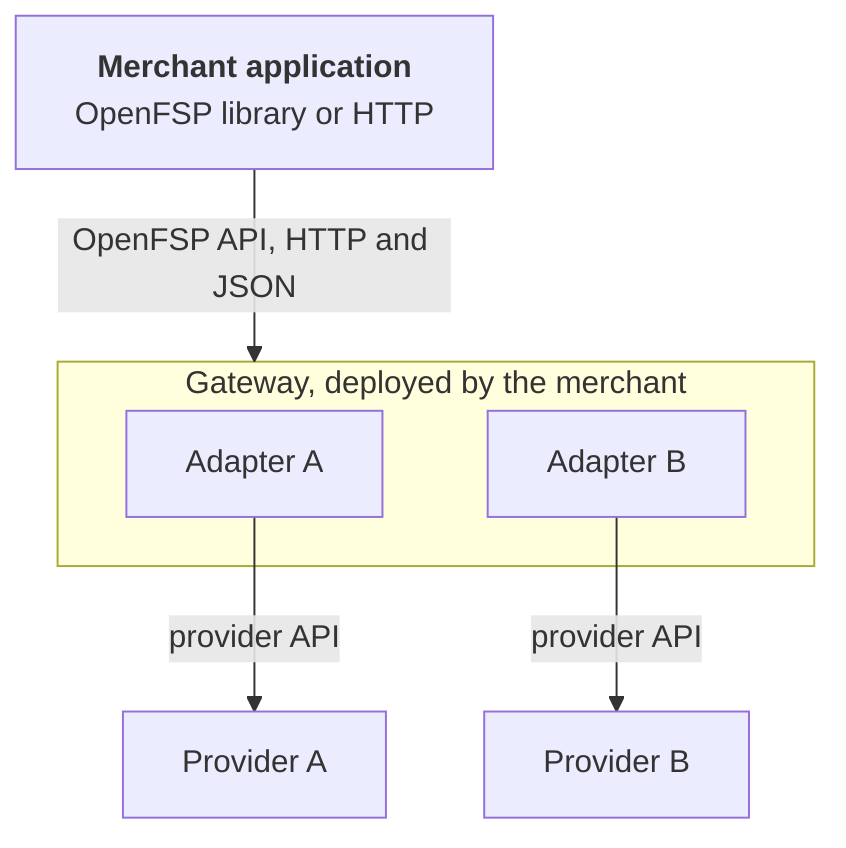

The gateway is an OpenFSP server that sits in front of the existing MonCash and NatCash APIs, so merchants can use the standard today, before providers implement it themselves. It runs on Kotlin, Spring Boot and PostgreSQL.

Towards its clients, it follows the [specification](/docs/spec) like any other server. This page describes what it does behind that API: translating each provider's dialect is a property of this tool, not a rule of the standard.

## Components

| Component         | Role                                                    | Technology                                                |
| ----------------- | ------------------------------------------------------- | --------------------------------------------------------- |
| Gateway           | Merchant-hosted OpenFSP server for existing APIs.       | Kotlin and Spring Boot, PostgreSQL.                       |
| Simulator         | Reference mock server, plus the MonCash and NatCash dialects. | Kotlin and Spring Boot.                             |
| SDKs              | Client libraries and testing tools.                     | Kotlin, Java and TypeScript, in the `openfsp` repository. |
| Conformance suite | Reproducible tests and reports.                         | Kotlin engine and CLI, YAML scenarios and JSON schemas.   |

The [project status](/docs/status) gives the state of each component.

## Request path



The application names the provider; the gateway never picks one. The gateway holds the payment record, the idempotency store, the state transitions and the audit, and hands each provider call to that provider's adapter. Callbacks, lookups and statements come back through the same adapter. A provider that already exposes OpenFSP is reached through one generic adapter, with no dialect translation; the gateway then sends `create-<order identifier>` as its `Idempotency-Key`.

## Deployment and trust

The operator (the merchant or its agent) deploys the gateway and holds its provider secrets; the project never holds them. The relationship between the merchant and its provider is unchanged. The merchant has an account with each accepted provider, so no value moves between providers and no clearing is needed. Each deployment serves a single merchant account, so a compromised gateway exposes only that merchant. Each release publishes multi-platform container images with build provenance and an SBOM.

## Adapters [#adapters]

An adapter translates an OpenFSP operation into a provider's API and the response back. It holds neither the payment record, nor the idempotency store, nor the state transitions, nor the audit, and it is the only component that holds a provider secret.

- **Operations.** Creation is required; lookup, callback ingestion and statement reading exist only if the provider offers them. An operation the provider cannot perform is neither implemented nor declared ([capabilities 1.3](/docs/spec/capabilities#1.3)).
- **Declaration.** The adapter declares the capabilities and payment profile the provider supports (`next_action` types, required `payer`, required `return_url`, guaranteed expiry). The gateway removes a suspended capability ([capabilities 4.5](/docs/spec/capabilities#4.5)). Amount limits come from the gateway configuration, per provider.
- **Statuses.** The mapping goes from the provider to OpenFSP, never the reverse. An unknown or ambiguous status maps to nothing and the payment stays `pending`; an uncertain reason gives `unspecified` ([lifecycle 7.3](/docs/spec/lifecycle#7.3)).
- **Data.** Decimal amounts are read from their text form, without a float; an amount not exact to the cent makes the response unusable (`provider-error`). Numbers are converted to E.164 by the provider's documented format, or omitted. A timestamp without offset is read in the business-day time zone (`America/Port-au-Prince` by default), an ambiguous time resolves to the later instant, and a relative duration runs from receipt. `failure_detail` carries the provider's code and message, redacted; a provider timestamp never replaces `completed_at`.
- **What is sent.** The adapter sends neither the `reference` nor the `metadata` to the provider.
- **Published document.** Each adapter publishes its capabilities and payment profile, its status and `failure_reason` mappings, its idempotency strategy, whether callbacks are signed, its known losses, the secrets it needs and how they are supplied, and its [registry](/docs/registry) identifier.

## Order identifier and unknown outcomes [#order-identifier]

The gateway sends the provider an order identifier derived from the `reference` by HMAC-SHA256 under a derivation key of the deployment, encoded as 26 lowercase base32 characters (128 bits). It is stored with the payment, stays valid after a key change (the new key serves new payments only), and is derived the same way for the `mock_*` providers. A provider that caps the identifier below 128 bits is documented as a known loss.

Before resending an operation whose outcome is unknown, the gateway tries to settle it from the provider: by its idempotency or by lookup on the order identifier. A per-call identifier such as NatCash's `requestId` is not idempotency. If the provider offers neither, the gateway never resends automatically: the payment stays `pending` and the operator is told. Until the creation call has answered, the gateway may withhold the payment.

## Establishing the outcome [#outcome]

The gateway records a terminal state only from one of these sources, in this order of preference, and keeps at least one for every pending payment:

| Source                                                     | How the provider offers it   |
| ---------------------------------------------------------- | ---------------------------- |
| **(a)** callback whose provider signature is verified      | signed callbacks             |
| **(b)** state lookup at the provider                       | `payments.lookup`            |
| **(c)** callback received on a payment-specific URL        | per-payment callback URL     |
| **(d)** provider statement over an authenticated channel   | `payments.statement`         |
| **(e)** operator attestation                               | always available             |

- **Callbacks.** A signed callback counts as (a) only if the signature covers at least the payment identifier and its outcome. Any other callback is a signal to query another source, and its content is ignored. A replayed callback cannot change a terminal state; NatCash signatures carry neither timestamp nor nonce.
- **Payment-specific URL.** For (c), each payment gets a token of at least 128 random bits in the path of its callback URL, compared in constant time, never logged, and excluded from the reverse proxy access logs. A token matching no pending payment is rejected without effect; a URL shared by several payments is not (c).
- **Conflicts.** A report that contradicts a recorded terminal state, or an amount different from the payment's, never changes the payment: the gateway records the conflict durably, reports it to the operator and leaves it to a person. A payment with a mismatched amount stays `pending`.
- **Background reconciliation.** The gateway re-reads pending payments periodically, without being asked.
- **Expiry.** `expired` is recorded when the provider reports the payment expired, when a lookup after `expires_at` shows it incomplete, when the provider guarantees expiry, when a statement covering a period after `expires_at` does not list it as complete, or on attestation.
- **Attestation.** Source (e) belongs to the gateway's administration API, never to the OpenFSP API. It records the attester, the time, the state and the evidence reference; a shared administration token may protect it, the attester then being named in the request. A deployment should require a second approval above an amount it sets.

## Return relay [#return-relay]

MonCash takes no return URL per payment. The gateway exposes one return endpoint per provider, registered by the operator with that provider. It finds the payment by the order identifier it receives, triggers a synchronization, redirects with `303` to the payment's recorded `return_url` (never to a URL from the request), and answers `404` without redirection for an unknown or malformed identifier. It is unauthenticated and rate-limited.

## Members and endpoints beyond the standard [#extensions]

- **Upstream data in `metadata`.** The gateway adds its own keys to each payment's `metadata` ([data model 9](/docs/spec/data-model#9)), next to the client's: `gateway.order_id`, the order identifier it sends the provider, and `gateway.provider_reference`, the provider's transaction identifier once known. They do not count toward the client's limits and never overwrite a client key.
- **Upstream errors.** On an error that comes from the provider, the provider's code and message appear in the problem's `detail`, never parsed into `type`, `retryable` or `effect`. For a provider that speaks OpenFSP, they are the last segment of its problem `type` and its `detail`, or failing that its `title`. Secrets and tokens are redacted. Clients should not base a decision on `detail` and should escape it when displayed.
- **Gateway statement** at `GET /v1/gateway_statements?provider=…&business_date=…`, announced as `gateway_statements_endpoint`, with the `statements:read` scope. Built from the gateway's own records for every provider and business day, by the date of `completed_at`: `payments` sorted by `completed_at`, `totals` per terminal state, and `final` once the day has ended. It serves the merchant's accounting; it never grounds a transition, and only a provider statement shows what the gateway did not see.
- **Health check** at `/actuator/health`, unauthenticated, outside `/v1`.

The gateway uses per-payment callback URLs and signed callbacks only towards providers. It does not deliver events to a client's `callback_url`, so it announces neither `webhooks.per_payment_url` nor the withdrawn `webhooks.verify`.

## Provider secrets [#secrets]

The gateway loads provider secrets from environment variables or a secrets manager, never only from a configuration file, and can reload them without a restart. No endpoint returns them, even partially; a health check may only say a provider is reachable. They never reach a log, trace, metric, error report or memory dump. Any value held as a provider secret is replaced by `[REDACTED]` in the problem `detail` and in `failure_detail`, by comparison with the held values rather than by pattern. Audit records never contain them.

## Observed profiles [#profiles]

I built these profiles from the providers' documentation (MonCash REST API, NatCash Merchant Online Integration 2.0) and from my own integrations of both providers. Unconfirmed points are listed under [To check in the sandbox](#sandbox-checks).

### Mapping [#mapping]

| Property       | MonCash                                                                                                                     | NatCash                                                                                                                                |
| -------------- | --------------------------------------------------------------------------------------------------------------------------- | -------------------------------------------------------------------------------------------------------------------------------------- |
| Authentication | OAuth 2 `client_credentials`, 59 s token                                                                                    | Username, password and HMAC-SHA256 on each request                                                                                     |
| Creation       | `amount`, `orderId`                                                                                                         | `amount`, `orderNumber`, `callbackUrl`, `msisdn`, `language`                                                                           |
| Expiration     | Absolute date without time zone, end of the payment token                                                                   | Relative duration (`expiredAt`, unit not documented)                                                                                   |
| Return URL     | Fixed, declared on the merchant portal: [return relay](#return-relay) by `orderId`, or else `RetrieveTransactionPayment` on the received `transactionId` | Not documented: `return_url_required` is `false`; page in a WebView, its origin stays visible ([API 4.4](/docs/spec/payments-api#4.4)) |
| Callback       | Not documented                                                                                                              | Per payment, signed over `orderNumber` and `code`                                                                                      |
| Lookup         | `RetrieveOrderPayment`                                                                                                      | `checkTransaction`, under the same base as creation                                                                                    |

### Capabilities [#capabilities]

| Property                 | MonCash                                   | NatCash                       |
| ------------------------ | ----------------------------------------- | ----------------------------- |
| `payments`               | yes                                       | yes                           |
| `payments.lookup`        | yes                                       | yes                           |
| `payments.statement`     | no: [gateway statement](#extensions) only | no: gateway statement only    |
| `payments.fee`           | no                                        | no                            |
| Signed callbacks         | no                                        | yes, source (a)               |
| Per-payment callback URL | no                                        | yes, source (c)               |

Idempotency strategy for both: lookup by [order identifier](#order-identifier).

### Statuses [#statuses]

| Provider | Value                                          | OpenFSP                                                                       |
| -------- | ---------------------------------------------- | ----------------------------------------------------------------------------- |
| MonCash  | `message: "successful"`                        | `succeeded`                                                                   |
| MonCash  | `message: "failed"`                            | `failed`, `unspecified`                                                       |
| MonCash  | `message: "pending"`                           | none: `pending`                                                               |
| MonCash  | Lookup with no payment (format not documented) | none until the format is observed in the sandbox; `expired` by attestation    |
| NatCash  | `1`                                            | `succeeded`                                                                   |
| NatCash  | `-1`                                           | `failed`, `unspecified`                                                       |
| NatCash  | `-3`                                           | none: `pending`, new lookup                                                   |
| NatCash  | `ERR_TRANSACTION_EXPIRED`                      | none while it is unknown whether it targets the token or the payment          |
| NatCash  | `ERR_TRANSACTION_NOT_FOUND`                    | none; an abandoned payment becomes `expired` by attestation                   |
| NatCash  | `ERR_DUPLICATE_REQUEST_ID`                     | none: duplicate request, not an outcome                                       |

### Known losses [#losses]

- No failure reason: `failure_reason` is `unspecified`.
- MonCash `cost` is the payment amount: it feeds the amount check, never `fee`.
- NatCash may write an amount with a thousands separator (`3,162.00`) and a `responseCode` as a number or a string.
- No fees: `fee` stays absent.
- Refusal of cents not confirmed: `amount_step` stays absent until the operator has observed it ([capabilities 6.3](/docs/spec/capabilities#6.3)).

### To check in the sandbox [#sandbox-checks]

1. Alphabet and length of the MonCash `orderId`.
2. Response of `RetrieveOrderPayment` for a missing or unfinished payment.
3. MonCash failure responses.
4. Refusal of cents by either provider.
5. MonCash callback and parameters sent to the return URL (`orderId` or `transactionId`).
6. Unit of NatCash `expiredAt`.
7. Scope of `ERR_TRANSACTION_EXPIRED`: token or payment.

## Testing the gateway [#testing]

The gateway is tested as an OpenFSP server ([conformance](/docs/spec/conformance)). Its adapters are tested against the simulator, which also plays `mock_moncash` and `mock_natcash`: their dialects follow each provider's documentation and sandbox observations, carry the `mock_` prefix and the "(mock)" display name, and offer only the scenarios the real provider can produce. For these runs the simulator also reproduces upstream timeouts (`TIMEOUT_THEN_SUCCESS`, `TIMEOUT_THEN_NOTHING`), contradictions (`CONTRADICT`), amount mismatches (`AMOUNT_MISMATCH`) and credential echoes (`CREDENTIAL_ECHO`), selects scenarios by the order identifier computed with the derivation key, and journals the requests it receives so a test can check a call or its absence. A gateway pointed at the simulator says so in its startup log and runs in the `test` environment. Connection refused is tested with a provider on a closed port.

None of this proves that an adapter matches its provider, nor that a provider behaves as documented. Without access to the provider, mappings are tested on data and refusals on recorded responses.

From the [openfsp](https://github.com/openfspht/openfsp) repository:

```bash
make simulator             # terminal 1, port 8090
make gateway-conformance   # terminal 2, port 8080
make validate              # terminal 3
```

The `conformance` profile adds the test-only providers `mock_no_source`, `mock_statement_only` and `mock_unreachable`. `make validate` issues the keys the scenarios need through the admin API, registers a webhook receiver on port 8099 for the run, then revokes and removes them. The report is written to `backend/validator/infrastructure/build/conformance-report.json`.

`make dev-sandbox` starts the gateway on the MonCash and NatCash sandboxes. It reads the credentials from `.env.sandbox` at the repository root (ignored by git), one `NAME=value` per line, or from the shell:

```bash
MONCASH_CLIENT_ID=
MONCASH_CLIENT_SECRET=
NATCASH_USERNAME=
NATCASH_PASSWORD=
NATCASH_PARTNER_CODE=
NATCASH_PRIVATE_KEY=
NATCASH_FUNCTION_CODE=
```

The gateway refuses to start when one of them is empty. Completing a payment needs a sandbox wallet, and provider callbacks need a gateway reachable from the Internet.
