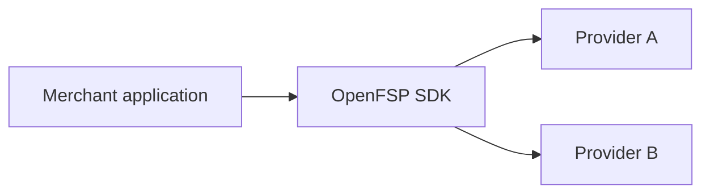

OpenFSP is an open specification for interoperability between merchant applications and payment service providers in Haiti. It defines a common interface, shared data models and expected implementation behaviour. Its objective is to enable integrations to be reused across compatible services within the limits of their declared capabilities.

The interface contract uses HTTP and covers payment creation and retrieval, capability discovery and the receipt of signed events.

OpenFSP covers application integration between merchant software and a payment service ([architecture](/en/docs/architecture#out-of-scope), [decision 0001](/en/docs/decisions#0001)).

## Start here

- **Merchant application development.** Use the [Kotlin and Java SDK](https://github.com/openfspht/openfsp/tree/main/sdks/kotlin), the [TypeScript SDK](https://github.com/openfspht/openfsp/tree/main/sdks/typescript) or the [HTTP API](/en/docs/spec/payments-api) directly. The [quickstart guide](/en/docs/quickstart) describes a simulated payment flow in a local environment.
- **Provider implementation.** Follow the [native implementation guide](/en/docs/implement), then assess applicable requirements with the [conformance suite](/en/docs/spec/conformance).
- **MonCash or NatCash integration.** According to the documented project status, these services do not yet implement OpenFSP natively. The [gateway](/en/docs/gateway), deployed in front of their existing APIs, provides a transitional option.
- **Technical or methodological review.** Read the [specification](/en/docs/spec), [design decisions](/en/docs/decisions) and [project status](/en/docs/status).

## What exists

The [project status](/en/docs/status) describes the available components and the limits of completed checks. Project documents and tools are provided under the Apache-2.0 licence.

## Phases

**Phase 1, in progress.** Definition of the merchant integration contract, development of supporting tools and establishment of reproducible conformance checks.

**Phase 2, proposed.** Extension to proximity payments using a short-lived, single-use token presented by the customer. This flow is outside the current version.
