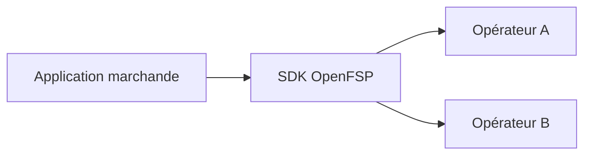

OpenFSP est une spécification ouverte d’interopérabilité entre les applications marchandes et les fournisseurs de services de paiement en Haïti. Elle définit une interface commune, les modèles de données échangés et les comportements attendus des implémentations. Son objectif est de permettre la réutilisation des intégrations auprès des services compatibles, dans les limites de leurs capacités déclarées.

Le contrat d’interface repose sur HTTP et couvre la création, la consultation et la synchronisation des paiements, la découverte des capacités et la réception d’événements signés. Chaque marchand conserve un compte, un contrat et des identifiants auprès de chaque fournisseur concerné.

Dans un modèle où chacune des `L` applications développe une interface propre à chacun des `O` services, le nombre d’intégrations spécifiques atteint `O × L`. Un contrat commun permet d’organiser le travail autour de `O + L` implémentations : une par service et une par application. Ce modèle suppose l’adoption du contrat et des capacités compatibles ; il ne mesure pas les coûts de configuration, de validation ou de maintenance de chaque déploiement.

Le périmètre d’OpenFSP porte sur l’intégration applicative entre un logiciel marchand et un service de paiement. Les transferts, la compensation et le règlement entre fournisseurs se situent hors de ce périmètre.

## Par où commencer

- **Développement d’une application marchande.** Utilisez le [SDK Kotlin et Java](https://github.com/openfspht/openfsp/tree/main/sdks/kotlin), le [SDK TypeScript](https://github.com/openfspht/openfsp/tree/main/sdks/typescript) ou directement [l’API HTTP](/fr/docs/spec/payments-api). Le [guide de démarrage](/fr/docs/quickstart) décrit un parcours de paiement simulé en environnement local.
- **Implémentation par un fournisseur.** Suivez le [guide d’implémentation native](/fr/docs/native-operator), puis évaluez les exigences applicables avec la [suite de conformité](/fr/docs/spec/conformance).
- **Intégration de MonCash ou NatCash.** Ces services ne disposent pas encore d’une implémentation native d’OpenFSP selon l’état documenté du projet. La [passerelle](/fr/docs/gateway), à déployer devant leurs API existantes, constitue une option transitoire.
- **Revue technique ou méthodologique.** Consultez la [spécification](/fr/docs/spec), les [décisions de conception](/fr/docs/decisions) et [l’état du projet](/fr/docs/status).

## Ce qui existe

- La spécification `0.1.0`, disponible en français et en anglais.
- Des bibliothèques clientes accompagnées de modules de test.
- Le serveur simulé de référence `mock_openfsp`, qui permet notamment de reproduire des défaillances.
- Une suite de conformité, un validateur public et des attestations signées consignant les résultats d’exécution.

Les documents et les outils du projet sont proposés sous licence Apache-2.0. [L’état du projet](/fr/docs/status) précise la disponibilité des composants et les limites des vérifications réalisées.

## Phases

**Phase 1, en cours.** Définition du contrat d’intégration marchande, développement des outils associés et mise en place de vérifications de conformité reproductibles.

**Phase 2, envisagée.** Extension au paiement de proximité au moyen d’un jeton éphémère à usage unique présenté par le client. Ce parcours ne relève pas de la version actuelle.
