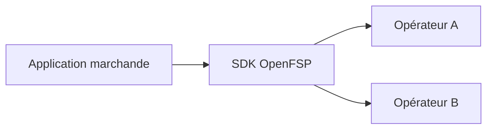

OpenFSP est une norme ouverte pour encaisser des paiements en Haïti. Une application marchande l'intègre une fois et fonctionne avec tous les opérateurs de paiement qui l'implémentent. Un opérateur l'implémente une fois et devient accessible à toutes les applications qui l'utilisent.

La norme est un contrat HTTP court : créer un paiement, le lire, le synchroniser avec l'opérateur, connaître ce que l'opérateur prend en charge et recevoir des événements signés. Chaque marchand garde son contrat et ses identifiants avec chaque opérateur.

Sans contrat commun, `L` applications intègrent chacune `O` opérateurs : `O × L` intégrations. Avec OpenFSP, il en faut `O + L`.

OpenFSP couvre le dialogue entre une application marchande et un opérateur. La norme ne transfère, ne compense et ne règle aucun fonds entre opérateurs.

## Par où commencer

- **Développeur marchand.** Utilisez le [SDK Kotlin et Java](https://github.com/openfspht/openfsp/tree/main/sdks/kotlin) ou le [SDK TypeScript](https://github.com/openfspht/openfsp/tree/main/sdks/typescript), ou appelez [l'API](/fr/docs/spec/payments-api) en HTTP. Le [démarrage rapide](/fr/docs/quickstart) fait tourner un paiement complet sur votre machine.
- **Opérateur de paiement.** [Implémentez OpenFSP](/fr/docs/native-operator) dans votre propre système et testez-le avec la [suite de conformité](/fr/docs/spec/conformance).
- **MonCash ou NatCash aujourd'hui.** Aucun des deux ne parle encore OpenFSP. La [passerelle](/fr/docs/gateway), que vous hébergez, traduit le contrat vers leurs API actuelles.
- **Relecteur.** Lisez la [spécification](/fr/docs/spec), les [décisions](/fr/docs/decisions) qui la fondent et [l'état du projet](/fr/docs/status).

## Ce qui existe

- La spécification, version `0.1.0`, en anglais et en français.
- Des SDK pour Kotlin, Java et TypeScript, chacun avec son module de test.
- Un simulateur de MonCash, de NatCash et d'un opérateur OpenFSP natif, pannes comprises.
- Une suite de conformité, un validateur public et des attestations signées de chaque exécution.
- La passerelle pour MonCash et NatCash.

Tout est sous licence Apache-2.0. [L'état du projet](/fr/docs/status) donne le détail.

## Phases

**Phase 1, en cours.** Le contrat d'intégration marchande, ses outils et une conformité reproductible.

**Phase 2, envisagée.** Le paiement de proximité, avec un jeton éphémère à usage unique présenté par le client. Hors de la version actuelle.
