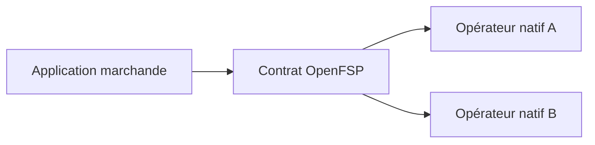

OpenFSP est une proposition de norme ouverte d'interopérabilité entre applications marchandes et fournisseurs de services de paiement. L'objectif est que chaque opérateur l'implémente nativement, pour qu'un marchand utilise le même contrat HTTP avec tous les opérateurs compatibles.

La norme est le livrable. La passerelle de référence traduit le contrat OpenFSP vers les API existantes de MonCash et NatCash, pour que le contrat soit utilisable dès aujourd'hui.

## Le problème

Sans contrat commun, chacune des `L` applications marchandes intègre chacun des `O` opérateurs : `O × L` intégrations. Avec OpenFSP, chaque application utilise un
seul protocole et chaque opérateur implémente ce contrat une seule fois : `O + L`. Le gain dépend de l'adoption.

## L'architecture cible

Avec l'adoption native, l'application s'adresse directement à chaque opérateur compatible. Chaque relation conserve ses identifiants, sa configuration et les capacités réelles de l'opérateur.

L'interopérabilité visée concerne l'intégration applicative marchande ; la norme n'effectue pas de transfert, de compensation ou de règlement entre opérateurs.

## Choisir un parcours

- **Fournisseur de services de paiement :** [implémenter OpenFSP nativement](/fr/docs/native-operator), lire le contrat puis tester votre propre cible.
- **Développeur marchand :** lire [l'API](/fr/docs/spec/payments-api), découvrir les capacités de votre contrepartie et l'appeler en HTTP.
- **Lecteur de la conception :** consulter les [décisions](/fr/docs/decisions) et [l'état du projet](/fr/docs/status).
- **Explorer les outils :** lancer la [démo locale](/fr/docs/quickstart) avec la [passerelle de transition](/fr/docs/gateway).

## Phases

**Phase 1, en cours.** Établir le contrat d'intégration marchande, ses outils de référence et sa vérification reproductible. La passerelle et les adaptateurs rendent le contrat utilisable avec les API existantes ; le simulateur et la suite de conformité permettent aussi d'éprouver un opérateur natif sans passerelle.

**Phase 2, envisagée.** Étendre la norme au paiement de proximité, avec un jeton éphémère à usage unique présenté par le client. Ce travail sort du périmètre de la version actuelle.

[L'état du projet](/fr/docs/status) donne l'état de chaque composant. La spécification et l'implémentation de référence sont sous licence Apache-2.0.

## Pour continuer

- [Spécification](/fr/docs/spec) : les règles normatives et le vocabulaire.
- [Architecture de la norme](/fr/docs/architecture) : contrat, adoption native et invariants.
- [Décisions](/fr/docs/decisions) : les raisons des choix de conception.
- [Passerelle de transition](/fr/docs/gateway) : rôle de cet outil et détails des adaptateurs.
- [Démarrage rapide](/fr/docs/quickstart) : exécuter les outils de démonstration et la suite.
