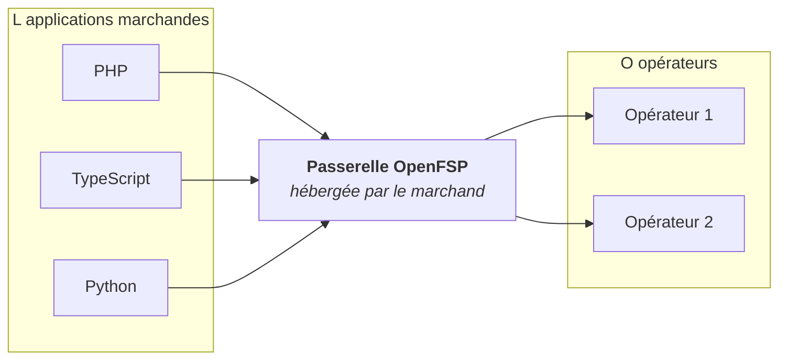

OpenFSP est une proposition de norme ouverte pour l'intégration des paiements numériques en Haïti : un contrat unique entre les applications marchandes et les
opérateurs de paiement, et une passerelle qui l'implémente, hébergée par le marchand.

## Le problème

Sans contrat commun, chacune des `L` applications marchandes intègre chacun des `O` opérateurs : `O × L` intégrations. Avec OpenFSP, chaque application parle un
seul protocole et chaque opérateur est intégré une seule fois, dans la passerelle : `O + L`.

La passerelle donne des instructions aux opérateurs sans jamais être partie à une transaction : elle ne détient aucun fonds, et le marchand garde son propre
contrat avec chaque opérateur.

## Composants

| Composant              | Rôle                                                                                                       |
| ---------------------- | ---------------------------------------------------------------------------------------------------------- |
| Spécification          | Le contrat : modèle de données, cycle de vie, capacités, erreurs, idempotence, webhooks, authentification. |
| Passerelle             | Serveur hébergé par le marchand : protocole OpenFSP d'un côté, API des opérateurs de l'autre.              |
| Serveur simulé         | Reproduit les opérateurs, défaillances comprises, pour tester sans compte marchand.                        |
| Bibliothèques clientes | Clients minces en TypeScript, PHP et Python ; le protocole reste utilisable en HTTP seul.                  |
| Suite de conformité    | Vérifie qu'une implémentation respecte la spécification ; un tiers peut la réexécuter.                     |

## État

La spécification est un brouillon, en version 0.1.0. OpenFSP est le projet de recherche de mon master MBDS, et reste une proposition : aucun opérateur ni
régulateur ne l'a adoptée. Avant `1.0.0`, une version mineure peut rompre la compatibilité. La spécification et l'implémentation de référence sont sous licence
Apache-2.0.

## Pour continuer

- [Démarrage rapide](/fr/docs/quickstart) : lancer la passerelle, le serveur simulé et la suite de conformité.
- [Spécification](/fr/docs/spec) : les règles normatives.
- [Architecture](/fr/docs/architecture) : périmètre, composants et adaptateurs d'opérateur.
- [Décisions](/fr/docs/decisions) : les raisons des règles.
