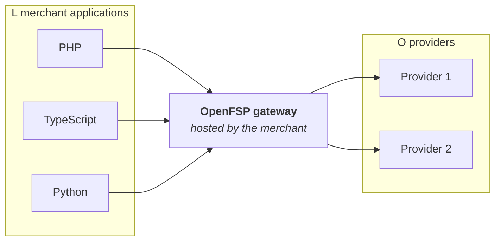

OpenFSP is a proposed open standard for integrating digital payments in Haiti: one contract between merchant applications and payment providers, and a gateway
that implements it, hosted by the merchant.

## The problem

Without a shared contract, each of `L` merchant applications integrates each of `O` providers: `O × L` integrations. With OpenFSP, each application speaks one
protocol and each provider is integrated once, in the gateway: `O + L`.

The gateway instructs providers and is never a party to a transaction: it holds no funds, and the merchant keeps its own contract with each provider.

## Components

| Component         | Role                                                                                                     |
| ----------------- | -------------------------------------------------------------------------------------------------------- |
| Specification     | The contract: data model, lifecycle, capabilities, errors, idempotency, webhooks, authentication.        |
| Gateway           | Server the merchant hosts: the OpenFSP protocol on one side, the provider APIs on the other.             |
| Simulator         | Reproduces the providers, failures included, so an integration can be tested without a merchant account. |
| Client libraries  | Thin clients in TypeScript, PHP and Python. The protocol stays usable over plain HTTP.                   |
| Conformance suite | Checks that an implementation follows the specification. A third party can run it again.                 |

## Status

The specification is a draft, version 0.1.0. OpenFSP is the research project of my MBDS master's degree, and it is a proposal: no provider or regulator has
adopted it. Before `1.0.0`, a minor version may break compatibility. The specification and the reference implementation are under the Apache-2.0 license.

## Next

- [Quickstart](/docs/quickstart): run the gateway, the simulator and the conformance suite.
- [Specification](/docs/spec): the normative rules.
- [Architecture](/docs/architecture): scope, components and provider adapters.
- [Decisions](/docs/decisions): the reasons behind the rules.
