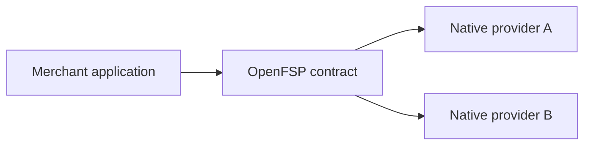

OpenFSP is a proposed open interoperability standard between merchant applications and payment service providers. The goal is for each provider to implement it natively, so merchants use the same HTTP contract with every compatible provider.

The standard is the deliverable. The reference gateway translates the OpenFSP contract into the existing MonCash and NatCash APIs, so the contract is usable today.

## The problem

Without a shared contract, each of `L` merchant applications integrates each of `O` providers: `O × L` integrations. With OpenFSP, each application speaks one
protocol and each provider implements that contract once: `O + L`. The benefit depends on adoption.

## The target architecture

With native adoption, the application connects directly to each compatible provider. Each relationship keeps its credentials, configuration and actual provider capabilities.

The interoperability addressed here is merchant application integration; the standard does not transfer, clear or settle funds between providers.

## Choose a path

- **Payment service provider:** [implement OpenFSP natively](/docs/native-operator), read the contract and test your own target.
- **Merchant developer:** read the [API](/docs/spec/payments-api), discover your counterparty's capabilities and call it over HTTP.
- **Design reader:** read the [decisions](/docs/decisions) and the [project status](/docs/status).
- **Explore the tools:** run the [local demo](/docs/quickstart) with the [transition gateway](/docs/gateway).

## Phases

**Phase 1, in progress.** Establish the merchant integration contract, reference tools and reproducible verification. The gateway and adapters make the contract usable with existing APIs; the simulator and conformance suite also exercise a native provider without a gateway.

**Phase 2, envisaged.** Extend the standard to proximity payments using a short-lived, single-use token presented by the customer. This is outside the current version.

The [project status](/docs/status) gives the state of each component. The specification and the reference implementation are under the Apache-2.0 license.

## Next

- [Specification](/docs/spec): normative rules and vocabulary.
- [Standard architecture](/docs/architecture): contract, native adoption and invariants.
- [Decisions](/docs/decisions): the reasons for the design choices.
- [Transition gateway](/docs/gateway): this tool's role and adapter details.
- [Quickstart](/docs/quickstart): run the demonstration tools and suite.
