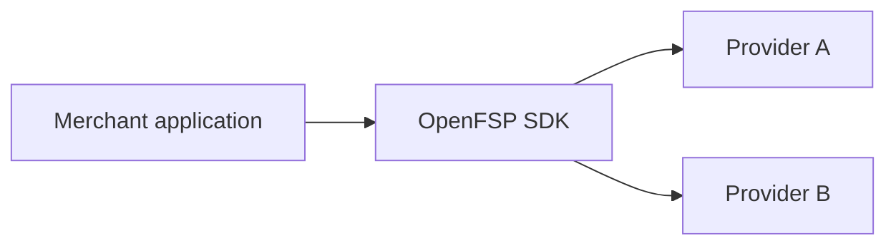

OpenFSP is an open specification for interoperability between merchant applications and payment service providers in Haiti. It defines a common interface, shared data models and expected implementation behaviour. Its objective is to enable integrations to be reused across compatible services within the limits of their declared capabilities.

The interface contract uses HTTP and covers payment creation, retrieval and synchronisation, capability discovery and the receipt of signed events. Each merchant maintains an account, an agreement and credentials with each relevant provider.

In a model where each of `L` applications implements a separate interface for each of `O` services, the number of service-specific integrations reaches `O × L`. A shared contract allows implementation work to be organised around `O + L` implementations: one per service and one per application. This model assumes adoption of the contract and compatible capabilities; it does not measure configuration, validation or maintenance costs for individual deployments.

OpenFSP covers application integration between merchant software and a payment service. Inter-provider funds transfers, clearing and settlement are outside this scope.

## Start here

- **Merchant application development.** Use the [Kotlin and Java SDK](https://github.com/openfspht/openfsp/tree/main/sdks/kotlin), the [TypeScript SDK](https://github.com/openfspht/openfsp/tree/main/sdks/typescript) or the [HTTP API](/docs/spec/payments-api) directly. The [quickstart guide](/docs/quickstart) describes a simulated payment flow in a local environment.
- **Provider implementation.** Follow the [native implementation guide](/docs/native-operator), then assess applicable requirements with the [conformance suite](/docs/spec/conformance).
- **MonCash or NatCash integration.** According to the documented project status, these services do not yet implement OpenFSP natively. The [gateway](/docs/gateway), deployed in front of their existing APIs, provides a transitional option.
- **Technical or methodological review.** Read the [specification](/docs/spec), [design decisions](/docs/decisions) and [project status](/docs/status).

## What exists

- Specification version `0.1.0`, available in French and English.
- Client libraries with testing modules.
- The `mock_openfsp` reference mock server, including scenarios that reproduce failures.
- A conformance suite, a public validator and signed attestations recording execution results.

Project documents and tools are provided under the Apache-2.0 licence. The [project status](/docs/status) describes component availability and the limits of completed checks.

## Phases

**Phase 1, in progress.** Definition of the merchant integration contract, development of supporting tools and establishment of reproducible conformance checks.

**Phase 2, proposed.** Extension to proximity payments using a short-lived, single-use token presented by the customer. This flow is outside the current version.
