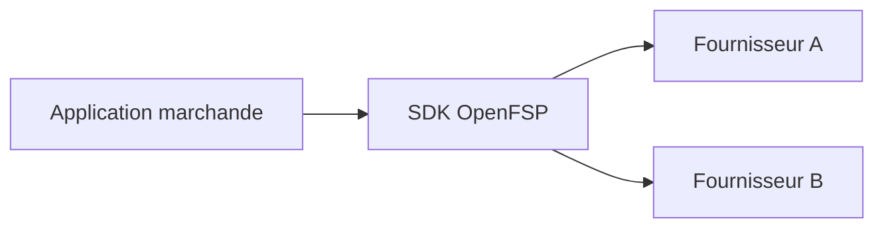

OpenFSP est une spécification ouverte d’interopérabilité entre les applications marchandes et les fournisseurs de services de paiement en Haïti. Elle définit une interface commune, les modèles de données échangés et les comportements attendus des implémentations. Son objectif est de permettre la réutilisation des intégrations auprès des services compatibles, dans les limites de leurs capacités déclarées.

Le contrat d’interface repose sur HTTP et couvre la création et la lecture des paiements, la découverte des capacités et la réception d’événements signés.

Le périmètre d’OpenFSP porte sur l’intégration applicative entre un logiciel marchand et un service de paiement ([architecture](/docs/architecture#hors-périmètre), [décision 0001](/docs/decisions#0001)).

## Par où commencer

- **Développement d’une application marchande.** Utilisez le [SDK Kotlin et Java](https://github.com/openfspht/openfsp/tree/main/sdks/kotlin), le [SDK TypeScript](https://github.com/openfspht/openfsp/tree/main/sdks/typescript) ou directement [l’API HTTP](/docs/spec/payments-api). Le [guide de démarrage](/docs/quickstart) décrit un parcours de paiement simulé en environnement local.
- **Implémentation par un fournisseur.** Suivez le [guide d’implémentation native](/docs/implement), puis évaluez les exigences applicables avec la [suite de conformité](/docs/spec/conformance).
- **Intégration de MonCash ou NatCash.** Ces services ne disposent pas encore d’une implémentation native d’OpenFSP selon l’état documenté du projet. La [passerelle](/docs/gateway), à déployer devant leurs API existantes, constitue une option transitoire.
- **Revue technique ou méthodologique.** Consultez la [spécification](/docs/spec), les [décisions de conception](/docs/decisions) et [l’état du projet](/docs/status).

## Ce qui existe

[L’état du projet](/docs/status) décrit les composants disponibles et les limites des vérifications réalisées. Les documents et les outils du projet sont proposés sous licence Apache-2.0.

## Phases

**Phase 1, en cours.** Définition du contrat d’intégration marchande, développement des outils associés et mise en place de vérifications de conformité reproductibles.

**Phase 2, envisagée.** Extension au paiement de proximité au moyen d’un jeton éphémère à usage unique présenté par le client. Ce parcours ne relève pas de la version actuelle.
