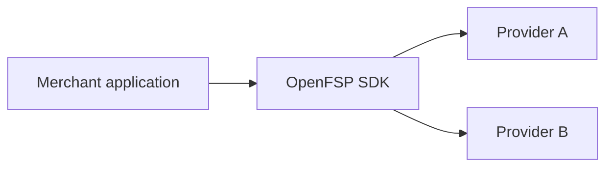

OpenFSP is an open standard for accepting payments in Haiti. A merchant application integrates it once and works with every payment provider that implements it. A provider implements it once and becomes reachable by every application built on it.

The standard is a small HTTP contract: create a payment, read it, synchronize it with the provider, discover what the provider supports, and receive signed events. Each merchant keeps its own agreement and credentials with each provider.

Without a shared contract, `L` applications each integrate `O` providers: `O × L` integrations. With OpenFSP, it is `O + L`.

OpenFSP covers how a merchant application talks to a provider. It does not move, clear or settle funds between providers.

## Start here

- **Merchant developer.** Use the [Kotlin and Java SDK](https://github.com/openfspht/openfsp/tree/main/sdks/kotlin) or the [TypeScript SDK](https://github.com/openfspht/openfsp/tree/main/sdks/typescript), or call the [API](/docs/spec/payments-api) over HTTP. The [quickstart](/docs/quickstart) runs a full payment on your machine.
- **Payment provider.** [Implement OpenFSP](/docs/native-operator) in your own system and test it with the [conformance suite](/docs/spec/conformance).
- **MonCash or NatCash today.** Neither speaks OpenFSP yet. The [gateway](/docs/gateway), which you host, translates the contract to their current APIs.
- **Reviewer.** Read the [specification](/docs/spec), the [decisions](/docs/decisions) behind it and the [project status](/docs/status).

## What exists

- The specification, version `0.1.0`, in English and French.
- SDKs for Kotlin, Java and TypeScript, each with a testing module.
- A simulator for MonCash, NatCash and a native OpenFSP provider, failures included.
- A conformance suite, a public validator and signed attestations of each run.
- The gateway for MonCash and NatCash.

Everything is under the Apache-2.0 license. The [project status](/docs/status) gives the detail.

## Phases

**Phase 1, in progress.** The merchant integration contract, its tools and reproducible conformance.

**Phase 2, considered.** In-person payments with a short-lived, single-use token shown by the customer. Not part of the current version.
