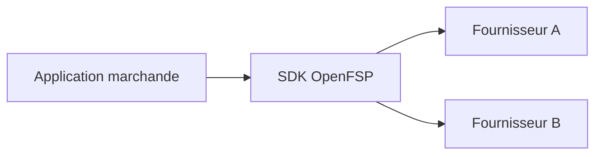

OpenFSP est une spécification ouverte d’interopérabilité entre les applications marchandes et les fournisseurs de services de paiement en Haïti. Elle définit une interface commune, les modèles de données échangés et les comportements attendus des implémentations. Une intégration écrite pour un fournisseur fonctionne avec les autres fournisseurs compatibles, pour les capacités qu’ils déclarent.

Le contrat d’interface repose sur HTTP et couvre la création et la lecture des paiements, la découverte des capacités et la réception d’événements signés.

Le périmètre d’OpenFSP porte sur l’intégration applicative entre un logiciel marchand et un service de paiement ([architecture](/docs/architecture#hors-périmètre), [décision 0001](/docs/decisions#0001)).

## Par où commencer

- **Développement d’une application marchande.** Utilisez le [SDK Kotlin et Java](https://github.com/openfspht/openfsp/tree/main/sdks/kotlin), le [SDK TypeScript](https://github.com/openfspht/openfsp/tree/main/sdks/typescript) ou directement [l’API HTTP](/docs/spec/payments-api). Le [guide de démarrage](/docs/quickstart) décrit un parcours de paiement simulé en environnement local.
- **Implémentation par un fournisseur.** Suivez le [guide d’implémentation native](/docs/implement), puis évaluez les exigences applicables avec la [suite de conformité](/docs/spec/conformance).
- **Intégration de MonCash ou NatCash.** Ces services n’implémentent pas encore OpenFSP. En attendant, une [passerelle de référence](/docs/gateway), déployée devant leurs API existantes, permet de les utiliser.
- **Revue technique.** Consultez la [spécification](/docs/spec), les [décisions de conception](/docs/decisions) et [l’état du projet](/docs/status).

## Ce qui existe

[L’état du projet](/docs/status) décrit les composants disponibles et ce qui a été vérifié. Les documents et les outils sont sous licence Apache-2.0.

## Phases

**Phase 1, en cours.** Le projet définit le contrat d’intégration marchande, développe les outils qui l’accompagnent et rend les vérifications de conformité reproductibles.

**Phase 2, envisagée.** Extension au paiement de proximité au moyen d’un jeton éphémère à usage unique présenté par le client. Ce parcours ne relève pas de la version actuelle.
