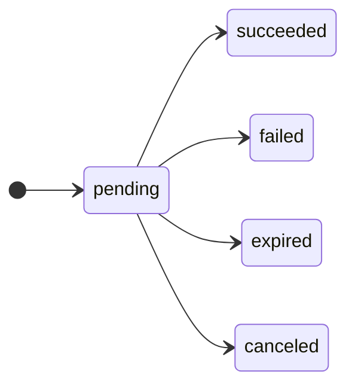

A payment remains pending until authoritative evidence establishes its terminal state. [Decision 0003](/en/docs/decisions#0003) explains this design principle.

## 1. States

| State       | Terminal | Meaning                                                   |
| ----------- | -------- | --------------------------------------------------------- |
| `pending`   | no       | Not yet known to be terminal.                             |
| `succeeded` | yes      | The provider confirmed the funds were captured.           |
| `failed`    | yes      | The provider reported that the payment will not complete. |
| `expired`   | yes      | The payment window closed without completion (5).         |
| `canceled`  | yes      | The payment was canceled before completion.               |

**1.1.** `pending` is the only non-terminal state. It covers payer inactivity, ongoing processing and outcomes that remain indeterminate.

**1.2.** When an unknown `status` value is received, the client MUST treat it as a processing error and MUST NOT infer a terminal or non-terminal state. New states are introduced only under section 8.

## 2. Transitions



**2.1.** Only the transitions in the following table are permitted:

| From      | To          | Cause                                   |
| --------- | ----------- | --------------------------------------- |
| `pending` | `succeeded` | Capture established (3.2).              |
| `pending` | `failed`    | Decline or error established (3.2).     |
| `pending` | `expired`   | Conditions of 5.3.                      |
| `pending` | `canceled`  | Cancellation established (3.2).         |

**2.2.** The server MUST reject all other transitions and MUST NOT record them.

## 3. Terminality

**3.1.** A terminal payment MUST NOT transition to any other state, even if contradictory information is received later.

**3.2.** The server MUST NOT record a terminal state by inference or solely from elapsed time. Recording occurs only when the outcome is established. The conditions in section 5 also apply to `expired`.

**3.3.** If the outcome cannot be established, the server MUST keep the payment in `pending`.

**3.4.** A payment MAY remain in `pending` indefinitely.

## 4. Fields

| Field            | Type        | Presence    | Notes                                  |
| ---------------- | ----------- | ----------- | -------------------------------------- |
| `status`         | string      | REQUIRED    | A value from 1.                        |
| `created_at`     | `Timestamp` | REQUIRED    | Creation by the server. Immutable.     |
| `updated_at`     | `Timestamp` | REQUIRED    | Last change of state or field.         |
| `expires_at`     | `Timestamp` | OPTIONAL    | Close of the payment window (5).       |
| `completed_at`   | `Timestamp` | conditional | REQUIRED once terminal, absent before. |
| `failure_reason` | string      | conditional | REQUIRED if `status` is `failed` (7).  |
| `failure_detail` | object      | OPTIONAL    | Raw provider error (7.4).              |

**4.1.** The `completed_at` field denotes the time at which the server recorded the terminal state.

**4.2.** The value of `updated_at` MUST change at each transition and MAY change without a transition. The client MUST NOT infer a transition from `updated_at` alone.

**4.3.** After a terminal transition, `status`, `completed_at` and `failure_reason` become immutable. Other fields MAY be completed later.

## 5. Expiration

**5.1.** The `expires_at` field identifies the time after which the payer can no longer complete the payment.

**5.2.** Passing `expires_at` is insufficient by itself to trigger a transition to `expired`.

**5.3.** The server MUST NOT record `expired` unless at least one of the following conditions is satisfied:

- **(a)** the server has established that the payment can no longer complete;
- **(b)** `expires_at` has passed and the provider guarantees that a payment incomplete at `expires_at` can never complete. This is the sole exception to 3.2.

**5.4.** If these conditions are not satisfied, the payment remains in `pending`.

## 6. Recording a state

**6.1.** The API MUST NOT provide any mechanism for setting a payment’s state.

## 7. Failures

**7.1.** A `200` response containing a `failed` payment indicates that the request succeeded ([API 10.2](/en/docs/spec/payments-api#10.2)). API errors are defined in the [error model](/en/docs/spec/payments-api#10) and are distinct from payment state.

**7.2.** When `status` is `failed`, `failure_reason` MUST contain one of the following values:

| Value                  | Meaning                                                                                                  |
| ---------------------- | -------------------------------------------------------------------------------------------------------- |
| `declined`             | Declined by the provider with no more precise reason.                                                    |
| `insufficient_funds`   | Payer balance insufficient.                                                                              |
| `payer_canceled`       | The payer abandoned or declined.                                                                         |
| `payer_unreachable`    | Payer account or number unreachable.                                                                     |
| `limit_exceeded`       | Provider or regulatory limit exceeded, not advertised ([capabilities 6.9](/en/docs/spec/capabilities#6.9)). |
| `rejected_by_provider` | Provider-specific refusal (risk, compliance).                                                            |
| `provider_error`       | Failure reported by the provider.                                                                        |
| `unspecified`          | Failure with no usable reason.                                                                           |

**7.3.** If no more specific reason is established, `unspecified` MUST be used. The server MUST NOT assign a more specific reason by assumption.

**7.4.** The `failure_detail` field MUST contain at least the provider’s error code and message, without alteration.

**7.5.** This enumeration is closed; extensions require a decision record. The client MUST interpret an unknown value as `unspecified`.

## 8. Extension by capability

**8.1.** A capability MAY define additional states.

**8.2.** The capability specification MUST define each additional state, its transitions to and from the base state machine, and whether it is terminal or non-terminal.

**8.3.** The server MUST NOT return a state associated with a capability it does not declare.

**8.4.** A capability MUST NOT alter the meaning of a base state, introduce a transition out of a terminal state or weaken section 3.

**8.5.** A refund is a separate resource. After a refund, the payment retains the `succeeded` state.

## 9. Security

**9.1.** Any client or server displaying `failure_detail` MUST treat its contents as untrusted.

**9.2.** The server SHOULD rate-limit payment creation to reduce account-enumeration risk through `payer_unreachable`.

**9.3.** Client documentation SHOULD recommend against displaying the raw `failure_reason` value directly to the payer.

## 10. Statements

### 10.1. Business day

**10.1.1.** The `Date` type is defined in [data model 1](/en/docs/spec/data-model#1).

**10.1.2.** An entry’s business day is the date assigned by the provider. If none is assigned, it is derived from `booked_at` in the IANA business-day time zone: `America/Port-au-Prince`, unless the operator configures another zone.

**10.1.3.** Because Haiti observes daylight saving time, the server MUST NOT determine the business day from a fixed time offset.

### 10.2. Entry

**10.2.1.** A statement is the list of successful transactions credited to the merchant account at a provider. Each transaction is an entry:

```json
{
  "provider": "natcash",
  "business_date": "2026-09-28",
  "booked_at": "2026-09-28T14:33:02Z",
  "amount": { "amount": 125000, "currency": "HTG" },
  "payment": "pay_01JAB7C2D9E4F6G8H1J3K5M7N9",
  "reference": "INV-184"
}
```

**10.2.2.** An entry has the following fields:

| Field           | Type         | Presence | Notes                                                          |
| --------------- | ------------ | -------- | -------------------------------------------------------------- |
| `provider`      | string       | REQUIRED | Registered identifier.                                         |
| `business_date` | `Date`       | REQUIRED | 10.1.                                                          |
| `booked_at`     | `Timestamp`  | REQUIRED | Booking time at the provider.                                  |
| `amount`        | `Money`      | REQUIRED | Gross amount received.                                         |
| `fee_amount`    | `Money`      | OPTIONAL | As reported. Absent means unknown.                             |
| `net_amount`    | `Money`      | OPTIONAL | As reported. Absent means unknown.                             |
| `payment`       | `ResourceId` | OPTIONAL | Payment that originated the transaction, when the server knows it. |
| `reference`     | string       | OPTIONAL | Merchant reference of that payment.                            |

**10.2.3.** A statement contains successful transactions only. A `pending`, `failed`, `expired` or `canceled` payment does not appear in it.

**10.2.4.** The server MUST NOT compute `fee_amount` or `net_amount`, including by subtraction.

### 10.3. Endpoint

**10.3.1.** A statement is read from the following endpoint, for one business day or for a range:

```
GET /v1/statements?provider=natcash&business_date=2026-09-28
GET /v1/statements?provider=natcash&from=2026-09-01&to=2026-09-30
```

**10.3.2.** The `provider` parameter is REQUIRED. The client supplies either `business_date`, or `from` and `to`, of type `Date`; both ends of the range are included. Without a period, the server responds `missing-field`. Any other combination, an invalid date or a range whose `to` precedes `from` results in `invalid-field`.

**10.3.3.** A range covers at most 31 business days. Beyond that, the server responds `invalid-field`.

**10.3.4.** The response is a collection ([API 1.12](/en/docs/spec/payments-api#1.12)) sorted by ascending `booked_at` and limited to `limit` items: from 1 to 100, 50 by default. When more items exist, `next_cursor` carries an opaque string to pass in the `cursor` parameter to continue. A period without transactions yields an empty collection.

**10.3.5.** The endpoint requires the `statements:read` scope ([authentication 6](/en/docs/spec/authentication#6)).

**10.3.6.** The endpoint is exposed for every provider. When `payments.statement` is not declared for the provider, the returned collection is empty.

### 10.4. Conformance

**10.4.1.** On a server declaring `payments.statement`, the suite checks that a successful payment appears in the statement of its business day, that an unsuccessful payment does not, that a range returns only the entries of its days and that a request without a period is refused.

### 10.5. Security

**10.5.1.** Statements reveal the merchant’s revenue. The `statements:read` scope SHOULD NOT be granted to a key used only for collection.
