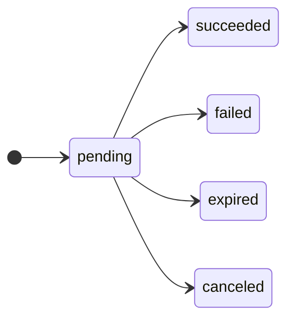

Je garde un paiement en attente tant qu’une source faisant autorité n’établit pas son état terminal. La [décision 0003](/fr/docs/decisions#0003) motive cette contrainte.

## 1. États

| État        | Terminal | Signification                                            |
| ----------- | -------- | -------------------------------------------------------- |
| `pending`   | non      | Non encore connu comme terminal.                         |
| `succeeded` | oui      | L'opérateur a confirmé la capture des fonds.             |
| `failed`    | oui      | L'opérateur a rapporté que le paiement n'aboutira pas.   |
| `expired`   | oui      | La fenêtre de paiement s'est fermée sans achèvement (5). |
| `canceled`  | oui      | Le paiement a été annulé avant son achèvement.           |

**1.1.** `pending` est le seul état non terminal. Il couvre indistinctement payeur inactif,
traitement en cours et issue pas encore établie.

**1.2.** Un client qui reçoit une valeur de `status` inconnue DOIT la traiter comme une erreur
de traitement et NE DOIT PAS en déduire un état, terminal ou non. Un nouvel état n'est
introduit qu'au titre du 8.

## 2. Transitions



**2.1.** Seules ces transitions sont permises :

| De        | Vers        | Cause                                   |
| --------- | ----------- | --------------------------------------- |
| `pending` | `succeeded` | Capture établie (3.2).                  |
| `pending` | `failed`    | Refus ou erreur établi (3.2).           |
| `pending` | `expired`   | Conditions du 5.3.                      |
| `pending` | `canceled`  | Annulation établie (3.2).               |

**2.2.** Le serveur DOIT rejeter et NE DOIT PAS enregistrer toute autre transition.

## 3. Terminalité

**3.1.** Un paiement terminal NE DOIT transiter vers aucun autre état, y compris sur une
information ultérieure contradictoire.

**3.2.** Le serveur NE DOIT PAS entrer dans un état terminal par déduction ou par le seul
écoulement du temps : il n'enregistre un état terminal qu'une fois l'issue établie.
Pour `expired`, le 5 s'applique en plus.

**3.3.** Un serveur qui ne peut pas établir l'issue d'un paiement DOIT le laisser
`pending`.

**3.4.** Un paiement PEUT rester `pending` indéfiniment.

## 4. Champs

| Champ            | Type        | Présence     | Notes                                        |
| ---------------- | ----------- | ------------ | -------------------------------------------- |
| `status`         | chaîne      | OBLIGATOIRE  | Une valeur du 1.                             |
| `created_at`     | `Timestamp` | OBLIGATOIRE  | Création par le serveur. Immuable.           |
| `updated_at`     | `Timestamp` | OBLIGATOIRE  | Dernier changement d'état ou de champ.       |
| `expires_at`     | `Timestamp` | FACULTATIF   | Fermeture de la fenêtre de paiement (5).     |
| `completed_at`   | `Timestamp` | conditionnel | OBLIGATOIRE une fois terminal, absent avant. |
| `failure_reason` | chaîne      | conditionnel | OBLIGATOIRE si `status` vaut `failed` (7).   |
| `failure_detail` | objet       | FACULTATIF   | Erreur brute de l'opérateur (7.4).           |

**4.1.** `completed_at` est l'instant où le serveur a enregistré l'état terminal.

**4.2.** `updated_at` DOIT changer à chaque transition et PEUT changer sans transition. Un
client NE DOIT PAS déduire une transition de `updated_at` seul.

**4.3.** Une fois l'état terminal atteint, `status`, `completed_at` et `failure_reason` sont
immuables. Les autres champs PEUVENT encore être complétés.

## 5. Expiration

**5.1.** `expires_at` est l'instant après lequel le payeur ne peut plus achever le paiement.

**5.2.** L'écoulement de `expires_at` ne fait pas, à lui seul, passer le paiement à `expired`.

**5.3.** Le serveur NE DOIT PAS enregistrer `expired` sans l'une de ces conditions :

- **(a)** il a établi que le paiement ne peut plus s'achever ;
- **(b)** `expires_at` est écoulé et l'opérateur garantit qu'un paiement non achevé à
  `expires_at` ne s'achèvera jamais (seule exception au 3.2).

**5.4.** Si aucune de ces conditions n'est remplie, le paiement reste `pending`.

## 6. Enregistrement d'un état

**6.1.** L'API NE DOIT offrir aucun moyen de fixer l'état d'un paiement.

## 7. Échecs

**7.1.** Une réponse `200` portant un paiement `failed` rapporte une requête réussie
([API 10.2](/fr/docs/spec/payments-api#10.2)). Les erreurs
d'API relèvent des [erreurs](/fr/docs/spec/payments-api#10), pas du cycle de vie.

**7.2.** Si `status` vaut `failed`, `failure_reason` DOIT prendre l'une de ces valeurs :

| Valeur                 | Signification                                                                                                   |
| ---------------------- | --------------------------------------------------------------------------------------------------------------- |
| `declined`             | Refus de l'opérateur sans motif plus précis.                                                                    |
| `insufficient_funds`   | Solde du payeur insuffisant.                                                                                    |
| `payer_canceled`       | Le payeur a abandonné ou refusé.                                                                                |
| `payer_unreachable`    | Compte ou numéro du payeur injoignable.                                                                         |
| `limit_exceeded`       | Plafond de l'opérateur ou réglementaire dépassé, non annoncé ([capacités 6.9](/fr/docs/spec/capabilities#6.9)). |
| `rejected_by_provider` | Refus propre à l'opérateur (risque, conformité).                                                                |
| `provider_error`       | Défaillance rapportée par l'opérateur.                                                                          |
| `unspecified`          | Échec sans motif exploitable.                                                                                   |

**7.3.** `unspecified` DOIT être utilisé lorsqu'aucun motif plus précis n'est établi. Le
serveur NE DOIT PAS deviner un motif plus précis.

**7.4.** `failure_detail` DOIT porter au minimum le code et le message d'erreur de
l'opérateur, inaltérés.

**7.5.** L'énumération est fermée ; l'étendre exige une décision écrite. Un client DOIT traiter une
valeur inconnue comme `unspecified`.

## 8. Extension par capacité

**8.1.** Une capacité PEUT introduire des états supplémentaires.

**8.2.** Un tel état DOIT être défini par la spécification de la capacité, avec ses
transitions vers et depuis la machine de base et son caractère terminal ou non.

**8.3.** Le serveur NE DOIT PAS rapporter un état propre à une capacité qu'il n'annonce
pas.

**8.4.** Une capacité NE DOIT PAS modifier le sens d'un état de base, ajouter une transition
sortant d'un état terminal, ni affaiblir le 3.

**8.5.** Un remboursement est une ressource distincte. Un paiement remboursé reste
`succeeded`.

## 9. Sécurité

**9.1.** Un client ou un serveur qui affiche `failure_detail` DOIT en traiter le contenu
comme non fiable.

**9.2.** Le serveur DEVRAIT limiter le débit de création de paiements pour contrer
l'énumération de comptes par `payer_unreachable`.

**9.3.** La documentation client DEVRAIT recommander de ne pas afficher `failure_reason` tel
quel au payeur.

## 10. Relevés et rapprochement

### 10.1. Journée comptable

**10.1.1.** Type `Date` : [modèle de données 1](/fr/docs/spec/data-model#1).

**10.1.2.** La journée comptable d'une ligne est la date que lui attribue l'opérateur. S'il n'en
attribue pas, c'est la date de `booked_at` dans le fuseau IANA de la journée comptable,
`America/Port-au-Prince` sauf si l'exploitant en configure un autre.

**10.1.3.** Haïti applique l'heure d'été : le serveur NE DOIT PAS dériver une journée
comptable d'un décalage horaire fixe.

### 10.2. Relevé

**10.2.1.** Un relevé regroupe les mouvements du compte marchand chez un opérateur pour une
journée comptable.

```json
{
  "id": "stm_01J9ZQ0R8V2K4M6N8P0Q2R4S6T",
  "provider": "natcash",
  "business_date": "2026-09-28",
  "complete": true,
  "entries": [
    {
      "type": "payment",
      "amount": { "amount": 125000, "currency": "HTG" },
      "booked_at": "2026-09-28T14:33:02Z",
      "payment": "pay_01JAB7C2D9E4F6G8H1J3K5M7N9",
      "match": "matched"
    }
  ],
  "missing_payments": []
}
```

**10.2.2.** Champs du relevé :

| Champ              | Type                    | Présence    | Notes                                          |
| ------------------ | ----------------------- | ----------- | ---------------------------------------------- |
| `id`               | `ResourceId`            | OBLIGATOIRE |                                                |
| `provider`         | chaîne                  | OBLIGATOIRE | Identifiant enregistré.                        |
| `business_date`    | `Date`                  | OBLIGATOIRE | 10.1.                                          |
| `complete`         | booléen                 | OBLIGATOIRE | 10.2.4.                                        |
| `entries`          | tableau                 | OBLIGATOIRE | 10.3.                                          |
| `missing_payments` | tableau de `ResourceId` | OBLIGATOIRE | 10.4.4. Vide tant que `complete` vaut `false`. |

**10.2.3.** Un compte marchand a au plus un relevé par (opérateur, journée comptable).

**10.2.4.** `complete` vaut `true` quand l'opérateur a clos la journée. Un relevé non clos PEUT recevoir de
nouvelles lignes ; un relevé clos NE DOIT PLUS en recevoir.

### 10.3. Ligne

**10.3.1.** Champs :

| Champ                | Type                | Présence     | Notes                                                         |
| -------------------- | ------------------- | ------------ | ------------------------------------------------------------- |
| `type`               | chaîne              | OBLIGATOIRE  | 10.3.2.                                                       |
| `amount`             | `Money`             | OBLIGATOIRE  | Brut, signé : positif au crédit du marchand.                  |
| `fee_amount`         | `Money`             | FACULTATIF   | Tel que rapporté. Absent signifie inconnu.                    |
| `net_amount`         | `Money`             | FACULTATIF   | Tel que rapporté. Absent signifie inconnu.                    |
| `booked_at`          | `Timestamp`         | OBLIGATOIRE  | Heure de comptabilisation chez l'opérateur.                   |
| `payment`            | `ResourceId`        | conditionnel | Présent si `match` vaut `matched` ou `conflict`.              |
| `match`              | chaîne              | OBLIGATOIRE  | 10.4.                                                         |

**10.3.2.** `type` prend l'une des valeurs `payment`, `reversal`, `fee`, `adjustment`.
L'énumération est fermée ; l'étendre exige une décision écrite. Un client DOIT traiter une valeur
inconnue comme `adjustment`.

**10.3.3.** Par exception au [modèle de données 3.6](/fr/docs/spec/data-model#3.6), `amount`, `fee_amount` et
`net_amount` d'une ligne PEUVENT être négatifs ou nuls.

**10.3.4.** Le serveur NE DOIT PAS calculer `fee_amount` ni `net_amount`, ni les compléter par
soustraction.

### 10.4. Rapprochement

**10.4.1.** Une ligne relative à un paiement le désigne par `payment`, son `id`. Le serveur NE DOIT
PAS rapprocher une ligne d'un paiement par montant ou par heure.

**10.4.2.** `match` prend l'une des valeurs :

| Valeur      | Sens                                                                     |
| ----------- | ------------------------------------------------------------------------ |
| `matched`   | Un paiement correspond ; montant et état concordent.                     |
| `unmatched` | Aucun paiement ne correspond.                                            |
| `conflict`  | Un paiement correspond, mais son montant ou son état contredit la ligne. |

**10.4.3.** Une ligne `unmatched` NE DOIT PAS créer de paiement. Le serveur DOIT la signaler à
l'exploitant.

**10.4.4.** Un relevé clos DOIT lister dans `missing_payments` les paiements `succeeded` chez cet
opérateur dont `completed_at` tombe dans la journée comptable et qu'aucune ligne ne rapproche.

**10.4.5.** Une ligne `conflict` NE DOIT PAS modifier le paiement.

### 10.5. Points d'accès

**10.5.1.** Lire un relevé :

```
GET /v1/statements?provider=natcash&business_date=2026-09-28
```

`provider` et `business_date` sont OBLIGATOIRES. La réponse est une collection d'au plus un
relevé ; un relevé qui n'existe pas encore donne `200` avec `data` vide
([API 5.2.2](/fr/docs/spec/payments-api#5.2.2)).

**10.5.2.** Lister les lignes non rapprochées :

```
GET /v1/statement_entries?match=unmatched&provider=natcash
```

Le paramètre `match` accepte les valeurs `unmatched` et `conflict`. La réponse est une collection
([API 1.12](/fr/docs/spec/payments-api#1.12)) triée par
`booked_at` croissant, d'au plus `limit` éléments (1 à 100, 50 par défaut). Si d'autres éléments
existent, la réponse porte `next_cursor`, chaîne opaque à renvoyer dans le paramètre `cursor`.

**10.5.3.** Les deux points d'accès exigent la portée `statements:read`
([authentification 6](/fr/docs/spec/authentication#6)).

**10.5.4.** Ils sont servis pour tout opérateur. Pour un opérateur qui n'annonce pas
`payments.statement`, la collection est vide.

### 10.6. Conformité

**10.6.1.** La suite teste, sur un serveur qui publie un relevé : une ligne rapprochée,
une ligne `unmatched` (aucun paiement créé), un paiement `succeeded` absent d'un relevé clos, et
une journée comptable à cheval sur le changement d'heure.

### 10.7. Sécurité

**10.7.1.** Un relevé révèle le chiffre d'affaires du marchand. `statements:read` NE DEVRAIT PAS
être accordée à une clé qui ne sert qu'à encaisser.
