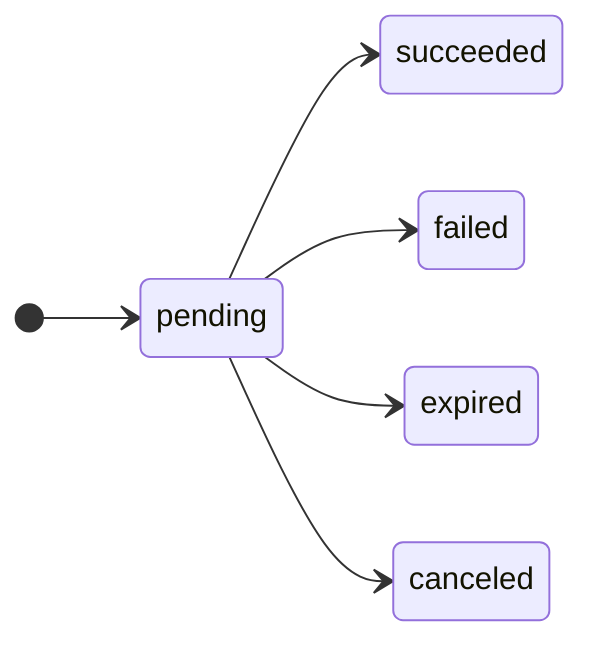

I keep a payment pending until authoritative evidence establishes a terminal state. [Decision 0003](/docs/decisions#0003) explains this constraint.

## 1. States

| State       | Terminal | Meaning                                                   |
| ----------- | -------- | --------------------------------------------------------- |
| `pending`   | no       | Not yet known to be terminal.                             |
| `succeeded` | yes      | The provider confirmed the funds were captured.           |
| `failed`    | yes      | The provider reported that the payment will not complete. |
| `expired`   | yes      | The payment window closed without completion (5).         |
| `canceled`  | yes      | Cancellation reported by an authoritative source.         |

**1.1.** `pending` is the only non-terminal state. It covers, without distinction, an inactive payer, settlement in progress at the provider and no response.

**1.2.** A client that receives an unknown `status` value MUST treat it as a processing error and MUST NOT infer a state from it, terminal or not. A new state is introduced only under 8.

## 2. Transitions



**2.1.** Only these transitions are allowed:

| From      | To          | Cause                                                 |
| --------- | ----------- | ----------------------------------------------------- |
| `pending` | `succeeded` | Capture confirmed by an authoritative source (6.5).   |
| `pending` | `failed`    | Decline or error reported by an authoritative source. |
| `pending` | `expired`   | Conditions of 5.3.                                    |
| `pending` | `canceled`  | Cancellation reported by an authoritative source.     |

**2.2.** The gateway MUST reject and MUST NOT record any other transition. A provider status implying a forbidden transition is a conflict (6.4).

## 3. Terminality

**3.1.** A terminal payment MUST NOT move to any other state, including on a later contradictory report from the provider.

**3.2.** The gateway MUST NOT enter a terminal state by inference or by the passage of time. Only a source from 6.5 grounds a terminal transition; for `expired`, 5 applies as well.

**3.3.** A gateway that cannot establish the state with the provider MUST leave the payment `pending`.

**3.4.** A payment MAY stay `pending` indefinitely.

## 4. Fields

| Field            | Type        | Presence    | Notes                                  |
| ---------------- | ----------- | ----------- | -------------------------------------- |
| `status`         | string      | REQUIRED    | A value from 1.                        |
| `created_at`     | `Timestamp` | REQUIRED    | Creation by the gateway. Immutable.    |
| `updated_at`     | `Timestamp` | REQUIRED    | Last change of state or field.         |
| `expires_at`     | `Timestamp` | OPTIONAL    | Close of the payment window (5).       |
| `completed_at`   | `Timestamp` | conditional | REQUIRED once terminal, absent before. |
| `failure_reason` | string      | conditional | REQUIRED if `status` is `failed` (7).  |
| `failure_detail` | object      | OPTIONAL    | Raw provider error (7.4).              |

**4.1.** `completed_at` is the instant the gateway recorded the terminal state. A timestamp supplied by the provider MUST NOT replace `completed_at`; on a failure, it MAY appear in `failure_detail`.

**4.2.** `updated_at` MUST change on every transition and MAY change without a transition. A client MUST NOT infer a transition from `updated_at` alone.

**4.3.** Once the terminal state is reached, `status`, `completed_at` and `failure_reason` are immutable. Other fields MAY still be filled in.

## 5. Expiration

**5.1.** `expires_at` is the instant after which the payer can no longer complete the payment.

**5.2.** `expires_at` passing does not, on its own, move the payment to `expired`.

**5.3.** The gateway MUST NOT record `expired` without one of these conditions:

- **(a)** the provider reported the payment as expired or permanently incomplete, through a source from 6.5 (a) to (c);
- **(b)** `expires_at` has passed and a later lookup at the provider shows the payment is not complete;
- **(c)** the provider contractually guarantees that a payment not complete at `expires_at` will never complete, and the gateway documents this behaviour (the only exception to 3.2);
- **(d)** `expires_at` has passed and a statement (6.7) covering a period that ends after `expires_at` does not list the payment as complete;
- **(e)** the operator attests it (6.8).

**5.4.** If none of these conditions holds, the payment stays `pending`.

## 6. Reconciliation

**6.1.** The gateway MUST have, for every non-terminal payment, at least one source from 6.5, and MUST advertise through [capability discovery](/docs/spec/capabilities) the sources it has for each provider.

**6.2.** The gateway SHOULD periodically re-read non-terminal payments without being prompted.

**6.3.** A provider callback grounds a transition only if it falls under 6.5 (a) or (c). A signature, if present, MUST be verified. In other cases, the gateway MUST NOT transition on the callback's content; it MAY treat it as a signal to query another source.

**6.3.1.** A signed callback falls under 6.5 (a) only if the signature covers at least the payment identifier and its outcome. Otherwise it is a signal: the gateway SHOULD query another source immediately.

**6.3.2.** If an authoritative source reports an amount different from the payment's, the gateway MUST NOT record `succeeded`. It MUST record and report the discrepancy as a conflict under 6.4, and the payment stays `pending`.

**6.4. Conflicts.** If the provider reports a state contradicting a recorded terminal state, or an amount different from the payment's (6.3.2), the gateway MUST NOT modify the payment. It MUST record the conflict durably and report it to the operator, and MUST NOT resolve it automatically.

**6.5. Authoritative sources.** The gateway SHOULD use the first available one in this order:

| Source                                                                  | Advertised capability      |
| ----------------------------------------------------------------------- | -------------------------- |
| **(a)** callback whose provider signature is verified                   | `webhooks.verify`          |
| **(b)** state lookup at the provider                                    | `payments.lookup`          |
| **(c)** callback received on a payment-specific URL (6.6)               | `webhooks.per_payment_url` |
| **(d)** provider statement obtained over an authenticated channel (6.7) | `payments.statement`       |
| **(e)** operator attestation (6.8)                                      | none, always available     |

A gateway that has only source (e) for a provider MAY advertise `payments` for that provider.

**6.6. Payment-specific URL.** For source (c), the gateway MUST generate for each payment a token of at least 128 bits from a cryptographic generator, MUST include it in the path of the callback URL sent at creation, and MUST compare it in constant time on receipt. A callback whose token matches no non-terminal payment MUST be rejected without effect. The token MUST NOT be logged. A URL shared by several payments MUST NOT be treated as source (c).

**6.7. Statement.** For source (d), a payment listed as complete is `succeeded`; listed as declined or canceled, it takes the corresponding terminal state. The absence of a payment grounds `expired` only under 5.3 (d). Format and reconciliation: 10.

**6.8. Attestation.** For source (e), the gateway MUST durably record the identity of the person, the timestamp, the attested state and the reference of the evidence. This mechanism MUST belong to the gateway's administration and MUST NOT be exposed by the [API](/docs/spec/payments-api). A single administration token, shared by operators, MAY protect it; the recorded identity is then the attester's name supplied in the request. An attestation is subject to 3.1; a later contradictory report falls under 6.4.

## 7. Failures

**7.1.** A `200` response carrying a `failed` payment reports a successful request ([API 10.2](/docs/spec/payments-api#10.2)). API errors belong to [errors](/docs/spec/payments-api#10), not to the lifecycle.

**7.2.** If `status` is `failed`, `failure_reason` MUST take one of these values:

| Value                  | Meaning                                                                                                  |
| ---------------------- | -------------------------------------------------------------------------------------------------------- |
| `declined`             | Declined by the provider with no more precise reason.                                                    |
| `insufficient_funds`   | Payer balance insufficient.                                                                              |
| `payer_canceled`       | The payer abandoned or declined.                                                                         |
| `payer_unreachable`    | Payer account or number unreachable.                                                                     |
| `limit_exceeded`       | Provider or regulatory limit exceeded, not advertised ([capabilities 6.9](/docs/spec/capabilities#6.9)). |
| `rejected_by_provider` | Provider-specific refusal (risk, compliance).                                                            |
| `provider_error`       | Failure reported by the provider.                                                                        |
| `unspecified`          | Failure with no usable reason.                                                                           |

**7.3.** `unspecified` MUST be used when the provider gives no reason or the mapping is not certain. The gateway MUST NOT guess a more precise reason.

**7.4.** `failure_detail` MUST carry at least the provider's error code and message, unaltered.

**7.5.** The enumeration is closed; extending it requires a decision record. A client MUST treat an unknown value as `unspecified`.

## 8. Extension by capability

**8.1.** A capability MAY introduce additional states.

**8.2.** Such a state MUST be defined by the capability's specification, with its transitions to and from the base machine and whether it is terminal.

**8.3.** The gateway MUST NOT report a capability-specific state for a capability it does not advertise.

**8.4.** A capability MUST NOT change the meaning of a base state, add a transition out of a terminal state, or weaken 3.

**8.5.** A refund is a separate resource. A refunded payment stays `succeeded`.

## 9. Security

**9.1.** A client or gateway that displays `failure_detail` MUST treat its content as untrusted.

**9.2.** The gateway SHOULD rate-limit payment creation to counter account enumeration through `payer_unreachable`.

**9.3.** Client documentation SHOULD recommend not showing `failure_reason` to the payer as is.

**9.4.** A deployment SHOULD require a second approval for an attestation (6.8) above an amount it sets.

**9.5.** The hardening guide SHOULD require excluding the path carrying the 6.6 token from the reverse proxy access logs.

## 10. Statements and reconciliation

### 10.1. Business day

**10.1.1.** `Date` type: [data model 1](/docs/spec/data-model#1).

**10.1.2.** The business day of an entry is the date the provider assigns to it. If the provider assigns none, it is the date of `booked_at` in the IANA time zone of the gateway's business day, `America/Port-au-Prince` by default ([data model 7.5](/docs/spec/data-model#7.5)).

**10.1.3.** Haiti observes daylight saving time: the gateway MUST NOT derive a business day from a fixed UTC offset.

### 10.2. Statement

**10.2.1.** A statement groups the movements on the merchant account at a provider for one business day.

```json
{
  "id": "stm_01J9ZQ0R8V2K4M6N8P0Q2R4S6T",
  "provider": "natcash",
  "business_date": "2026-09-28",
  "complete": true,
  "entries": [
    {
      "provider_reference": "1744538637721000911000007",
      "type": "payment",
      "amount": { "amount": 125000, "currency": "HTG" },
      "booked_at": "2026-09-28T14:33:02Z",
      "payment": "pay_01JAB7C2D9E4F6G8H1J3K5M7N9",
      "match": "matched"
    }
  ],
  "missing_payments": []
}
```

**10.2.2.** Statement fields:

| Field              | Type                  | Presence | Notes                                      |
| ------------------ | --------------------- | -------- | ------------------------------------------ |
| `id`               | `ResourceId`          | REQUIRED |                                            |
| `provider`         | string                | REQUIRED | Registered identifier.                     |
| `business_date`    | `Date`                | REQUIRED | 10.1.                                      |
| `complete`         | boolean               | REQUIRED | 10.2.4.                                    |
| `entries`          | array                 | REQUIRED | 10.3.                                      |
| `missing_payments` | array of `ResourceId` | REQUIRED | 10.4.4. Empty while `complete` is `false`. |

**10.2.3.** There is at most one statement per (provider, business day).

**10.2.4.** `complete` is `true` when the provider has closed the day. An open statement MAY receive new entries; a closed statement MUST NOT receive any from the `provider` source.

### 10.3. Entry

**10.3.1.** Fields:

| Field                | Type                | Presence    | Notes                                                  |
| -------------------- | ------------------- | ----------- | ------------------------------------------------------ |
| `provider_reference` | `ProviderReference` | REQUIRED    |                                                        |
| `type`               | string              | REQUIRED    | 10.3.2.                                                |
| `amount`             | `Money`             | REQUIRED    | Gross, signed: positive when credited to the merchant. |
| `fee_amount`         | `Money`             | OPTIONAL    | As reported. Absent means unknown.                     |
| `net_amount`         | `Money`             | OPTIONAL    | As reported. Absent means unknown.                     |
| `booked_at`          | `Timestamp`         | REQUIRED    | Booking time at the provider.                          |
| `provider_order_id`  | string              | OPTIONAL    | Order identifier, if the provider reports it (10.4.1). |
| `payment`            | `ResourceId`        | conditional | Present if `match` is `matched` or `conflict`.         |
| `match`              | string              | REQUIRED    | 10.4.                                                  |

**10.3.2.** `type` takes one of the values `payment`, `reversal`, `fee`, `adjustment`. The enumeration is closed; extending it requires a decision record. A client MUST treat an unknown value as `adjustment`.

**10.3.3.** As an exception to [data model 3.6](/docs/spec/data-model#3.6), an entry's `amount`, `fee_amount` and `net_amount` MAY be negative or zero.

**10.3.4.** The gateway MUST NOT compute `fee_amount` or `net_amount`, nor fill them in by subtraction.

### 10.4. Reconciliation

**10.4.1.** The gateway matches an entry to a payment by `provider_reference`, then by order identifier (`provider_order_id`). It MUST NOT match by amount or by time.

**10.4.2.** `match` takes one of the values:

| Value       | Meaning                                                           |
| ----------- | ----------------------------------------------------------------- |
| `matched`   | A payment matches; amount and state agree.                        |
| `unmatched` | No payment matches.                                               |
| `conflict`  | A payment matches, but its amount or state contradicts the entry. |

**10.4.3.** An `unmatched` entry MUST NOT create a payment. The gateway MUST report it to the operator.

**10.4.4.** A closed statement MUST list in `missing_payments` the `succeeded` payments at that provider whose `completed_at` falls within the business day and that no entry matches.

**10.4.5.** A `conflict` on a terminal payment falls under 6.4. On a `pending` payment, 6.7 applies to an entry from the `provider` source.

### 10.5. Reserved

**10.5.1.** Reserved.

**10.5.2.** Reserved.

**10.5.3.** Reserved.

### 10.6. Endpoints

**10.6.1.** Read a statement:

```
GET /v1/statements?provider=natcash&business_date=2026-09-28
```

`provider` and `business_date` are REQUIRED. The response is a collection of at most one statement; a statement that does not exist yet gives `200` with empty `data` ([API 5.2.2](/docs/spec/payments-api#5.2.2)).

**10.6.2.** List unmatched entries:

```
GET /v1/statement_entries?match=unmatched&provider=natcash
```

The `match` parameter accepts the values `unmatched` and `conflict`. The response is a collection ([API 1.12](/docs/spec/payments-api#1.12)) sorted by ascending `booked_at`, of at most `limit` items (1 to 100, default 50). If more items exist, the response carries `next_cursor`, an opaque string to send back in the `cursor` parameter.

**10.6.3.** Both endpoints require the `statements:read` scope ([authentication 6](/docs/spec/authentication#6)).

**10.6.4.** They are served for every provider. Entries come only from the provider, if it advertises `payments.statement`; for any other provider, the collection is empty. The gateway statement (10.9) is served for all.

### 10.7. Conformance

**10.7.1.** The suite tests, with `mock_openfsp` publishing a statement: a matched entry, an `unmatched` entry (no payment created), a `succeeded` payment missing from a closed statement, and a business day spanning the clock change.

### 10.8. Security

**10.8.1.** A statement reveals the merchant's revenue. `statements:read` SHOULD NOT be granted to a key used only to collect payments.

### 10.9. Gateway statement

The gateway does not import provider portal exports. It builds its own statement from the payments it relayed, which serves the merchant's accounting at every provider; only the provider statement (10.2) reveals what the gateway did not see.

**10.9.1.** The gateway MUST build, for every provider and every business day, its statement: the payments of that provider that entered a terminal state during the day, by the date of `completed_at` in the time zone of 10.1.2.

**10.9.2.** The gateway statement comes only from the gateway's own records. It MUST NOT ground a transition nor serve as a statement under 5.3 (d), 6.7 or 10.4.

**10.9.3.** Read the gateway statement:

```
GET /v1/gateway_statements?provider=natcash&business_date=2026-09-28
```

`provider` and `business_date` are REQUIRED. The response is a collection of one statement, even for a day with no payment.

```json
{
  "data": [
    {
      "provider": "natcash",
      "business_date": "2026-09-28",
      "final": true,
      "payments": [
        {
          "payment": "pay_01JAB7C2D9E4F6G8H1J3K5M7N9",
          "reference": "INV-2026-00184",
          "status": "succeeded",
          "amount": { "amount": 125000, "currency": "HTG" },
          "completed_at": "2026-09-28T14:33:02.118Z"
        }
      ],
      "totals": {
        "succeeded": { "count": 1, "amount": { "amount": 125000, "currency": "HTG" } }
      }
    }
  ]
}
```

**10.9.4.** `payments` is sorted by ascending `completed_at`. `totals` carries, for each terminal state present, the number of payments and the sum of their `amount`.

**10.9.5.** `final` is `true` once the business day has ended. A statement whose `final` is `false` MAY still change.

**10.9.6.** The endpoint requires the `statements:read` scope and is served for every provider, whether or not it advertises `payments.statement`.
