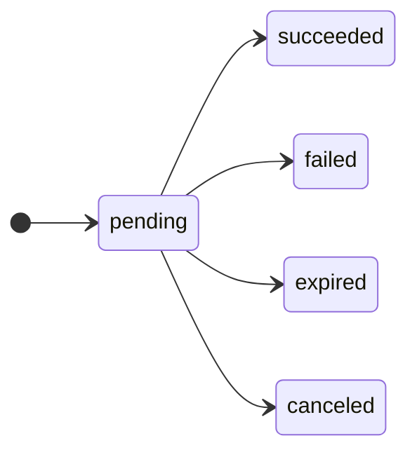

Un paiement reste en attente tant que les éléments faisant autorité ne permettent pas d’établir son état terminal. La [décision 0003](/docs/decisions#0003) explique ce principe de conception.

## 1. États

| État        | Terminal | Signification                                            |
| ----------- | -------- | -------------------------------------------------------- |
| `pending`   | non      | Non encore connu comme terminal.                         |
| `succeeded` | oui      | L'opérateur a confirmé la capture des fonds.             |
| `failed`    | oui      | L'opérateur a rapporté que le paiement n'aboutira pas.   |
| `expired`   | oui      | La fenêtre de paiement s'est fermée sans achèvement (5). |
| `canceled`  | oui      | Le paiement a été annulé avant son achèvement.           |

**1.1.** `pending` constitue l’unique état non terminal. Il couvre l’absence d’action du payeur, le traitement en cours et les résultats encore indéterminés.

**1.2.** Lorsqu’une valeur inconnue de `status` est reçue, le client DOIT la traiter comme une erreur de traitement et NE DOIT PAS en déduire un état terminal ou non terminal. L’introduction d’un état relève exclusivement du 8.

## 2. Transitions



**2.1.** Les transitions autorisées sont exclusivement celles du tableau suivant :

| De        | Vers        | Cause                                   |
| --------- | ----------- | --------------------------------------- |
| `pending` | `succeeded` | Capture établie (3.2).                  |
| `pending` | `failed`    | Refus ou erreur établi (3.2).           |
| `pending` | `expired`   | Conditions du 5.3.                      |
| `pending` | `canceled`  | Annulation établie (3.2).               |

**2.2.** Le serveur DOIT rejeter toute autre transition et NE DOIT PAS l’enregistrer.

## 3. Terminalité

**3.1.** Un paiement terminal NE DOIT évoluer vers aucun autre état, même si une information contradictoire est reçue ultérieurement.

**3.2.** Le serveur NE DOIT PAS enregistrer un état terminal sur la base d’une déduction ou du seul écoulement du temps. L’enregistrement intervient uniquement lorsque le résultat est établi. Pour l’état `expired`, les conditions du 5 s’appliquent également.

**3.3.** Si le résultat ne peut pas être établi, le serveur DOIT maintenir le paiement dans l’état `pending`.

**3.4.** La durée de maintien d’un paiement dans l’état `pending` PEUT être indéfinie.

## 4. Champs

| Champ            | Type        | Présence     | Notes                                        |
| ---------------- | ----------- | ------------ | -------------------------------------------- |
| `status`         | chaîne      | OBLIGATOIRE  | Une valeur du 1.                             |
| `created_at`     | `Timestamp` | OBLIGATOIRE  | Création par le serveur. Immuable.           |
| `updated_at`     | `Timestamp` | OBLIGATOIRE  | Dernier changement d'état ou de champ.       |
| `expires_at`     | `Timestamp` | FACULTATIF   | Fermeture de la fenêtre de paiement (5).     |
| `completed_at`   | `Timestamp` | conditionnel | OBLIGATOIRE une fois terminal, absent avant. |
| `failure_reason` | chaîne      | conditionnel | OBLIGATOIRE si `status` vaut `failed` (7).   |
| `failure_detail` | objet       | FACULTATIF   | Erreur brute de l'opérateur (7.4).           |

**4.1.** Le champ `completed_at` désigne l’instant d’enregistrement de l’état terminal par le serveur.

**4.2.** La valeur de `updated_at` DOIT être modifiée à chaque transition et PEUT être modifiée en l’absence de transition. Le client NE DOIT PAS déduire une transition de la seule valeur de `updated_at`.

**4.3.** Après une transition terminale, `status`, `completed_at` et `failure_reason` deviennent immuables. Les autres champs PEUVENT être complétés ultérieurement.

## 5. Expiration

**5.1.** Le champ `expires_at` indique l’instant après lequel le payeur ne peut plus achever le paiement.

**5.2.** Le dépassement de `expires_at` ne suffit pas à provoquer une transition vers `expired`.

**5.3.** Le serveur NE DOIT PAS enregistrer `expired` sans qu’au moins une des conditions suivantes soit satisfaite :

- **(a)** le serveur a établi que le paiement ne peut plus être achevé ;
- **(b)** `expires_at` est dépassé et l’opérateur garantit qu’un paiement non achevé à `expires_at` ne pourra jamais l’être. Ce cas constitue l’unique exception au 3.2.

**5.4.** Lorsque ces conditions ne sont pas satisfaites, le paiement reste dans l’état `pending`.

## 6. Enregistrement d'un état

**6.1.** L’API NE DOIT proposer aucun mécanisme permettant de fixer l’état d’un paiement.

## 7. Échecs

**7.1.** Une réponse `200` contenant un paiement `failed` indique que la requête a réussi ([API 10.2](/docs/spec/payments-api#10.2)). Les erreurs d’API sont définies dans le [modèle d’erreur](/docs/spec/payments-api#10) et se distinguent de l’état du paiement.

**7.2.** Lorsque `status` vaut `failed`, le champ `failure_reason` DOIT contenir l’une des valeurs suivantes :

| Valeur                 | Signification                                                                                                   |
| ---------------------- | --------------------------------------------------------------------------------------------------------------- |
| `declined`             | Refus de l'opérateur sans motif plus précis.                                                                    |
| `insufficient_funds`   | Solde du payeur insuffisant.                                                                                    |
| `payer_canceled`       | Le payeur a abandonné ou refusé.                                                                                |
| `payer_unreachable`    | Compte ou numéro du payeur injoignable.                                                                         |
| `limit_exceeded`       | Plafond de l'opérateur ou réglementaire dépassé, non annoncé ([capacités 6.9](/docs/spec/capabilities#6.9)). |
| `rejected_by_provider` | Refus propre à l'opérateur (risque, conformité).                                                                |
| `provider_error`       | Défaillance rapportée par l'opérateur.                                                                          |
| `unspecified`          | Échec sans motif exploitable.                                                                                   |

**7.3.** En l’absence de motif plus précis établi, `unspecified` DOIT être utilisé. Le serveur NE DOIT PAS attribuer un motif plus précis par supposition.

**7.4.** Le champ `failure_detail` DOIT contenir au minimum le code et le message d’erreur de l’opérateur, sans altération.

**7.5.** Cette énumération est fermée ; toute extension nécessite une décision écrite. Le client DOIT interpréter une valeur inconnue comme `unspecified`.

## 8. Extension par capacité

**8.1.** Une capacité PEUT définir des états supplémentaires.

**8.2.** La spécification de la capacité DOIT définir chaque état supplémentaire, ses transitions depuis et vers la machine de base, ainsi que son caractère terminal ou non terminal.

**8.3.** Le serveur NE DOIT PAS retourner un état associé à une capacité qu’il ne déclare pas.

**8.4.** Une capacité NE DOIT PAS modifier la signification d’un état de base, introduire une transition sortant d’un état terminal ou réduire les exigences du 3.

**8.5.** Le remboursement constitue une ressource distincte. Après remboursement, le paiement conserve l’état `succeeded`.

## 9. Sécurité

**9.1.** Tout client ou serveur affichant `failure_detail` DOIT considérer son contenu comme non fiable.

**9.2.** Le serveur DEVRAIT limiter le débit de création des paiements afin de réduire le risque d’énumération des comptes par `payer_unreachable`.

**9.3.** La documentation destinée aux clients DEVRAIT recommander de ne pas présenter directement la valeur brute de `failure_reason` au payeur.

## 10. Relevés et rapprochement

### 10.1. Journée comptable

**10.1.1.** Le type `Date` est défini dans le [modèle de données 1](/docs/spec/data-model#1).

**10.1.2.** La journée comptable d’une ligne correspond à la date attribuée par l’opérateur. À défaut, elle est déduite de `booked_at` dans le fuseau IANA de la journée comptable : `America/Port-au-Prince`, sauf configuration différente par l’exploitant.

**10.1.3.** Haïti appliquant l’heure d’été, le serveur NE DOIT PAS déterminer la journée comptable à partir d’un décalage horaire fixe.

### 10.2. Relevé

**10.2.1.** Un relevé rassemble les mouvements d’un compte marchand auprès d’un opérateur pour une journée comptable donnée.

```json
{
  "id": "stm_01J9ZQ0R8V2K4M6N8P0Q2R4S6T",
  "provider": "natcash",
  "business_date": "2026-09-28",
  "complete": true,
  "entries": [
    {
      "type": "payment",
      "amount": { "amount": 125000, "currency": "HTG" },
      "booked_at": "2026-09-28T14:33:02Z",
      "payment": "pay_01JAB7C2D9E4F6G8H1J3K5M7N9",
      "match": "matched"
    }
  ],
  "missing_payments": []
}
```

**10.2.2.** La structure du relevé est définie par les champs suivants :

| Champ              | Type                    | Présence    | Notes                                          |
| ------------------ | ----------------------- | ----------- | ---------------------------------------------- |
| `id`               | `ResourceId`            | OBLIGATOIRE |                                                |
| `provider`         | chaîne                  | OBLIGATOIRE | Identifiant enregistré.                        |
| `business_date`    | `Date`                  | OBLIGATOIRE | 10.1.                                          |
| `complete`         | booléen                 | OBLIGATOIRE | 10.2.4.                                        |
| `entries`          | tableau                 | OBLIGATOIRE | 10.3.                                          |
| `missing_payments` | tableau de `ResourceId` | OBLIGATOIRE | 10.4.4. Vide tant que `complete` vaut `false`. |

**10.2.3.** Pour chaque couple (opérateur, journée comptable), un compte marchand possède au plus un relevé.

**10.2.4.** La valeur de `complete` est `true` lorsque l’opérateur a clôturé la journée. Un relevé non clôturé PEUT recevoir de nouvelles lignes ; un relevé clôturé NE DOIT PLUS en recevoir.

### 10.3. Ligne

**10.3.1.** Une ligne possède les champs suivants :

| Champ                | Type                | Présence     | Notes                                                         |
| -------------------- | ------------------- | ------------ | ------------------------------------------------------------- |
| `type`               | chaîne              | OBLIGATOIRE  | 10.3.2.                                                       |
| `amount`             | `Money`             | OBLIGATOIRE  | Brut, signé : positif au crédit du marchand.                  |
| `fee_amount`         | `Money`             | FACULTATIF   | Tel que rapporté. Absent signifie inconnu.                    |
| `net_amount`         | `Money`             | FACULTATIF   | Tel que rapporté. Absent signifie inconnu.                    |
| `booked_at`          | `Timestamp`         | OBLIGATOIRE  | Heure de comptabilisation chez l'opérateur.                   |
| `payment`            | `ResourceId`        | conditionnel | Présent si `match` vaut `matched` ou `conflict`.              |
| `match`              | chaîne              | OBLIGATOIRE  | 10.4.                                                         |

**10.3.2.** Le champ `type` prend l’une des valeurs `payment`, `reversal`, `fee` ou `adjustment`. L’énumération est fermée et son extension nécessite une décision écrite. Le client DOIT interpréter une valeur inconnue comme `adjustment`.

**10.3.3.** Par exception au [modèle de données 3.6](/docs/spec/data-model#3.6), les champs `amount`, `fee_amount` et `net_amount` d’une ligne PEUVENT être négatifs ou nuls.

**10.3.4.** Le serveur NE DOIT PAS calculer `fee_amount` ou `net_amount`, y compris par soustraction.

### 10.4. Rapprochement

**10.4.1.** Une ligne associée à un paiement le référence dans `payment` au moyen de son `id`. Le serveur NE DOIT PAS établir cette correspondance à partir du montant ou de l’heure.

**10.4.2.** Le champ `match` accepte les valeurs suivantes :

| Valeur      | Sens                                                                     |
| ----------- | ------------------------------------------------------------------------ |
| `matched`   | Un paiement correspond ; montant et état concordent.                     |
| `unmatched` | Aucun paiement ne correspond.                                            |
| `conflict`  | Un paiement correspond, mais son montant ou son état contredit la ligne. |

**10.4.3.** Une ligne `unmatched` NE DOIT PAS entraîner la création d’un paiement. Le serveur DOIT signaler cette ligne à l’exploitant.

**10.4.4.** Un relevé clôturé DOIT inclure dans `missing_payments` les paiements `succeeded` de l’opérateur dont `completed_at` appartient à la journée comptable et auxquels aucune ligne ne correspond.

**10.4.5.** Une ligne `conflict` NE DOIT PAS provoquer de modification du paiement.

### 10.5. Points d'accès

**10.5.1.** La consultation d’un relevé utilise le point d’accès suivant :

```
GET /v1/statements?provider=natcash&business_date=2026-09-28
```

Les paramètres `provider` et `business_date` sont OBLIGATOIRES. La réponse contient une collection d’au plus un relevé. Si aucun relevé n’existe encore, le serveur retourne `200` avec `data` vide ([API 5.2.2](/docs/spec/payments-api#5.2.2)).

**10.5.2.** La consultation des lignes non rapprochées utilise le point d’accès suivant :

```
GET /v1/statement_entries?match=unmatched&provider=natcash
```

Le paramètre `match` accepte `unmatched` et `conflict`. La réponse est une collection ([API 1.12](/docs/spec/payments-api#1.12)) triée par `booked_at` croissant et limitée à `limit` éléments : de 1 à 100, avec 50 par défaut. Si des éléments supplémentaires existent, `next_cursor` contient une chaîne opaque à transmettre dans le paramètre `cursor` pour poursuivre la consultation.

**10.5.3.** Les deux points d’accès nécessitent la portée `statements:read` ([authentification 6](/docs/spec/authentication#6)).

**10.5.4.** Les deux points d’accès sont exposés pour chaque opérateur. Lorsque `payments.statement` n’est pas déclaré pour l’opérateur, la collection retournée est vide.

### 10.6. Conformité

**10.6.1.** Sur un serveur publiant un relevé, la suite vérifie une ligne rapprochée, une ligne `unmatched` sans création de paiement, un paiement `succeeded` absent d’un relevé clôturé et une journée comptable comprenant un changement d’heure.

### 10.7. Sécurité

**10.7.1.** Les relevés révèlent le chiffre d’affaires du marchand. La portée `statements:read` NE DEVRAIT PAS être accordée à une clé utilisée uniquement pour l’encaissement.
