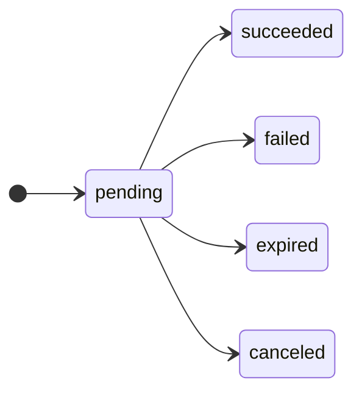

I keep a payment pending until authoritative evidence establishes a terminal state. [Decision 0003](/docs/decisions#0003) explains this constraint.

## 1. States

| State       | Terminal | Meaning                                                   |
| ----------- | -------- | --------------------------------------------------------- |
| `pending`   | no       | Not yet known to be terminal.                             |
| `succeeded` | yes      | The provider confirmed the funds were captured.           |
| `failed`    | yes      | The provider reported that the payment will not complete. |
| `expired`   | yes      | The payment window closed without completion (5).         |
| `canceled`  | yes      | The payment was canceled before completion.               |

**1.1.** `pending` is the only non-terminal state. It covers, without distinction, an inactive payer, processing in progress and an outcome not yet established.

**1.2.** A client that receives an unknown `status` value MUST treat it as a processing error and MUST NOT infer a state from it, terminal or not. A new state is introduced only under 8.

## 2. Transitions



**2.1.** Only these transitions are allowed:

| From      | To          | Cause                                   |
| --------- | ----------- | --------------------------------------- |
| `pending` | `succeeded` | Capture established (3.2).              |
| `pending` | `failed`    | Decline or error established (3.2).     |
| `pending` | `expired`   | Conditions of 5.3.                      |
| `pending` | `canceled`  | Cancellation established (3.2).         |

**2.2.** The server MUST reject and MUST NOT record any other transition.

## 3. Terminality

**3.1.** A terminal payment MUST NOT move to any other state, including on later contradictory information.

**3.2.** The server MUST NOT enter a terminal state by inference or by the passage of time: it records a terminal state only once it has established the outcome. For `expired`, 5 applies as well.

**3.3.** A server that cannot establish the outcome of a payment MUST leave it `pending`.

**3.4.** A payment MAY stay `pending` indefinitely.

## 4. Fields

| Field            | Type        | Presence    | Notes                                  |
| ---------------- | ----------- | ----------- | -------------------------------------- |
| `status`         | string      | REQUIRED    | A value from 1.                        |
| `created_at`     | `Timestamp` | REQUIRED    | Creation by the server. Immutable.     |
| `updated_at`     | `Timestamp` | REQUIRED    | Last change of state or field.         |
| `expires_at`     | `Timestamp` | OPTIONAL    | Close of the payment window (5).       |
| `completed_at`   | `Timestamp` | conditional | REQUIRED once terminal, absent before. |
| `failure_reason` | string      | conditional | REQUIRED if `status` is `failed` (7).  |
| `failure_detail` | object      | OPTIONAL    | Raw provider error (7.4).              |

**4.1.** `completed_at` is the instant the server recorded the terminal state.

**4.2.** `updated_at` MUST change on every transition and MAY change without a transition. A client MUST NOT infer a transition from `updated_at` alone.

**4.3.** Once the terminal state is reached, `status`, `completed_at` and `failure_reason` are immutable. Other fields MAY still be filled in.

## 5. Expiration

**5.1.** `expires_at` is the instant after which the payer can no longer complete the payment.

**5.2.** `expires_at` passing does not, on its own, move the payment to `expired`.

**5.3.** The server MUST NOT record `expired` without one of these conditions:

- **(a)** it has established that the payment can no longer complete;
- **(b)** `expires_at` has passed and the provider guarantees that a payment not complete at `expires_at` will never complete (the only exception to 3.2).

**5.4.** If none of these conditions holds, the payment stays `pending`.

## 6. Recording a state

**6.1.** The API MUST NOT offer any way to set the state of a payment.

## 7. Failures

**7.1.** A `200` response carrying a `failed` payment reports a successful request ([API 10.2](/docs/spec/payments-api#10.2)). API errors belong to [errors](/docs/spec/payments-api#10), not to the lifecycle.

**7.2.** If `status` is `failed`, `failure_reason` MUST take one of these values:

| Value                  | Meaning                                                                                                  |
| ---------------------- | -------------------------------------------------------------------------------------------------------- |
| `declined`             | Declined by the provider with no more precise reason.                                                    |
| `insufficient_funds`   | Payer balance insufficient.                                                                              |
| `payer_canceled`       | The payer abandoned or declined.                                                                         |
| `payer_unreachable`    | Payer account or number unreachable.                                                                     |
| `limit_exceeded`       | Provider or regulatory limit exceeded, not advertised ([capabilities 6.9](/docs/spec/capabilities#6.9)). |
| `rejected_by_provider` | Provider-specific refusal (risk, compliance).                                                            |
| `provider_error`       | Failure reported by the provider.                                                                        |
| `unspecified`          | Failure with no usable reason.                                                                           |

**7.3.** `unspecified` MUST be used when no more precise reason is established. The server MUST NOT guess a more precise reason.

**7.4.** `failure_detail` MUST carry at least the provider's error code and message, unaltered.

**7.5.** The enumeration is closed; extending it requires a decision record. A client MUST treat an unknown value as `unspecified`.

## 8. Extension by capability

**8.1.** A capability MAY introduce additional states.

**8.2.** Such a state MUST be defined by the capability's specification, with its transitions to and from the base machine and whether it is terminal.

**8.3.** The server MUST NOT report a capability-specific state for a capability it does not advertise.

**8.4.** A capability MUST NOT change the meaning of a base state, add a transition out of a terminal state, or weaken 3.

**8.5.** A refund is a separate resource. A refunded payment stays `succeeded`.

## 9. Security

**9.1.** A client or server that displays `failure_detail` MUST treat its content as untrusted.

**9.2.** The server SHOULD rate-limit payment creation to counter account enumeration through `payer_unreachable`.

**9.3.** Client documentation SHOULD recommend not showing `failure_reason` to the payer as is.

## 10. Statements and reconciliation

### 10.1. Business day

**10.1.1.** `Date` type: [data model 1](/docs/spec/data-model#1).

**10.1.2.** The business day of an entry is the date the provider assigns to it. If the provider assigns none, it is the date of `booked_at` in the IANA time zone of the business day, `America/Port-au-Prince` unless the operator configures another.

**10.1.3.** Haiti observes daylight saving time: the server MUST NOT derive a business day from a fixed UTC offset.

### 10.2. Statement

**10.2.1.** A statement groups the movements on the merchant account at a provider for one business day.

```json
{
  "id": "stm_01J9ZQ0R8V2K4M6N8P0Q2R4S6T",
  "provider": "natcash",
  "business_date": "2026-09-28",
  "complete": true,
  "entries": [
    {
      "type": "payment",
      "amount": { "amount": 125000, "currency": "HTG" },
      "booked_at": "2026-09-28T14:33:02Z",
      "payment": "pay_01JAB7C2D9E4F6G8H1J3K5M7N9",
      "match": "matched"
    }
  ],
  "missing_payments": []
}
```

**10.2.2.** Statement fields:

| Field              | Type                  | Presence | Notes                                      |
| ------------------ | --------------------- | -------- | ------------------------------------------ |
| `id`               | `ResourceId`          | REQUIRED |                                            |
| `provider`         | string                | REQUIRED | Registered identifier.                     |
| `business_date`    | `Date`                | REQUIRED | 10.1.                                      |
| `complete`         | boolean               | REQUIRED | 10.2.4.                                    |
| `entries`          | array                 | REQUIRED | 10.3.                                      |
| `missing_payments` | array of `ResourceId` | REQUIRED | 10.4.4. Empty while `complete` is `false`. |

**10.2.3.** A merchant account has at most one statement per (provider, business day).

**10.2.4.** `complete` is `true` when the provider has closed the day. An open statement MAY receive new entries; a closed statement MUST NOT.

### 10.3. Entry

**10.3.1.** Fields:

| Field                | Type                | Presence    | Notes                                                  |
| -------------------- | ------------------- | ----------- | ------------------------------------------------------ |
| `type`               | string              | REQUIRED    | 10.3.2.                                                |
| `amount`             | `Money`             | REQUIRED    | Gross, signed: positive when credited to the merchant. |
| `fee_amount`         | `Money`             | OPTIONAL    | As reported. Absent means unknown.                     |
| `net_amount`         | `Money`             | OPTIONAL    | As reported. Absent means unknown.                     |
| `booked_at`          | `Timestamp`         | REQUIRED    | Booking time at the provider.                          |
| `payment`            | `ResourceId`        | conditional | Present if `match` is `matched` or `conflict`.         |
| `match`              | string              | REQUIRED    | 10.4.                                                  |

**10.3.2.** `type` takes one of the values `payment`, `reversal`, `fee`, `adjustment`. The enumeration is closed; extending it requires a decision record. A client MUST treat an unknown value as `adjustment`.

**10.3.3.** As an exception to [data model 3.6](/docs/spec/data-model#3.6), an entry's `amount`, `fee_amount` and `net_amount` MAY be negative or zero.

**10.3.4.** The server MUST NOT compute `fee_amount` or `net_amount`, nor fill them in by subtraction.

### 10.4. Reconciliation

**10.4.1.** An entry for a payment refers to it by `payment`, its `id`. The server MUST NOT match an entry to a payment by amount or by time.

**10.4.2.** `match` takes one of the values:

| Value       | Meaning                                                           |
| ----------- | ----------------------------------------------------------------- |
| `matched`   | A payment matches; amount and state agree.                        |
| `unmatched` | No payment matches.                                               |
| `conflict`  | A payment matches, but its amount or state contradicts the entry. |

**10.4.3.** An `unmatched` entry MUST NOT create a payment. The server MUST report it to the operator.

**10.4.4.** A closed statement MUST list in `missing_payments` the `succeeded` payments at that provider whose `completed_at` falls within the business day and that no entry matches.

**10.4.5.** A `conflict` entry MUST NOT modify the payment.

### 10.5. Endpoints

**10.5.1.** Read a statement:

```
GET /v1/statements?provider=natcash&business_date=2026-09-28
```

`provider` and `business_date` are REQUIRED. The response is a collection of at most one statement; a statement that does not exist yet gives `200` with empty `data` ([API 5.2.2](/docs/spec/payments-api#5.2.2)).

**10.5.2.** List unmatched entries:

```
GET /v1/statement_entries?match=unmatched&provider=natcash
```

The `match` parameter accepts the values `unmatched` and `conflict`. The response is a collection ([API 1.12](/docs/spec/payments-api#1.12)) sorted by ascending `booked_at`, of at most `limit` items (1 to 100, default 50). If more items exist, the response carries `next_cursor`, an opaque string to send back in the `cursor` parameter.

**10.5.3.** Both endpoints require the `statements:read` scope ([authentication 6](/docs/spec/authentication#6)).

**10.5.4.** They are served for every provider. For a provider that does not advertise `payments.statement`, the collection is empty.

### 10.6. Conformance

**10.6.1.** The suite tests, against a server that publishes a statement: a matched entry, an `unmatched` entry (no payment created), a `succeeded` payment missing from a closed statement, and a business day spanning the clock change.

### 10.7. Security

**10.7.1.** A statement reveals the merchant's revenue. `statements:read` SHOULD NOT be granted to a key used only to collect payments.
