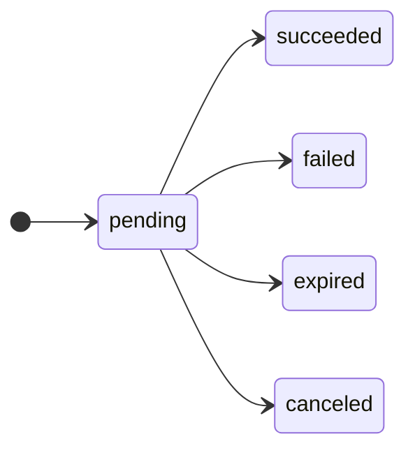

Un paiement reste en attente tant que les éléments faisant autorité ne permettent pas d’établir son état terminal. La [décision 0003](/docs/decisions#0003) explique ce principe de conception.

## 1. États

| État        | Terminal | Signification                                            |
| ----------- | -------- | -------------------------------------------------------- |
| `pending`   | non      | Non encore connu comme terminal.                         |
| `succeeded` | oui      | L'opérateur a confirmé la capture des fonds.             |
| `failed`    | oui      | L'opérateur a rapporté que le paiement n'aboutira pas.   |
| `expired`   | oui      | La fenêtre de paiement s'est fermée sans achèvement (5). |
| `canceled`  | oui      | Le paiement a été annulé avant son achèvement.           |

**1.1.** `pending` constitue l’unique état non terminal. Il couvre l’absence d’action du payeur, le traitement en cours et les résultats encore indéterminés.

**1.2.** Lorsqu’une valeur inconnue de `status` est reçue, le client DOIT la traiter comme une erreur de traitement et NE DOIT PAS en déduire un état terminal ou non terminal. L’introduction d’un état relève exclusivement du 8.

**1.3.** L’état `canceled` est réservé : aucune opération de cette version ne le produit. Le client DOIT néanmoins le traiter comme un état terminal.

## 2. Transitions



**2.1.** Les transitions autorisées sont exclusivement celles du tableau suivant :

| De        | Vers        | Cause                                   |
| --------- | ----------- | --------------------------------------- |
| `pending` | `succeeded` | Capture établie (3.2).                  |
| `pending` | `failed`    | Refus ou erreur établi (3.2).           |
| `pending` | `expired`   | Conditions du 5.3.                      |
| `pending` | `canceled`  | Annulation établie (3.2).               |

**2.2.** Le serveur DOIT rejeter toute autre transition et NE DOIT PAS l’enregistrer.

## 3. Terminalité

**3.1.** Un paiement terminal NE DOIT évoluer vers aucun autre état, même si une information contradictoire est reçue ultérieurement.

**3.2.** Le serveur NE DOIT PAS enregistrer un état terminal sur la base d’une déduction ou du seul écoulement du temps. L’enregistrement intervient uniquement lorsque le résultat est établi. Pour l’état `expired`, les conditions du 5 s’appliquent également.

**3.3.** Si le résultat ne peut pas être établi, le serveur DOIT maintenir le paiement dans l’état `pending`.

**3.4.** La durée de maintien d’un paiement dans l’état `pending` PEUT être indéfinie.

## 4. Champs

| Champ            | Type        | Présence     | Notes                                        |
| ---------------- | ----------- | ------------ | -------------------------------------------- |
| `status`         | chaîne      | OBLIGATOIRE  | Une valeur du 1.                             |
| `created_at`     | `Timestamp` | OBLIGATOIRE  | Création par le serveur. Immuable.           |
| `updated_at`     | `Timestamp` | OBLIGATOIRE  | Dernier changement d'état ou de champ.       |
| `expires_at`     | `Timestamp` | FACULTATIF   | Fermeture de la fenêtre de paiement (5).     |
| `completed_at`   | `Timestamp` | conditionnel | OBLIGATOIRE une fois terminal, absent avant. |
| `failure_reason` | chaîne      | conditionnel | OBLIGATOIRE si `status` vaut `failed` (7).   |
| `failure_detail` | objet       | FACULTATIF   | Erreur brute de l'opérateur (7.4).           |

**4.1.** Le champ `completed_at` désigne l’instant d’enregistrement de l’état terminal par le serveur.

**4.2.** La valeur de `updated_at` DOIT être modifiée à chaque transition et PEUT être modifiée en l’absence de transition. Le client NE DOIT PAS déduire une transition de la seule valeur de `updated_at`.

**4.3.** Après une transition terminale, `status`, `completed_at` et `failure_reason` deviennent immuables. Les autres champs PEUVENT être complétés ultérieurement.

## 5. Expiration

**5.1.** Le champ `expires_at` indique l’instant après lequel le payeur ne peut plus achever le paiement.

**5.2.** Le dépassement de `expires_at` ne suffit pas à provoquer une transition vers `expired`.

**5.3.** Le serveur NE DOIT PAS enregistrer `expired` sans qu’au moins une des conditions suivantes soit satisfaite :

- **(a)** l’opérateur a rapporté que le paiement a expiré ou ne peut plus être achevé ;
- **(b)** l’`expires_at` retenu ([API 5.1.4](/docs/spec/payments-api#5.1.4)) est dépassé et l’opérateur garantit qu’un paiement non achevé à `expires_at` ne pourra jamais l’être. Ce cas constitue l’unique exception au 3.2.

**5.4.** Lorsque ces conditions ne sont pas satisfaites, le paiement reste dans l’état `pending`.

**5.5.** Le serveur NE DOIT PAS conclure de lui-même à l’expiration, notamment à partir de l’`expires_at` demandé à la création, d’une consultation sans résultat ou de l’absence du paiement dans un relevé.

## 6. Enregistrement d'un état

**6.1.** L’API NE DOIT proposer aucun mécanisme permettant de fixer l’état d’un paiement.

## 7. Échecs

**7.1.** Une réponse `200` contenant un paiement `failed` indique que la requête a réussi ([API 10.2](/docs/spec/payments-api#10.2)). Les erreurs d’API sont définies dans le [modèle d’erreur](/docs/spec/payments-api#10) et se distinguent de l’état du paiement.

**7.2.** Lorsque `status` vaut `failed`, le champ `failure_reason` DOIT contenir l’une des valeurs suivantes :

| Valeur                 | Signification                                                                                                   |
| ---------------------- | --------------------------------------------------------------------------------------------------------------- |
| `declined`             | Refus de l'opérateur sans motif plus précis.                                                                    |
| `insufficient_funds`   | Solde du payeur insuffisant.                                                                                    |
| `payer_canceled`       | Le payeur a abandonné ou refusé.                                                                                |
| `payer_unreachable`    | Compte ou numéro du payeur injoignable.                                                                         |
| `limit_exceeded`       | Plafond de l'opérateur ou réglementaire dépassé, non annoncé ([capacités 6.9](/docs/spec/capabilities#6.9)). |
| `rejected_by_provider` | Refus propre à l'opérateur (risque, conformité).                                                                |
| `provider_error`       | Défaillance rapportée par l'opérateur.                                                                          |
| `unspecified`          | Échec sans motif exploitable.                                                                                   |

**7.3.** En l’absence de motif plus précis établi, `unspecified` DOIT être utilisé. Le serveur NE DOIT PAS attribuer un motif plus précis par supposition.

**7.4.** Le champ `failure_detail` DOIT contenir au minimum le code et le message d’erreur de l’opérateur, sans altération.

**7.5.** Cette énumération est fermée ; toute extension nécessite une décision écrite. Le client DOIT interpréter une valeur inconnue comme `unspecified`.

## 8. Extension par capacité

**8.1.** Une capacité PEUT définir des états supplémentaires.

**8.2.** La spécification de la capacité DOIT définir chaque état supplémentaire, ses transitions depuis et vers la machine de base, ainsi que son caractère terminal ou non terminal.

**8.3.** Le serveur NE DOIT PAS retourner un état associé à une capacité qu’il ne déclare pas.

**8.4.** Une capacité NE DOIT PAS modifier la signification d’un état de base, introduire une transition sortant d’un état terminal ou réduire les exigences du 3.

**8.5.** Le remboursement constitue une ressource distincte. Après remboursement, le paiement conserve l’état `succeeded`.

## 9. Sécurité

**9.1.** Tout client ou serveur affichant `failure_detail` DOIT considérer son contenu comme non fiable.

**9.2.** La limitation du débit de création ([idempotence 8.2](/docs/spec/idempotency#8.2)) réduit aussi le risque d’énumération des comptes par `payer_unreachable`.

**9.3.** La documentation destinée aux clients DEVRAIT recommander de ne pas présenter directement la valeur brute de `failure_reason` au payeur.

## 10. Relevés

### 10.1. Journée comptable

**10.1.1.** Le type `Date` est défini dans le [modèle de données 1](/docs/spec/data-model#1).

**10.1.2.** La journée comptable d’une ligne correspond à la date attribuée par l’opérateur. À défaut, elle est déduite de `booked_at` dans le fuseau IANA de la journée comptable : `America/Port-au-Prince`, sauf configuration différente par l’exploitant.

**10.1.3.** Haïti appliquant l’heure d’été, le serveur NE DOIT PAS déterminer la journée comptable à partir d’un décalage horaire fixe.

### 10.2. Ligne

**10.2.1.** Un relevé est la liste des transactions réussies portées au compte du marchand chez un opérateur. Chaque transaction constitue une ligne :

```json
{
  "provider": "natcash",
  "business_date": "2026-09-28",
  "booked_at": "2026-09-28T14:33:02Z",
  "amount": { "amount": 125000, "currency": "HTG" },
  "fee": { "amount": { "amount": 2500, "currency": "HTG" }, "bearer": "merchant" },
  "payment": "pay_01JAB7C2D9E4F6G8H1J3K5M7N9",
  "reference": "INV-184"
}
```

**10.2.2.** Une ligne possède les champs suivants :

| Champ           | Type         | Présence    | Notes                                                              |
| --------------- | ------------ | ----------- | ------------------------------------------------------------------ |
| `provider`      | chaîne       | OBLIGATOIRE | Identifiant enregistré.                                            |
| `business_date` | `Date`       | OBLIGATOIRE | 10.1.                                                              |
| `booked_at`     | `Timestamp`  | OBLIGATOIRE | Heure de comptabilisation chez l'opérateur.                        |
| `amount`        | `Money`      | OBLIGATOIRE | Montant brut reçu.                                                 |
| `fee`           | `Fee`        | FACULTATIF  | [Modèle de données 8](/docs/spec/data-model#8).                    |
| `payment`       | `ResourceId` | FACULTATIF  | Paiement à l’origine de la transaction, lorsque le serveur le connaît. |
| `reference`     | `Reference`  | FACULTATIF  | Référence marchande de ce paiement.                                |

**10.2.3.** Le relevé ne contient que des transactions réussies. Un paiement `pending`, `failed`, `expired` ou `canceled` n’y figure pas.

**10.2.4.** Le champ `fee` suit le [modèle de données 8](/docs/spec/data-model#8) : son absence signifie que les frais sont inconnus, et le serveur NE DOIT PAS les calculer.

### 10.3. Point d'accès

**10.3.1.** La consultation d’un relevé utilise le point d’accès suivant, pour une journée comptable ou pour un intervalle :

```
GET /v1/statements?provider=natcash&business_date=2026-09-28
GET /v1/statements?provider=natcash&from=2026-09-01&to=2026-09-30
```

**10.3.2.** Le paramètre `provider` est OBLIGATOIRE. Le client fournit soit `business_date`, soit `from` et `to`, de type `Date` ; les bornes de l’intervalle sont incluses. En l’absence de période, le serveur répond `missing-field`. Toute autre combinaison, une date invalide ou un intervalle dont `to` précède `from` entraîne `invalid-field`.

**10.3.3.** Un intervalle couvre au plus 31 journées comptables. Au-delà, le serveur répond `invalid-field`.

**10.3.4.** La réponse est une collection ([API 1.12](/docs/spec/payments-api#1.12)) triée par `booked_at` croissant, puis, à égalité, dans un ordre stable propre au serveur et identique d’une page à l’autre, et limitée à `limit` éléments : de 1 à 100, avec 50 par défaut. Si des éléments supplémentaires existent, `next_cursor` contient une chaîne opaque à transmettre dans le paramètre `cursor` pour poursuivre la consultation. Une période sans transaction donne une collection vide.

**10.3.5.** Le point d’accès nécessite la portée `statements:read` ([authentification 6](/docs/spec/authentication#6)).

**10.3.6.** Le point d’accès est exposé pour chaque opérateur. Lorsque `payments.statement` n’est pas déclaré pour l’opérateur, le serveur répond `capability-not-supported` ([capacités 4.4](/docs/spec/capabilities#4.4)).

### 10.4. Conformité

**10.4.1.** Sur un serveur déclarant `payments.statement`, la suite vérifie qu’un paiement réussi figure au relevé de sa journée comptable, qu’un paiement non réussi n’y figure pas, qu’un intervalle ne retourne que les lignes de ses journées et qu’une requête sans période est refusée.

### 10.5. Sécurité

**10.5.1.** Les relevés révèlent le chiffre d’affaires du marchand. La portée `statements:read` NE DEVRAIT PAS être accordée à une clé utilisée uniquement pour l’encaissement.

Les numéros 10.4.2 à 10.4.5, 10.5.2 à 10.5.4, 10.6.1 et 10.7.1, retirés par la [décision 0010](/docs/decisions#0010), ne sont pas réattribués.
