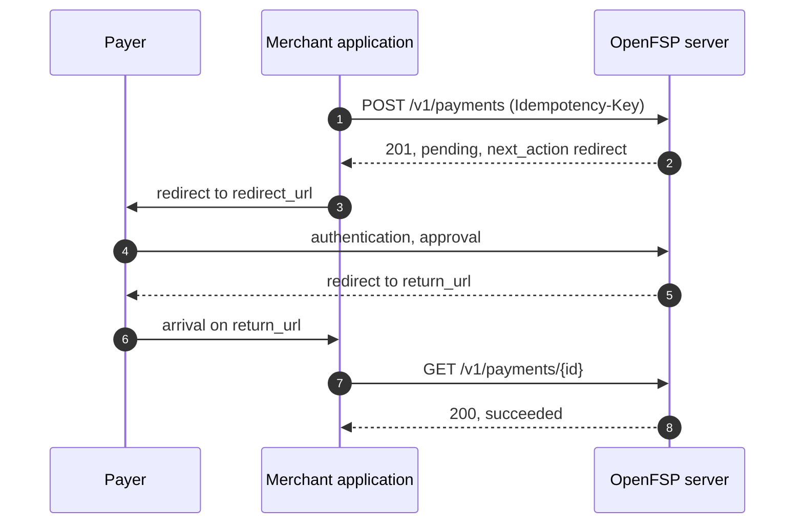

The API defines payment creation and retrieval, using the merchant reference for correlation. The error model distinguishes operation rejection from uncertainty about its effects, as described in [decision 0004](/en/docs/decisions#0004).

## 1. HTTP conventions

The following conventions apply to all OpenFSP endpoints.

**1.1.** The API uses HTTPS. The server MUST NOT expose it over plain HTTP except in an explicit development mode, which MUST be reported in the startup log.

**1.2.** All endpoints are under `/v1`. The major version changes only for an incompatible change.

**1.3.** Minor versions are omitted from the path. Available additions are exposed through [capability discovery](/en/docs/spec/capabilities).

**1.4.** Requests and successful responses use `application/json`; error responses use `application/problem+json` (10.1.1).

**1.5.** A body whose `Content-Type` is unsupported MUST be rejected with `malformed-request`.

**1.6.** `POST` creates a resource or performs an action; `GET` retrieves a resource. The methods `PATCH` and `DELETE` are not used in this version. A method not implemented for a known path MUST produce `405` with the `Allow` header.

**1.7.** The scope of idempotency is defined in [idempotency 1](/en/docs/spec/idempotency#1). No operation is exempt.

**1.8.** Every response, successful or otherwise, contains a `Request-Id` header specific to the received request. Its value equals the body’s `request_id` (10.1.6), except for a replay ([idempotency 3.2](/en/docs/spec/idempotency#3.2)), whose returned body keeps the `request_id` of the initial request.

**1.9.** Unknown fields are rejected in requests and tolerated in responses ([data model 2.3](/en/docs/spec/data-model#2.3), [2.4](/en/docs/spec/data-model#2.4)).

**1.10.** Canonical paths have no trailing slash. The path `/v1/payments/` MUST be treated as `/v1/payments`.

**1.11.** Every timestamp uses the `Timestamp` type ([data model 7](/en/docs/spec/data-model#7)).

**1.12.** A collection is represented by an object containing the REQUIRED `data` member, an array of resources. An array without an enclosing object is not permitted: `{ "data": [] }`.

## 2. Base capability

**2.1.** The operations in section 5 constitute the `payments` capability. A conforming server MUST implement them for each provider served. When `payments.lookup` is unsupported, retrieval follows [capabilities 5.3](/en/docs/spec/capabilities#5.3).

**2.2.** The server MUST NOT condition these operations on a prior capability discovery request.

## 3. `Payment` resource

```json
{
  "id": "pay_01J9ZK3QF8XN2M7VYB4C6D8E0G",
  "reference": "INV-2026-00184",
  "status": "pending",
  "amount": { "amount": 125000, "currency": "HTG" },
  "provider": "moncash",
  "payer": { "phone_number": "+50934567890" },
  "description": "Invoice 184",
  "next_action": {
    "type": "redirect",
    "redirect_url": "https://provider.example/checkout/abc123",
    "expires_at": "2026-08-17T15:02:07Z"
  },
  "created_at": "2026-08-17T14:32:07.412Z",
  "updated_at": "2026-08-17T14:32:07.412Z",
  "expires_at": "2026-08-17T15:02:07Z",
  "completed_at": null,
  "failure_reason": null,
  "failure_detail": null,
  "fee": null,
  "metadata": { "order_id": "184" }
}
```

**3.1.** The resource contains the following fields:

| Field                | Type                | Presence    | Notes                                                                                     |
| -------------------- | ------------------- | ----------- | ----------------------------------------------------------------------------------------- |
| `id`                 | `ResourceId`        | REQUIRED    | Opaque.                                                                                   |
| `reference`          | `Reference`         | REQUIRED    | Unique per merchant account.                                                              |
| `status`             | string              | REQUIRED    | [Lifecycle 1](/en/docs/spec/lifecycle#1).                                                    |
| `amount`             | `Money`             | REQUIRED    |                                                                                           |
| `provider`           | string              | REQUIRED    | Registered provider identifier (3.2).                                                     |
| `payer`              | object              | OPTIONAL    | 3.3.                                                                                      |
| `description`        | string              | OPTIONAL    | At most 255 characters.                                                                   |
| `next_action`        | object              | conditional | 4.1.                                                                                      |
| `created_at`         | `Timestamp`         | REQUIRED    | Immutable.                                                                                |
| `updated_at`         | `Timestamp`         | REQUIRED    | [Lifecycle 4.2](/en/docs/spec/lifecycle#4.2).                                                |
| `expires_at`         | `Timestamp`         | OPTIONAL    | [Lifecycle 5](/en/docs/spec/lifecycle#5).                                                    |
| `completed_at`       | `Timestamp`         | conditional | REQUIRED if terminal.                                                                     |
| `failure_reason`     | string              | conditional | REQUIRED if `failed`.                                                                     |
| `failure_detail`     | object              | OPTIONAL    | Raw provider error.                                                                       |
| `fee`                | `Fee`               | OPTIONAL    | Absent means not known (3.5).                                                             |
| `metadata`           | `Metadata`          | OPTIONAL    |                                                                                           |

**3.2.** The value of `provider` follows `^[a-z0-9_]{1,32}$` and MUST match an identifier in the [provider registry](/en/docs/registry) or a `mock_*` identifier of the [mock server](/en/docs/spec/conformance#9). This field is REQUIRED even when the server serves a single provider.

**3.3.** The `payer` object contains one field: `phone_number`, of type `PhoneNumber`.

**3.4.** The value of `description` MAY be displayed to the payer. The client MUST NOT include personal data in it.

**3.5.** The `fee` field follows these rules:

- any creation request containing `fee` MUST be rejected;
- the `fee` field MAY appear only after a terminal transition. Its addition changes `updated_at` without changing `status`;
- the client MUST NOT interpret absent fee data as a zero amount ([data model 8.2](/en/docs/spec/data-model#8.2)).

## 4. `next_action`

**4.1.** The field is REQUIRED while the payment remains `pending` and absent after a terminal transition, except in the case defined in 4.1.1.

**4.1.1.** A creation whose `effect` is `unknown` (10.6) leaves the payment `pending` without `next_action`. Until the creation outcome is established, the server MAY defer exposing the payment. Once it exposes it, and at the latest when that outcome is established, it MUST return it on retrieval (5.2), following the client recovery path in 10.6.3, and announce it once through `payment.created` ([webhooks 3](/en/docs/spec/webhooks#3)). The retrieval and the event then omit `next_action`, which is populated if creation succeeds on retry with the same key.

**4.2.** The permitted types form the following closed enumeration:

| `type`           | Meaning                                                  | Fields                       |
| ---------------- | -------------------------------------------------------- | ---------------------------- |
| `redirect`       | Send the payer to a provider page.                       | `redirect_url`, `expires_at` |
| `payer_approval` | The payer approves on their device (USSD, notification). | none                         |
| `none`           | Nothing is required from the payer.                      | none                         |

For a `redirect` action, `expires_at` is OPTIONAL when the provider declares `expiry_guaranteed` as `false` ([capabilities 3.2.2](/en/docs/spec/capabilities#3.2.2)).

**4.3.** The server MUST report the type required by the provider. If that type cannot be established, creation returns an error. The value `none` MUST NOT be used as a default.

**4.4.** The client MUST treat `redirect_url` as opaque, MUST NOT modify it and MUST NOT embed it in a frame that conceals its origin.

**4.5.** The value of `next_action.expires_at` MAY precede the payment’s `expires_at`. Expiry of the action does not make the payment terminal.

**4.6.** A capability MAY introduce an additional type, produced only for a provider declaring that capability. The client MUST NOT equate an unknown type with `none`.

## 5. Endpoints

### 5.1. Create a payment

```
POST /v1/payments
```

```json
{
  "reference": "INV-2026-00184",
  "amount": { "amount": 125000, "currency": "HTG" },
  "provider": "moncash",
  "payer": { "phone_number": "+50934567890" },
  "description": "Invoice 184",
  "return_url": "https://merchant.example/checkout/184/return",
  "expires_at": "2026-08-17T15:02:07Z",
  "metadata": { "order_id": "184" }
}
```

| Field          | Presence    | Notes                                                                                                           |
| -------------- | ----------- | --------------------------------------------------------------------------------------------------------------- |
| `reference`    | REQUIRED    | Duplicate: `reference-conflict`.                                                                                |
| `amount`       | REQUIRED    | Strictly positive, within the limits ([capabilities 6](/en/docs/spec/capabilities#6)).                             |
| `provider`     | REQUIRED    | 5.1.1.                                                                                                          |
| `payer`        | conditional | Depends on the provider (5.1.2).                                                                                |
| `description`  | OPTIONAL    |                                                                                                                 |
| `return_url`   | conditional | REQUIRED if the provider announces `return_url_required` ([capabilities 3.2.2](/en/docs/spec/capabilities#3.2.2)). |
| `expires_at`   | OPTIONAL    | Requested value. The value applied is the one in the response (5.1.4).                                          |
| `locale`       | OPTIONAL    | Language of the payer's page: `fr`, `ht` or `en` (5.1.7).                                                       |
| `metadata`     | OPTIONAL    |                                                                                                                 |
| `callback_url` | OPTIONAL    | Only if the provider announces `webhooks.per_payment_url` (5.1.8).                                              |

**5.1.1.** The server MUST NOT select the provider on the client’s behalf.

**5.1.2.** The server MUST state whether `payer` is required through `payer_required` in `/v1/capabilities` ([capabilities 3.2.2](/en/docs/spec/capabilities#3.2.2)). It MUST reject any request omitting a provider-required field with `missing-field`.

**5.1.3.** The value of `return_url` MUST be an absolute `https` URL. An `http` URL MUST be rejected except in development mode, where `http://localhost` and `http://127.0.0.1` are accepted.

**5.1.4.** The server assigns the resource’s `expires_at` according to the provider’s guarantee. This value MAY differ from the requested value or be absent. The client MUST inspect the value actually returned.

| Status                   | Condition                                    |
| ------------------------ | -------------------------------------------- |
| `201`                    | Payment created. `Location` carries its URL. |
| `400`, `422`             | Invalid request (10.8.1).                    |
| `409 reference-conflict` | Reference already used (5.1.5).              |
| `502`, `503`, `504`      | Failure on the provider side. Read `effect`. |

**5.1.5.** After `reference-conflict`, the client SHOULD retrieve the existing payment under 5.2.

**5.1.6.** For `504 provider-timeout`, the value of `effect` is `unknown` (10.6.3). For `500 internal-error`, it follows 10.8.6.2.

**5.1.7.** The server applies `locale` to the payer’s page if it is among the declared `locales` ([capabilities 3.2.2](/en/docs/spec/capabilities#3.2.2)); otherwise it ignores it. Any value other than `fr`, `ht` or `en` MUST be rejected with `invalid-field`.

**5.1.8.** The server delivers the payment’s events to `callback_url` with the signatures defined in [webhooks 5](/en/docs/spec/webhooks#5). This value is an absolute `https` URL. In development mode (1.1), `http://localhost` and `http://127.0.0.1` are also accepted under 5.1.3. Creation containing `callback_url` for a provider that does not declare `webhooks.per_payment_url` MUST be rejected with `capability-not-supported` ([capabilities 4.4](/en/docs/spec/capabilities#4.4)).

### 5.2. Read a payment

```
GET /v1/payments/{id}
GET /v1/payments?reference={reference}
```

**5.2.1.** Lookup by `id` returns the payment or a `404 not-found` response.

**5.2.2.** Lookup by `reference` returns a collection of at most one element. An unknown reference produces `200` with an empty `data` collection.

**5.2.3.** Client libraries SHOULD provide an operation for lookup by reference.

**5.2.4.** Retrieval returns the most recent state the server can establish. How it establishes that state is up to the implementation.

**5.2.5.** A terminal payment is returned as recorded.

**5.2.6.** The server MAY limit, per payment, the lookups a retrieval triggers at an external source. It then returns the last known state.

**5.2.7.** If an external source is unreachable or does not respond in time, the server returns the last known state and the payment remains `pending`.

## 6. Tracking changes

**6.1.** The client learns of state changes through retrieval (5.2) or a [webhook](/en/docs/spec/webhooks).

**6.2.** The client SHOULD progressively increase polling intervals and SHOULD stop polling when the payment becomes terminal.

**6.3.** Additional requirements are defined in [webhooks 10](/en/docs/spec/webhooks#10).

## 7. Return URL

**7.1.** The client MUST NOT interpret the payer’s return to `return_url` as evidence of the payment outcome.

**7.2.** Parameters added to `return_url` by the provider can be manipulated by an attacker.

**7.3.** When the payer returns, the client MUST retrieve the payment from the server and display only the result of that response.

## 8. Typical flow

Informative example: a payment flow using payer redirection.



## 9. Security

**9.1.** Lookup by reference applies to the merchant account’s payments, which are accessible to all authorised principals of that account ([authentication 5.5](/en/docs/spec/authentication#5.5)).

**9.2.** A key lacking the required scope produces `forbidden` ([authentication 6.4](/en/docs/spec/authentication#6.4)).

**9.3.** Client documentation SHOULD indicate that `description` may be displayed to the payer, unlike `metadata` (3.4).

## 10. Errors

### 10.1. Format

**10.1.1.** Each error response MUST use an RFC 9457 problem detail object with the `application/problem+json` media type.

**10.1.2.** Example error representation:

```json
{
  "type": "https://openfsp.org/problems/provider-timeout",
  "title": "The provider did not respond in time",
  "status": 504,
  "detail": "No response from the provider after 30s. The payment's outcome is unknown.",
  "instance": "/v1/payments",
  "retryable": true,
  "effect": "unknown",
  "request_id": "req_01J9ZK3QF8XN2M7VYB4C6D8E0G"
}
```

**10.1.3.** The error object has the following members:

| Member            | Type          | Presence | Notes                                                   |
| ----------------- | ------------- | -------- | ------------------------------------------------------- |
| `type`            | URI           | REQUIRED | Stable identifier (10.3).                               |
| `title`           | string        | REQUIRED | Human-readable, not stable.                             |
| `status`          | integer       | REQUIRED | HTTP status.                                            |
| `detail`          | string        | OPTIONAL | Human-readable, specific to the occurrence, not stable. |
| `instance`        | URI reference | OPTIONAL | Request path.                                           |
| `retryable`       | boolean       | REQUIRED | 10.5.                                                   |
| `effect`          | string        | REQUIRED | `none` or `unknown` (10.6).                             |
| `request_id`      | string        | REQUIRED | Correlation with the server logs.                       |
| `errors`          | array         | OPTIONAL | Per-field detail (10.7).                                |

**10.1.4.** The client MUST identify the error exclusively through `type`. The values of `title` and `detail` MAY change or be localised.

**10.1.5.** The `status` field MUST match the response’s HTTP status.

**10.1.6.** The `request_id` field MUST appear in every error response, including `500`.

### 10.2. Failed request and failed payment

**10.2.1.** An error response indicates request failure. The payment outcome is described by its `status` field (10.2.2).

**10.2.2.** A declined payment is represented in a `200` response by `"status": "failed"` and a `failure_reason` field ([lifecycle 7.2](/en/docs/spec/lifecycle#7.2)).

**10.2.3.** The server MUST NOT represent payment refusal with an error response or use a `4xx` or `5xx` status to express the payment outcome.

**10.2.4.** The client MUST NOT equate a non-`2xx` response with payment failure. The operation’s effects are indicated by `effect`.

### 10.3. Type URIs

**10.3.1.** URIs follow the form `https://openfsp.org/problems/<code>`, where `<code>` belongs to the catalogue in 10.8.

**10.3.2.** The client MUST compare these URIs as opaque strings and MUST NOT dereference them to interpret the response.

**10.3.3.** The specification editor SHOULD make each type’s documentation available at its URI. This rule does not apply to implementations.

**10.3.4.** In every version, type URIs MUST retain the `openfsp.org` authority.

**10.3.5.** The server MAY define types under its own authority and MUST NOT create them under the OpenFSP authority.

**10.3.6.** For an unknown `type`, the client MUST use `status`, `retryable` and `effect`. Adding a type to the catalogue is not an incompatible change.

### 10.4. Statuses

**10.4.1.** The server MUST return the status assigned to the error type in the catalogue.

**10.4.2.** Statuses follow RFC 9110: `400` for an unreadable or malformed request, including a missing or unknown field, `422` for an invalid value and `409` for a conflict with server-held state.

**10.4.3.** The errors `idempotency-key-reused` and `idempotency-request-in-progress` use `422` and `409`, respectively, following the IETF `Idempotency-Key` draft.

**10.4.4.** For provider-related errors, `502` indicates an invalid response or provider error, `503` an unreachable provider and `504` no response within the allotted time.

### 10.5. `retryable`

**10.5.1.** The `retryable` property indicates whether repeating the unchanged request with the same `Idempotency-Key` can succeed.

**10.5.2.** The value `retryable: true` indicates that a retry with the same `Idempotency-Key` produces no duplicate effect. It does not guarantee that the retry succeeds.

**10.5.3.** The client MUST NOT repeat a request whose error indicates `retryable: false`.

**10.5.4.** When retrying, the client MUST reuse the original key and space attempts ([idempotency 7.1](/en/docs/spec/idempotency#7.1), [7.4](/en/docs/spec/idempotency#7.4)).

**10.5.5.** The client MUST honour the delay indicated by `Retry-After`.

**10.5.6.** The value of `retryable` MUST match the catalogue entry.

### 10.6. `effect`

**10.6.1.** The property accepts the following values:

| Value     | Meaning                              |
| --------- | ------------------------------------ |
| `none`    | The operation did not take effect.   |
| `unknown` | The operation may have taken effect. |

**10.6.2.** The server MUST indicate `none` only when the absence of effects is established; otherwise it indicates `unknown`.

**10.6.3.** When the value is `unknown`, the client MUST NOT conclude that the operation failed. It MUST retry with the original key or retrieve the resource by its `reference` ([data model 6.2.3](/en/docs/spec/data-model#6.2.3)).

**10.6.4.** The `effect` and `retryable` properties are independent of each other.

**10.6.5.** The server MUST NOT retain an error indicating `effect: unknown` for [idempotency](/en/docs/spec/idempotency). Any retry follows [idempotency 3](/en/docs/spec/idempotency#3).

### 10.7. Field errors

**10.7.1.** If an error concerns identifiable fields, the `errors` member SHOULD be present:

| Member   | Type   | Presence | Notes                                          |
| -------- | ------ | -------- | ---------------------------------------------- |
| `field`  | string | REQUIRED | JSON Pointer (RFC 6901) into the request body. |
| `code`   | string | REQUIRED | Stable code, from the closed list below.       |
| `detail` | string | OPTIONAL | Human-readable, not stable.                    |

| `code`          | Meaning                                                     |
| --------------- | ----------------------------------------------------------- |
| `required`      | Required field absent or `null`.                            |
| `malformed`     | Value not in the expected format (number, URL, identifier). |
| `invalid_type`  | Unexpected JSON type.                                       |
| `unknown_field` | Field not defined by the specification.                     |
| `not_positive`  | Zero or negative amount.                                    |
| `too_large`     | Value above the maximum.                                    |
| `too_long`      | String above the maximum length.                            |
| `too_many`      | Number of elements above the maximum.                       |
| `not_allowed`   | Value outside the allowed set.                              |

```json
{
  "type": "https://openfsp.org/problems/invalid-field",
  "title": "One or more fields are invalid",
  "status": 422,
  "retryable": false,
  "effect": "none",
  "request_id": "req_01J9ZK…",
  "errors": [
    { "field": "/amount/amount", "code": "not_positive" },
    { "field": "/payer/phone_number", "code": "malformed" }
  ]
}
```

**10.7.2.** The server SHOULD report all invalid fields together in one response.

**10.7.3.** The `field` member MUST identify a location in the request as sent by the client.

### 10.8. Catalogue

The catalogue is closed. Extending it requires a decision record.

#### 10.8.1. Request

| Code                       | Status | `retryable` | `effect` | Condition                                                                              |
| -------------------------- | ------ | ----------- | -------- | -------------------------------------------------------------------------------------- |
| `malformed-request`        | 400    | false       | `none`   | Body not JSON or not an object.                                                        |
| `unknown-field`            | 400    | false       | `none`   | Unknown field ([data model 2.4](/en/docs/spec/data-model#2.4)).                           |
| `missing-field`            | 400    | false       | `none`   | Required field absent.                                                                 |
| `method-not-allowed`       | 405    | false       | `none`   | Method not implemented on a known path (1.6). MUST carry `Allow`.                      |
| `idempotency-key-required` | 400    | false       | `none`   | `Idempotency-Key` absent ([idempotency 1.3](/en/docs/spec/idempotency#1.3)).              |
| `invalid-field`            | 422    | false       | `none`   | Invalid value. Carries `errors` when the value is in the body (10.7.3).                |
| `capability-not-supported` | 422    | false       | `none`   | Capability not announced.                                                              |
| `amount-out-of-range`      | 422    | false       | `none`   | Amount outside the announced limits ([capabilities 6.7](/en/docs/spec/capabilities#6.7)). |
| `idempotency-key-reused`   | 422    | false       | `none`   | Same key, different body ([idempotency 3.3](/en/docs/spec/idempotency#3.3)).              |

#### 10.8.2. Authentication

| Code              | Status | `retryable` | `effect` | Condition                                |
| ----------------- | ------ | ----------- | -------- | ---------------------------------------- |
| `unauthenticated` | 401    | false       | `none`   | Credential absent, malformed or invalid. |
| `forbidden`       | 403    | false       | `none`   | Authenticated, not authorized.           |

#### 10.8.3. Resource

| Code        | Status | `retryable` | `effect` | Condition                |
| ----------- | ------ | ----------- | -------- | ------------------------ |
| `not-found` | 404    | false       | `none`   | Resource does not exist. |

**10.8.3.1.** The server MUST check scope before checking resource existence. A key lacking the required scope receives `forbidden` whether or not the resource exists ([authentication 6.4](/en/docs/spec/authentication#6.4)), preventing disclosure of its existence.

#### 10.8.4. Conflicts

| Code                              | Status | `retryable` | `effect`  | Condition                                                                                 |
| --------------------------------- | ------ | ----------- | --------- | ----------------------------------------------------------------------------------------- |
| `reference-conflict`              | 409    | false       | `none`    | `reference` already used ([data model 6.2.2](/en/docs/spec/data-model#6.2.2)).               |
| `idempotency-request-in-progress` | 409    | true        | `unknown` | Request with the same key in progress ([idempotency 3.4](/en/docs/spec/idempotency#3.4)).    |
| `state-conflict`                  | 409    | false       | `none`    | Operation not allowed from the current state ([lifecycle 2.1](/en/docs/spec/lifecycle#2.1)). |

**10.8.4.1.** The `idempotency-request-in-progress` response carries `Retry-After` under [idempotency 3.4](/en/docs/spec/idempotency#3.4).

**10.8.4.2.** The `state-conflict` error is reserved: no operation of this version produces it.

#### 10.8.5. Rate

| Code           | Status | `retryable` | `effect` | Condition                                    |
| -------------- | ------ | ----------- | -------- | -------------------------------------------- |
| `rate-limited` | 429    | true        | `none`   | Too many requests. MUST carry `Retry-After`. |

#### 10.8.6. Server and provider

| Code                   | Status | `retryable` | `effect`  | Condition                                     |
| ---------------------- | ------ | ----------- | --------- | --------------------------------------------- |
| `internal-error`       | 500    | true        | `unknown` | Unexpected server failure.                    |
| `provider-error`       | 502    | true        | `unknown` | Provider error or unusable provider response. |
| `provider-unavailable` | 503    | true        | `none`    | Provider unreachable.                         |
| `provider-timeout`     | 504    | true        | `unknown` | No response from the provider in time.        |

**10.8.6.1.** The `provider-unavailable` error MUST be used only when the operation was not initiated at the provider, for example after connection refusal or DNS failure. If the operation was initiated and its outcome remains unknown, the applicable error is `provider-timeout`.

**10.8.6.2.** The `internal-error` response MUST indicate `unknown` unless the server establishes that the operation had no effect.

**10.8.6.3.** The `internal-error` response MUST NOT expose internal diagnostics, including stack traces, queries or host names.

### 10.9. Language

**10.9.1.** The values of `title` and `detail` SHOULD use English by default.

**10.9.2.** The server MAY localise these values and SHOULD then honour `Accept-Language`.

**10.9.3.** Localisation MUST NOT alter `type`, `retryable`, `effect` or any `code`.

### 10.10. Security

**10.10.1.** The fields `title`, `detail` and `errors[].detail` MUST NOT include a phone number, payer identifier or amount.

**10.10.2.** The `unauthenticated` response MUST NOT distinguish the failure causes defined in [authentication 4.7](/en/docs/spec/authentication#4.7).
