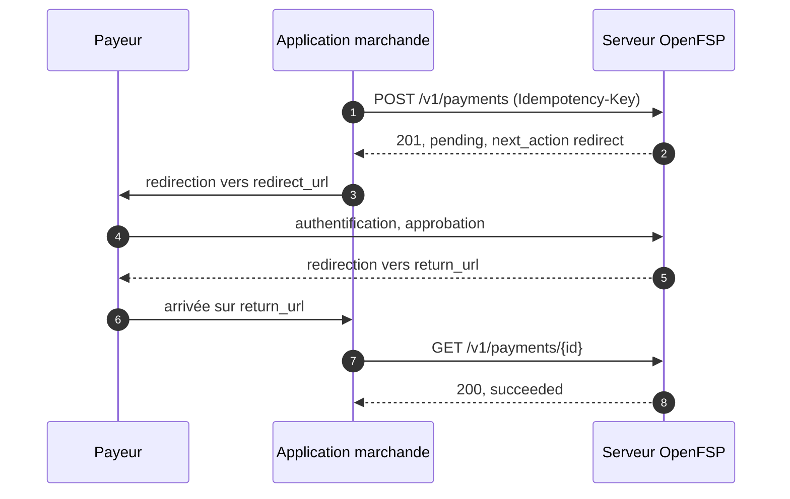

L’API définit la création et la lecture des paiements, avec la référence du marchand comme moyen de corrélation. Le modèle d’erreur distingue le refus d’une opération de l’incertitude sur ses effets, conformément à la [décision 0004](/docs/decisions#0004).

## 1. Conventions HTTP

Les conventions suivantes s’appliquent à tous les points d’accès OpenFSP.

**1.1.** L’API utilise HTTPS. Le serveur NE DOIT PAS l’exposer en HTTP clair, sauf dans un mode de développement explicite qui DOIT être signalé dans le journal de démarrage.

**1.2.** Tous les points d’accès relèvent du chemin `/v1`. Un changement de version majeure intervient uniquement en cas de rupture de compatibilité.

**1.3.** Les versions mineures sont absentes du chemin. Les ajouts disponibles sont exposés par la [découverte des capacités](/docs/spec/capabilities).

**1.4.** Les requêtes et les réponses de succès utilisent `application/json` ; les réponses d’erreur utilisent `application/problem+json` (10.1.1).

**1.5.** Un corps dont le `Content-Type` n’est pas pris en charge DOIT être rejeté avec `malformed-request`.

**1.6.** `POST` crée une ressource ou exécute une action ; `GET` consulte une ressource. Les méthodes `PATCH` et `DELETE` ne sont pas utilisées dans cette version. Une méthode non implémentée pour un chemin connu DOIT produire `405` avec l’en-tête `Allow`.

**1.7.** Le périmètre de l’idempotence est défini en [idempotence 1](/docs/spec/idempotency#1). Aucune opération n’en est exemptée.

**1.8.** Chaque réponse, de succès ou d’erreur, contient l’en-tête `Request-Id`, propre à la requête reçue. Sa valeur est égale au `request_id` du corps (10.1.6), sauf pour un rejeu ([idempotence 3.2](/docs/spec/idempotency#3.2)), dont le corps restitué conserve le `request_id` de la requête initiale.

**1.9.** Les champs inconnus sont rejetés dans les requêtes et tolérés dans les réponses ([modèle de données 2.3](/docs/spec/data-model#2.3), [2.4](/docs/spec/data-model#2.4)).

**1.10.** Les chemins canoniques ne comportent pas de barre oblique finale. Le chemin `/v1/payments/` DOIT être traité comme `/v1/payments`.

**1.11.** Chaque horodatage utilise le type `Timestamp` ([modèle de données 7](/docs/spec/data-model#7)).

**1.12.** Une collection est représentée par un objet contenant le membre OBLIGATOIRE `data`, tableau de ressources. Un tableau sans objet englobant n’est pas admis : `{ "data": [] }`.

## 2. Capacité de base

**2.1.** Les opérations du 5 constituent la capacité `payments`. Le serveur conforme DOIT les implémenter pour chaque opérateur servi. Lorsque `payments.lookup` n’est pas pris en charge, la lecture suit les [capacités 5.3](/docs/spec/capabilities#5.3).

**2.2.** Le serveur NE DOIT PAS conditionner l’exécution de ces opérations à une requête préalable de découverte des capacités.

## 3. Ressource `Payment`

```json
{
  "id": "pay_01J9ZK3QF8XN2M7VYB4C6D8E0G",
  "reference": "INV-2026-00184",
  "status": "pending",
  "amount": { "amount": 125000, "currency": "HTG" },
  "provider": "moncash",
  "payer": { "phone_number": "+50934567890" },
  "description": "Invoice 184",
  "next_action": {
    "type": "redirect",
    "redirect_url": "https://provider.example/checkout/abc123",
    "expires_at": "2026-08-17T15:02:07Z"
  },
  "created_at": "2026-08-17T14:32:07.412Z",
  "updated_at": "2026-08-17T14:32:07.412Z",
  "expires_at": "2026-08-17T15:02:07Z",
  "completed_at": null,
  "failure_reason": null,
  "failure_detail": null,
  "fee": null,
  "metadata": { "order_id": "184" }
}
```

**3.1.** La ressource comporte les champs suivants :

| Champ                | Type                | Présence     | Notes                                                                                                     |
| -------------------- | ------------------- | ------------ | --------------------------------------------------------------------------------------------------------- |
| `id`                 | `ResourceId`        | OBLIGATOIRE  | Opaque.                                                                                                   |
| `reference`          | `Reference`         | OBLIGATOIRE  | Unique par compte marchand.                                                                               |
| `status`             | chaîne              | OBLIGATOIRE  | [Cycle de vie 1](/docs/spec/lifecycle#1).                                                              |
| `amount`             | `Money`             | OBLIGATOIRE  |                                                                                                           |
| `provider`           | chaîne              | OBLIGATOIRE  | Identifiant enregistré de l'opérateur (3.2).                                                              |
| `payer`              | objet               | FACULTATIF   | 3.3.                                                                                                      |
| `description`        | chaîne              | FACULTATIF   | 255 caractères au plus.                                                                                   |
| `next_action`        | objet               | conditionnel | 4.1.                                                                                                      |
| `created_at`         | `Timestamp`         | OBLIGATOIRE  | Immuable.                                                                                                 |
| `updated_at`         | `Timestamp`         | OBLIGATOIRE  | [Cycle de vie 4.2](/docs/spec/lifecycle#4.2).                                                          |
| `expires_at`         | `Timestamp`         | FACULTATIF   | [Cycle de vie 5](/docs/spec/lifecycle#5).                                                              |
| `completed_at`       | `Timestamp`         | conditionnel | OBLIGATOIRE si terminal.                                                                                  |
| `failure_reason`     | chaîne              | conditionnel | OBLIGATOIRE si `failed`.                                                                                  |
| `failure_detail`     | objet               | FACULTATIF   | Erreur brute de l'opérateur.                                                                              |
| `fee`                | `Fee`               | FACULTATIF   | Absent signifie non connu (3.5).                                                                          |
| `metadata`           | `Metadata`          | FACULTATIF   |                                                                                                           |

**3.2.** La valeur de `provider` respecte `^[a-z0-9_]{1,32}$` et DOIT correspondre à un identifiant du [registre des opérateurs](/docs/registry) ou à un identifiant `mock_*` du [serveur simulé](/docs/spec/conformance#9). Ce champ est OBLIGATOIRE même si le serveur ne sert qu’un opérateur.

**3.3.** L’objet `payer` contient un seul champ : `phone_number`, de type `PhoneNumber`.

**3.4.** La valeur de `description` PEUT être présentée au payeur. Le client NE DOIT PAS y inclure de données personnelles.

**3.5.** Le champ `fee` suit les règles suivantes :

- toute requête de création contenant `fee` DOIT être rejetée ;
- le champ `fee` PEUT apparaître uniquement après une transition terminale. Son ajout modifie `updated_at` sans modifier `status` ;
- le client NE DOIT PAS interpréter l’absence de frais comme un montant nul ([modèle de données 8.2](/docs/spec/data-model#8.2)).

## 4. `next_action`

**4.1.** Le champ est OBLIGATOIRE tant que le paiement reste `pending` et absent après une transition terminale, sauf dans le cas du 4.1.1.

**4.1.1.** Une création dont `effect` vaut `unknown` (10.6) laisse le paiement `pending` sans `next_action`. Tant que le résultat de la création reste indéterminé, le serveur PEUT différer l’exposition du paiement. Dès qu’il l’expose, et au plus tard lorsque ce résultat est établi, il DOIT le restituer en lecture (5.2), conformément à la démarche du client définie au 10.6.3, et l’annoncer une seule fois par `payment.created` ([webhooks 3](/docs/spec/webhooks#3)). La lecture et l’événement omettent alors `next_action`, qui est renseigné si une nouvelle tentative de création avec la même clé aboutit.

**4.2.** Les types autorisés constituent l’énumération fermée suivante :

| `type`           | Sens                                                      | Champs                       |
| ---------------- | --------------------------------------------------------- | ---------------------------- |
| `redirect`       | Envoyer le payeur vers une page de l'opérateur.           | `redirect_url`, `expires_at` |
| `payer_approval` | Le payeur approuve sur son appareil (USSD, notification). | aucun                        |
| `none`           | Rien n'est requis du payeur.                              | aucun                        |

Pour une action `redirect`, le champ `expires_at` est FACULTATIF lorsque l’opérateur déclare `expiry_guaranteed` à `false` ([capacités 3.2.2](/docs/spec/capabilities#3.2.2)).

**4.3.** Le serveur DOIT indiquer le type requis par l’opérateur. Si ce type ne peut pas être établi, la création retourne une erreur. La valeur `none` NE DOIT PAS être utilisée par défaut.

**4.4.** Le client DOIT traiter `redirect_url` comme une valeur opaque, NE DOIT PAS la modifier et NE DOIT PAS l’intégrer dans un cadre masquant son origine.

**4.5.** La valeur de `next_action.expires_at` PEUT précéder l’`expires_at` du paiement. L’expiration de l’action ne rend pas le paiement terminal.

**4.6.** Une capacité PEUT introduire un type supplémentaire, produit uniquement pour un opérateur déclarant cette capacité. Le client NE DOIT PAS assimiler un type inconnu à `none`.

## 5. Points d'accès

### 5.1. Créer un paiement

```
POST /v1/payments
```

```json
{
  "reference": "INV-2026-00184",
  "amount": { "amount": 125000, "currency": "HTG" },
  "provider": "moncash",
  "payer": { "phone_number": "+50934567890" },
  "description": "Invoice 184",
  "return_url": "https://merchant.example/checkout/184/return",
  "expires_at": "2026-08-17T15:02:07Z",
  "metadata": { "order_id": "184" }
}
```

| Champ          | Présence     | Notes                                                                                                           |
| -------------- | ------------ | --------------------------------------------------------------------------------------------------------------- |
| `reference`    | OBLIGATOIRE  | Doublon : `reference-conflict`.                                                                                 |
| `amount`       | OBLIGATOIRE  | Strictement positif, dans les bornes ([capacités 6](/docs/spec/capabilities#6)).                             |
| `provider`     | OBLIGATOIRE  | 5.1.1.                                                                                                          |
| `payer`        | conditionnel | Selon l'opérateur (5.1.2).                                                                                      |
| `description`  | FACULTATIF   |                                                                                                                 |
| `return_url`   | conditionnel | OBLIGATOIRE si l'opérateur annonce `return_url_required` ([capacités 3.2.2](/docs/spec/capabilities#3.2.2)). |
| `expires_at`   | FACULTATIF   | Valeur demandée ; la valeur retenue est celle de la réponse (5.1.4).                                            |
| `locale`       | FACULTATIF   | Langue de la page du payeur : `fr`, `ht` ou `en` (5.1.7).                                                       |
| `metadata`     | FACULTATIF   |                                                                                                                 |
| `callback_url` | FACULTATIF   | Seulement si l'opérateur annonce `webhooks.per_payment_url` (5.1.8).                                            |

**5.1.1.** Le serveur NE DOIT PAS sélectionner l’opérateur à la place du client.

**5.1.2.** Le serveur DOIT préciser si `payer` est exigé au moyen de `payer_required` dans `/v1/capabilities` ([capacités 3.2.2](/docs/spec/capabilities#3.2.2)). Il DOIT rejeter avec `missing-field` toute requête omettant un champ exigé par l’opérateur.

**5.1.3.** La valeur de `return_url` DOIT être une URL `https` absolue. Une URL `http` DOIT être rejetée, sauf en mode développement, où `http://localhost` et `http://127.0.0.1` sont acceptées.

**5.1.4.** Le serveur attribue à la ressource l’`expires_at` garanti par l’opérateur. Cette valeur PEUT différer de celle demandée ou être absente. Le client DOIT consulter la valeur effectivement retournée.

| Statut                   | Condition                                 |
| ------------------------ | ----------------------------------------- |
| `201`                    | Paiement créé ; `Location` porte son URL. |
| `400`, `422`             | Requête invalide (10.8.1).                |
| `409 reference-conflict` | Référence déjà utilisée (5.1.5).          |
| `502`, `503`, `504`      | Échec côté opérateur ; lire `effect`.     |

**5.1.5.** Après `reference-conflict`, le client DEVRAIT consulter le paiement existant selon le 5.2.

**5.1.6.** Pour `504 provider-timeout`, la valeur de `effect` est `unknown` (10.6.3). Pour `500 internal-error`, elle suit le 10.8.6.2.

**5.1.7.** Le serveur applique `locale` à la page du payeur si cette valeur figure parmi les `locales` déclarées ([capacités 3.2.2](/docs/spec/capabilities#3.2.2)) ; sinon, il l’ignore. Toute valeur autre que `fr`, `ht` ou `en` DOIT être rejetée avec `invalid-field`.

**5.1.8.** Le serveur livre les événements du paiement à `callback_url` avec les signatures définies dans les [webhooks 5](/docs/spec/webhooks#5). Cette valeur est une URL `https` absolue. En mode développement (1.1), `http://localhost` et `http://127.0.0.1` sont également acceptées selon le 5.1.3. Toute création contenant `callback_url` pour un opérateur ne déclarant pas `webhooks.per_payment_url` DOIT être rejetée avec `capability-not-supported` ([capacités 4.4](/docs/spec/capabilities#4.4)).

### 5.2. Lire un paiement

```
GET /v1/payments/{id}
GET /v1/payments?reference={reference}
```

**5.2.1.** La recherche par `id` retourne le paiement ou une réponse `404 not-found`.

**5.2.2.** La recherche par `reference` retourne une collection d’au plus un élément. Une référence inconnue produit `200` avec une collection `data` vide.

**5.2.3.** Les bibliothèques clientes DEVRAIENT proposer une opération de recherche par référence.

**5.2.4.** La lecture retourne l’état le plus récent que le serveur peut établir. La manière de l’établir relève de l’implémentation.

**5.2.5.** Un paiement terminal est retourné tel qu’enregistré.

**5.2.6.** Le serveur PEUT limiter, par paiement, les consultations qu’une lecture provoque auprès d’une source extérieure. Il retourne alors le dernier état connu.

**5.2.7.** Si une source extérieure est injoignable ou ne répond pas dans le délai imparti, le serveur retourne le dernier état connu et le paiement reste `pending`.

## 6. Suivi des changements

**6.1.** Le client prend connaissance d’un changement d’état par lecture (5.2) ou par [webhook](/docs/spec/webhooks).

**6.2.** Le client DEVRAIT augmenter progressivement l’intervalle entre ses consultations et DEVRAIT les arrêter dès que le paiement devient terminal.

**6.3.** Les exigences complémentaires sont définies dans les [webhooks 10](/docs/spec/webhooks#10).

## 7. URL de retour

**7.1.** Le retour du payeur sur `return_url` NE DOIT PAS être interprété par le client comme une preuve du résultat du paiement.

**7.2.** Les paramètres ajoutés à `return_url` par l’opérateur peuvent être manipulés par un attaquant.

**7.3.** Au retour du payeur, le client DOIT consulter le paiement auprès du serveur et afficher uniquement le résultat de cette réponse.

## 8. Flux type

Exemple informatif : déroulement d’un paiement avec redirection du payeur.



## 9. Sécurité

**9.1.** La recherche par référence s’applique aux paiements du compte marchand, accessibles à tous les principaux autorisés de ce compte ([authentification 5.5](/docs/spec/authentication#5.5)).

**9.2.** Une clé dépourvue de la portée requise produit `forbidden` ([authentification 6.4](/docs/spec/authentication#6.4)).

**9.3.** La documentation destinée aux clients DEVRAIT signaler que `description` peut être présentée au payeur, contrairement à `metadata` (3.4).

## 10. Erreurs

### 10.1. Format

**10.1.1.** Chaque réponse d’erreur DOIT utiliser un objet d’erreur RFC 9457 (« problem detail »), avec le type de média `application/problem+json`.

**10.1.2.** Exemple de représentation d’une erreur :

```json
{
  "type": "https://openfsp.org/problems/provider-timeout",
  "title": "The provider did not respond in time",
  "status": 504,
  "detail": "No response from the provider after 30s. The payment's outcome is unknown.",
  "instance": "/v1/payments",
  "retryable": true,
  "effect": "unknown",
  "request_id": "req_01J9ZK3QF8XN2M7VYB4C6D8E0G"
}
```

**10.1.3.** L’objet d’erreur possède les membres suivants :

| Membre            | Type            | Présence    | Notes                                           |
| ----------------- | --------------- | ----------- | ----------------------------------------------- |
| `type`            | URI             | OBLIGATOIRE | Identifiant stable (10.3).                      |
| `title`           | chaîne          | OBLIGATOIRE | Lisible, non stable.                            |
| `status`          | entier          | OBLIGATOIRE | Statut HTTP.                                    |
| `detail`          | chaîne          | FACULTATIF  | Lisible, propre à l'occurrence, non stable.     |
| `instance`        | référence d'URI | FACULTATIF  | Chemin de la requête.                           |
| `retryable`       | booléen         | OBLIGATOIRE | 10.5.                                           |
| `effect`          | chaîne          | OBLIGATOIRE | `none` ou `unknown` (10.6).                     |
| `request_id`      | chaîne          | OBLIGATOIRE | Corrélation avec les journaux du serveur.       |
| `errors`          | tableau         | FACULTATIF  | Détail par champ (10.7).                        |

**10.1.4.** Le client DOIT identifier l’erreur exclusivement par `type`. Les valeurs de `title` et `detail` PEUVENT évoluer ou être localisées.

**10.1.5.** Le champ `status` DOIT correspondre au statut HTTP de la réponse.

**10.1.6.** Le champ `request_id` DOIT figurer dans toutes les réponses d’erreur, y compris `500`.

### 10.2. Requête échouée et paiement échoué

**10.2.1.** La réponse d’erreur signale l’échec de la requête. Le résultat du paiement est décrit par son champ `status` (10.2.2).

**10.2.2.** Un paiement refusé est représenté dans une réponse `200` par `"status": "failed"` et un champ `failure_reason` ([cycle de vie 7.2](/docs/spec/lifecycle#7.2)).

**10.2.3.** Le serveur NE DOIT PAS représenter le refus d’un paiement par une réponse d’erreur ni utiliser un statut `4xx` ou `5xx` pour exprimer le résultat du paiement.

**10.2.4.** Le client NE DOIT PAS assimiler une réponse non `2xx` à l’échec du paiement. Les effets de l’opération sont indiqués par `effect`.

### 10.3. URI de type

**10.3.1.** Les URI suivent la forme `https://openfsp.org/problems/<code>`, où `<code>` appartient au catalogue du 10.8.

**10.3.2.** Le client DOIT comparer ces URI comme des chaînes opaques et NE DOIT PAS les déréférencer pour interpréter la réponse.

**10.3.3.** L’éditeur de la spécification DEVRAIT rendre la documentation de chaque type accessible à son URI. Cette règle ne s’applique pas aux implémentations.

**10.3.4.** Dans toutes les versions, les URI de type DOIVENT conserver l’autorité `openfsp.org`.

**10.3.5.** Le serveur PEUT définir des types sous sa propre autorité et NE DOIT PAS en créer sous l’autorité OpenFSP.

**10.3.6.** Pour un `type` inconnu, le client DOIT utiliser `status`, `retryable` et `effect`. L’ajout d’un type au catalogue ne constitue pas une rupture de compatibilité.

### 10.4. Statuts

**10.4.1.** Le serveur DOIT retourner le statut attribué au type d’erreur dans le catalogue.

**10.4.2.** Les statuts respectent la RFC 9110 : `400` pour une requête illisible ou mal formée, `422` pour un contenu invalide et `409` pour un conflit avec l’état détenu par le serveur.

**10.4.3.** Les erreurs `idempotency-key-reused` et `idempotency-request-in-progress` utilisent respectivement `422` et `409`, conformément au projet IETF `Idempotency-Key`.

**10.4.4.** Pour les erreurs liées à l’opérateur : `502` indique une réponse invalide ou une erreur de l’opérateur, `503` un opérateur injoignable et `504` une absence de réponse dans le délai imparti.

### 10.5. `retryable`

**10.5.1.** La propriété `retryable` indique si la répétition de la requête inchangée avec la même `Idempotency-Key` peut réussir.

**10.5.2.** La valeur `retryable: true` indique qu’une nouvelle tentative avec la même `Idempotency-Key` ne produit aucun effet en double. Elle ne garantit pas la réussite de cette tentative.

**10.5.3.** Le client NE DOIT PAS répéter une requête dont l’erreur indique `retryable: false`.

**10.5.4.** Lors d’une nouvelle tentative, le client DOIT réutiliser la clé initiale et espacer les tentatives ([idempotence 7.1](/docs/spec/idempotency#7.1), [7.4](/docs/spec/idempotency#7.4)).

**10.5.5.** Le client DOIT respecter le délai indiqué par `Retry-After`.

**10.5.6.** La valeur de `retryable` DOIT correspondre à celle du catalogue.

### 10.6. `effect`

**10.6.1.** La propriété accepte les valeurs suivantes :

| Valeur    | Sens                            |
| --------- | ------------------------------- |
| `none`    | L'opération n'a pas pris effet. |
| `unknown` | L'opération a pu prendre effet. |

**10.6.2.** Le serveur DOIT indiquer `none` uniquement lorsque l’absence d’effet est établie ; dans les autres cas, il indique `unknown`.

**10.6.3.** Lorsque la valeur est `unknown`, le client NE DOIT PAS conclure à l’échec. Il DOIT répéter la requête avec la clé initiale ou consulter la ressource par sa `reference` ([modèle de données 6.2.3](/docs/spec/data-model#6.2.3)).

**10.6.4.** Les propriétés `effect` et `retryable` sont indépendantes l’une de l’autre.

**10.6.5.** Le serveur NE DOIT PAS conserver au titre de l’[idempotence](/docs/spec/idempotency) une erreur indiquant `effect: unknown`. Toute nouvelle tentative suit les règles de l’[idempotence 3](/docs/spec/idempotency#3).

### 10.7. Erreurs par champ

**10.7.1.** Si l’erreur concerne des champs identifiables, le membre `errors` DEVRAIT être présent :

| Membre   | Type   | Présence    | Notes                                                |
| -------- | ------ | ----------- | ---------------------------------------------------- |
| `field`  | chaîne | OBLIGATOIRE | JSON Pointer (RFC 6901) dans le corps de la requête. |
| `code`   | chaîne | OBLIGATOIRE | Code stable, de la liste fermée ci-dessous.          |
| `detail` | chaîne | FACULTATIF  | Lisible, non stable.                                 |

| `code`          | Sens                                                      |
| --------------- | --------------------------------------------------------- |
| `required`      | Champ obligatoire absent ou `null`.                       |
| `malformed`     | Valeur hors du format attendu (numéro, URL, identifiant). |
| `invalid_type`  | Type JSON inattendu.                                      |
| `unknown_field` | Champ non défini par la spécification.                    |
| `not_positive`  | Montant nul ou négatif.                                   |
| `too_large`     | Valeur au-delà du maximum.                                |
| `too_long`      | Chaîne au-delà de la longueur maximale.                   |
| `too_many`      | Nombre d'éléments au-delà du maximum.                     |
| `not_allowed`   | Valeur hors de l'ensemble admis.                          |

```json
{
  "type": "https://openfsp.org/problems/invalid-field",
  "title": "One or more fields are invalid",
  "status": 422,
  "retryable": false,
  "effect": "none",
  "request_id": "req_01J9ZK…",
  "errors": [
    { "field": "/amount/amount", "code": "not_positive" },
    { "field": "/payer/phone_number", "code": "malformed" }
  ]
}
```

**10.7.2.** Le serveur DEVRAIT regrouper tous les champs invalides dans une même réponse.

**10.7.3.** Le champ `field` DOIT désigner un emplacement de la requête telle qu’elle a été envoyée par le client.

### 10.8. Catalogue

Le catalogue est fermé. Son extension nécessite une décision écrite.

#### 10.8.1. Requête

| Code                       | Statut | `retryable` | `effect` | Condition                                                                            |
| -------------------------- | ------ | ----------- | -------- | ------------------------------------------------------------------------------------ |
| `malformed-request`        | 400    | false       | `none`   | Corps non JSON ou non objet.                                                         |
| `unknown-field`            | 400    | false       | `none`   | Champ inconnu ([modèle de données 2.4](/docs/spec/data-model#2.4)).               |
| `missing-field`            | 400    | false       | `none`   | Champ obligatoire absent.                                                            |
| `method-not-allowed`       | 405    | false       | `none`   | Méthode non implémentée sur un chemin connu (1.6). DOIT porter `Allow`.              |
| `idempotency-key-required` | 400    | false       | `none`   | `Idempotency-Key` absente ([idempotence 1.3](/docs/spec/idempotency#1.3)).        |
| `invalid-field`            | 422    | false       | `none`   | Contenu invalide. Porte `errors`.                                                    |
| `capability-not-supported` | 422    | false       | `none`   | Capacité non annoncée.                                                               |
| `amount-out-of-range`      | 422    | false       | `none`   | Montant hors des bornes annoncées ([capacités 6.7](/docs/spec/capabilities#6.7)). |
| `idempotency-key-reused`   | 422    | false       | `none`   | Même clé, corps différent ([idempotence 3.3](/docs/spec/idempotency#3.3)).        |

#### 10.8.2. Authentification

| Code              | Statut | `retryable` | `effect` | Condition                                  |
| ----------------- | ------ | ----------- | -------- | ------------------------------------------ |
| `unauthenticated` | 401    | false       | `none`   | Identifiant absent, mal formé ou invalide. |
| `forbidden`       | 403    | false       | `none`   | Authentifié, non autorisé.                 |

#### 10.8.3. Ressource

| Code        | Statut | `retryable` | `effect` | Condition              |
| ----------- | ------ | ----------- | -------- | ---------------------- |
| `not-found` | 404    | false       | `none`   | Ressource inexistante. |

**10.8.3.1.** Le serveur DOIT contrôler la portée avant de vérifier l’existence de la ressource. Une clé sans la portée requise reçoit `forbidden`, que la ressource existe ou non ([authentification 6.4](/docs/spec/authentication#6.4)), afin de ne pas révéler son existence.

#### 10.8.4. Conflits

| Code                              | Statut | `retryable` | `effect`  | Condition                                                                                    |
| --------------------------------- | ------ | ----------- | --------- | -------------------------------------------------------------------------------------------- |
| `reference-conflict`              | 409    | false       | `none`    | `reference` déjà utilisée ([modèle de données 6.2.2](/docs/spec/data-model#6.2.2)).       |
| `idempotency-request-in-progress` | 409    | true        | `unknown` | Requête de même clé en cours ([idempotence 3.4](/docs/spec/idempotency#3.4)).             |
| `state-conflict`                  | 409    | false       | `none`    | Opération interdite depuis l'état courant ([cycle de vie 2.1](/docs/spec/lifecycle#2.1)). |

**10.8.4.1.** La réponse `idempotency-request-in-progress` porte `Retry-After` selon l’[idempotence 3.4](/docs/spec/idempotency#3.4).

#### 10.8.5. Débit

| Code           | Statut | `retryable` | `effect` | Condition                                    |
| -------------- | ------ | ----------- | -------- | -------------------------------------------- |
| `rate-limited` | 429    | true        | `none`   | Trop de requêtes. DOIT porter `Retry-After`. |

#### 10.8.6. Serveur et opérateur

| Code                   | Statut | `retryable` | `effect`  | Condition                                       |
| ---------------------- | ------ | ----------- | --------- | ----------------------------------------------- |
| `internal-error`       | 500    | true        | `unknown` | Défaillance inattendue du serveur.              |
| `provider-error`       | 502    | true        | `unknown` | Erreur ou réponse inexploitable de l'opérateur. |
| `provider-unavailable` | 503    | true        | `none`    | Opérateur injoignable.                          |
| `provider-timeout`     | 504    | true        | `unknown` | Pas de réponse de l'opérateur à temps.          |

**10.8.6.1.** L’erreur `provider-unavailable` NE DOIT être utilisée que si l’opération n’a pas été engagée auprès de l’opérateur, par exemple après un refus de connexion ou un échec DNS. Si l’opération a été engagée et son résultat reste inconnu, l’erreur applicable est `provider-timeout`.

**10.8.6.2.** La réponse `internal-error` DOIT indiquer `unknown`, sauf si le serveur établit l’absence d’effet de l’opération.

**10.8.6.3.** La réponse `internal-error` NE DOIT PAS exposer de diagnostic interne, notamment une trace d’exécution, une requête ou un nom d’hôte.

### 10.9. Langue

**10.9.1.** Les valeurs de `title` et `detail` DEVRAIENT être rédigées en anglais par défaut.

**10.9.2.** Le serveur PEUT localiser ces valeurs et DEVRAIT alors respecter `Accept-Language`.

**10.9.3.** La localisation NE DOIT PAS modifier `type`, `retryable`, `effect` ou un quelconque `code`.

### 10.10. Sécurité

**10.10.1.** Les champs `title`, `detail` et `errors[].detail` NE DOIVENT PAS inclure de numéro de téléphone, d’identifiant du payeur ou de montant.

**10.10.2.** La réponse `unauthenticated` NE DOIT PAS différencier les causes d’échec définies en [authentification 4.7](/docs/spec/authentication#4.7).
