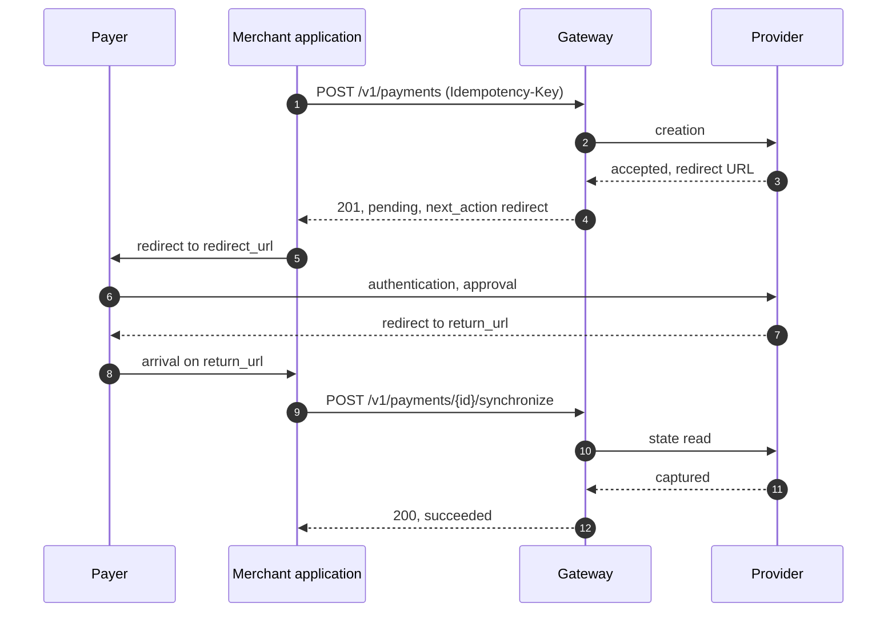

The reasons behind these rules are in [Decisions](/docs/decisions#0004).

## 1. HTTP conventions

These conventions apply to every OpenFSP endpoint.

**1.1.** HTTPS only. The gateway MUST NOT serve the API over plain HTTP outside an explicit development mode, which MUST be announced in the startup log.

**1.2.** Every endpoint is under `/v1`. The major version changes only on a breaking change.

**1.3.** Minor versions do not appear in the path. Additions are found through [capability discovery](/docs/spec/capabilities).

**1.4.** Requests and success responses use `application/json`. Errors use `application/problem+json` (10.1.1).

**1.5.** A body with an unsupported `Content-Type` MUST be rejected with `malformed-request`.

**1.6.** `POST` creates or acts, `GET` reads. `PATCH` and `DELETE` are not used here. A method not implemented on a known path MUST receive `405` with `Allow`.

**1.7.** Idempotency scope: [idempotency 1](/docs/spec/idempotency#1). Only synchronization (5.3) is exempted. The gateway MUST NOT extend the exemption.

**1.8.** Every response, success or error, carries the `Request-Id` header, equal to the `request_id` (10.1.6).

**1.9.** Unknown fields: rejected in requests, tolerated in responses ([data model 2.3](/docs/spec/data-model#2.3), [2.4](/docs/spec/data-model#2.4)).

**1.10.** Paths are canonical without a trailing slash. `/v1/payments/` MUST be treated as `/v1/payments`.

**1.11.** Every timestamp is a `Timestamp` ([data model 7](/docs/spec/data-model#7)).

**1.12.** A collection is an object with a REQUIRED `data` member, an array of resources, never a bare array: `{ "data": [] }`.

## 2. Base capability

**2.1.** The three operations of 5 form the `payments` capability. A conformant gateway MUST implement them for every provider it supports. Without `payments.lookup`, synchronization follows [capabilities 5.3](/docs/spec/capabilities#5.3).

**2.2.** The gateway MUST NOT make these operations depend on a prior capability discovery request.

## 3. `Payment` resource

```json
{
  "id": "pay_01J9ZK3QF8XN2M7VYB4C6D8E0G",
  "reference": "INV-2026-00184",
  "status": "pending",
  "amount": { "amount": 125000, "currency": "HTG" },
  "provider": "moncash",
  "provider_reference": null,
  "provider_order_id": "q3v7m2kxbh4tapewdc5nzr2b3z",
  "payer": { "phone_number": "+50934567890" },
  "description": "Invoice 184",
  "next_action": {
    "type": "redirect",
    "redirect_url": "https://provider.example/checkout/abc123",
    "expires_at": "2026-08-17T15:02:07Z"
  },
  "created_at": "2026-08-17T14:32:07.412Z",
  "updated_at": "2026-08-17T14:32:07.412Z",
  "expires_at": "2026-08-17T15:02:07Z",
  "completed_at": null,
  "failure_reason": null,
  "failure_detail": null,
  "fee": null,
  "metadata": { "order_id": "184" }
}
```

**3.1.** Fields:

| Field                | Type                | Presence    | Notes                                                                                     |
| -------------------- | ------------------- | ----------- | ----------------------------------------------------------------------------------------- |
| `id`                 | `ResourceId`        | REQUIRED    | Opaque.                                                                                   |
| `reference`          | `Reference`         | REQUIRED    | Unique per gateway.                                                                       |
| `status`             | string              | REQUIRED    | [Lifecycle 1](/docs/spec/lifecycle#1).                                                    |
| `amount`             | `Money`             | REQUIRED    |                                                                                           |
| `provider`           | string              | REQUIRED    | Registered provider identifier (3.2).                                                     |
| `provider_reference` | `ProviderReference` | OPTIONAL    | Absent until the provider supplies one ([data model 6.3.2](/docs/spec/data-model#6.3.2)). |
| `provider_order_id`  | string              | REQUIRED    | Order identifier sent to the provider ([idempotency 7.2](/docs/spec/idempotency#7.2)).    |
| `payer`              | object              | OPTIONAL    | 3.3.                                                                                      |
| `description`        | string              | OPTIONAL    | At most 255 characters.                                                                   |
| `next_action`        | object              | conditional | 4.1.                                                                                      |
| `created_at`         | `Timestamp`         | REQUIRED    | Immutable.                                                                                |
| `updated_at`         | `Timestamp`         | REQUIRED    | [Lifecycle 4.2](/docs/spec/lifecycle#4.2).                                                |
| `expires_at`         | `Timestamp`         | OPTIONAL    | [Lifecycle 5](/docs/spec/lifecycle#5).                                                    |
| `completed_at`       | `Timestamp`         | conditional | REQUIRED if terminal.                                                                     |
| `failure_reason`     | string              | conditional | REQUIRED if `failed`.                                                                     |
| `failure_detail`     | object              | OPTIONAL    | Raw provider error.                                                                       |
| `fee`                | `Fee`               | OPTIONAL    | Absent means not known (3.5).                                                             |
| `metadata`           | `Metadata`          | OPTIONAL    |                                                                                           |

**3.2.** `provider` matches `^[a-z0-9_]{1,32}$` and MUST be the identifier from the
[provider registry](/docs/registry), or a `mock_*` identifier of the
[mock server](/docs/spec/conformance#9). It is REQUIRED even if the gateway serves a single provider.

**3.3.** `payer` carries a single field, `phone_number` (`PhoneNumber`).

**3.4.** `description` MAY be sent to the provider and shown to the payer. The client MUST NOT put personal data in it.

**3.5.** `fee`:

- a creation request containing `fee` MUST be rejected;
- `fee` MAY appear only once the payment is terminal. Its arrival changes `updated_at` without changing `status`;
- a client MUST NOT display its absence as zero ([data model 8.2](/docs/spec/data-model#8.2)).

## 4. `next_action`

**4.1.** REQUIRED while the payment is `pending`, absent once terminal, except in 4.1.1.

**4.1.1.** A creation whose `effect` is `unknown` (10.6) leaves the payment `pending` without `next_action`. The gateway MUST still return it on read (5.2) and
on synchronization (5.3), as the client is told to do (10.6.3), and announce it once through `payment.created` ([webhooks 3](/docs/spec/webhooks#3)). It
receives `next_action` if a resend of the creation succeeds ([idempotency 7](/docs/spec/idempotency#7)). Until the creation call to the provider has
answered, the gateway MAY withhold the payment.

**4.2.** Closed enumeration:

| `type`           | Meaning                                                  | Fields                       |
| ---------------- | -------------------------------------------------------- | ---------------------------- |
| `redirect`       | Send the payer to a provider page.                       | `redirect_url`, `expires_at` |
| `payer_approval` | The payer approves on their device (USSD, notification). | none                         |
| `none`           | Nothing is required from the payer.                      | none                         |

The `expires_at` of a `redirect` is OPTIONAL when the provider announces `expiry_guaranteed` as `false`
([capabilities 3.2.2](/docs/spec/capabilities#3.2.2)).

**4.3.** The gateway MUST report the type the provider requires. If that type cannot be determined, the creation fails with an error. `none` MUST NOT be used
as a default.

**4.4.** A client MUST treat `redirect_url` as opaque, MUST NOT rewrite it, and MUST NOT embed it in a frame that hides its origin.

**4.5.** `next_action.expires_at` MAY precede the payment's `expires_at`. Its expiry does not make the payment terminal.

**4.6.** A capability MAY add a type. It is produced only for a provider that announces that capability. A client that receives an unknown type MUST NOT treat
it as `none`.

## 5. Endpoints

### 5.1. Create a payment

```
POST /v1/payments
```

```json
{
  "reference": "INV-2026-00184",
  "amount": { "amount": 125000, "currency": "HTG" },
  "provider": "moncash",
  "payer": { "phone_number": "+50934567890" },
  "description": "Invoice 184",
  "return_url": "https://merchant.example/checkout/184/return",
  "expires_at": "2026-08-17T15:02:07Z",
  "metadata": { "order_id": "184" }
}
```

| Field          | Presence    | Notes                                                                                                           |
| -------------- | ----------- | --------------------------------------------------------------------------------------------------------------- |
| `reference`    | REQUIRED    | Duplicate: `reference-conflict`.                                                                                |
| `amount`       | REQUIRED    | Strictly positive, within the limits ([capabilities 6](/docs/spec/capabilities#6)).                             |
| `provider`     | REQUIRED    | 5.1.1.                                                                                                          |
| `payer`        | conditional | Depends on the provider (5.1.2).                                                                                |
| `description`  | OPTIONAL    |                                                                                                                 |
| `return_url`   | conditional | REQUIRED if the provider announces `return_url_required` ([capabilities 3.2.2](/docs/spec/capabilities#3.2.2)). |
| `expires_at`   | OPTIONAL    | Requested value. The value applied is the one in the response (5.1.4).                                          |
| `locale`       | OPTIONAL    | Language of the payer's page: `fr`, `ht` or `en` (5.1.7).                                                       |
| `metadata`     | OPTIONAL    |                                                                                                                 |
| `callback_url` | conditional | Reserved for a call from a gateway to a native provider (5.1.8).                                                |

**5.1.1.** The gateway MUST NOT choose the provider on the client's behalf.

**5.1.2.** The gateway MUST document, per adapter, whether `payer` is required: the `payer_required` member of `/v1/capabilities`
([capabilities 3.2.2](/docs/spec/capabilities#3.2.2)) serves as that documentation. It MUST reject with `missing-field` a request lacking a field the
provider requires.

**5.1.3.** `return_url` MUST be an absolute `https` URL. An `http` URL MUST be rejected. Exception: in development mode, the gateway accepts
`http://localhost` and `http://127.0.0.1`.

**5.1.4.** The gateway sets the resource's `expires_at` to what the provider guarantees, which MAY differ from the request or be absent. A client MUST read the
value back.

| Status                   | Condition                                    |
| ------------------------ | -------------------------------------------- |
| `201`                    | Payment created. `Location` carries its URL. |
| `400`, `422`             | Invalid request (10.9.1).                    |
| `409 reference-conflict` | Reference already used (5.1.5).              |
| `502`, `503`, `504`      | Failure on the provider side. Read `effect`. |

**5.1.5.** On `reference-conflict`, the client SHOULD read the existing payment (5.2).

**5.1.6.** On `504 provider-timeout` or `500 internal-error`, `effect` is `unknown` (10.6.3).

**5.1.7.** The gateway passes `locale` to the provider if it is among the announced `locales` ([capabilities 3.2.2](/docs/spec/capabilities#3.2.2)), and
ignores it otherwise. A value other than `fr`, `ht` or `en` MUST be rejected with `invalid-field`.

**5.1.8.** `callback_url` is the payment's callback URL ([lifecycle 6.6](/docs/spec/lifecycle#6.6)), sent by a gateway to a native provider that announces
`webhooks.verify` or `webhooks.per_payment_url`. It is an absolute `https` URL. In development mode (1.1), the provider also accepts `http://localhost` and
`http://127.0.0.1`, as in 5.1.3. The provider MUST deliver this payment's events to it, signed as in [webhooks 5](/docs/spec/webhooks#5). A gateway MUST
reject with `unknown-field` a creation carrying `callback_url` received from a client.

### 5.2. Read a payment

```
GET /v1/payments/{id}
GET /v1/payments?reference={reference}
```

**5.2.1.** By `id`: the payment, or `404 not-found`.

**5.2.2.** By `reference`: a collection of at most one element. An unknown reference gives `200` with an empty `data`.

**5.2.3.** Client libraries SHOULD expose lookup by reference.

**5.2.4.** A read returns the state recorded by the gateway. It MUST NOT call the provider.

### 5.3. Synchronize a payment

```
POST /v1/payments/{id}/synchronize
```

**5.3.1.** The gateway reads the state again from the provider, applies the resulting transition according to the [lifecycle](/docs/spec/lifecycle), and
returns the payment.

**5.3.2.** The gateway MUST implement this endpoint and SHOULD also reconcile in the background ([lifecycle 6.2](/docs/spec/lifecycle#6.2)).

**5.3.3.** On a terminal payment, the gateway MUST NOT call the provider and MUST return the payment unchanged with `200`.

**5.3.3.1.** This check precedes every other, including the capability check ([capabilities 5.3](/docs/spec/capabilities#5.3)).

**5.3.4.** Provider unreachable: `503 provider-unavailable` or `504 provider-timeout`. The payment stays `pending`.

**5.3.5.** The gateway SHOULD rate-limit this endpoint per payment (`429 rate-limited` with `Retry-After`).

**5.3.6.** This endpoint is exempted from `Idempotency-Key` ([idempotency 1.4](/docs/spec/idempotency#1.4)).

**5.3.7.** An unknown provider status ([lifecycle 1.1](/docs/spec/lifecycle#1.1)) or a conflict ([lifecycle 6.4](/docs/spec/lifecycle#6.4)) is not a
synchronization error: the response is `200` with the payment unchanged.

## 6. Tracking changes

**6.1.** A client learns of a state change by read (5.2), synchronization (5.3) or [webhook](/docs/spec/webhooks).

**6.2.** A client SHOULD poll at increasing intervals and SHOULD stop as soon as the payment is terminal.

**6.3.** See [webhooks 10](/docs/spec/webhooks#10).

## 7. Return URL

**7.1.** A client MUST NOT treat the payer's return to `return_url` as proof of an outcome.

**7.2.** Parameters the provider adds to `return_url` can be controlled by an attacker.

**7.3.** On return, a client MUST read the payment from the gateway and display the result of that response alone.

**7.4.** If the provider does not take a return URL per payment, the gateway MUST expose a return endpoint per provider, which the operator registers with
that provider. This endpoint:

- MUST find the payment by the order identifier received ([idempotency 7.2](/docs/spec/idempotency#7.2));
- SHOULD trigger a synchronization (5.3);
- MUST redirect with `303` to the payment's recorded `return_url` and MUST NOT redirect to a URL received as a parameter;
- MUST answer `404` without redirection if the payment is unknown, without distinguishing a malformed identifier from an unknown one.

**7.5.** The return endpoint is not authenticated ([authentication 1.1](/docs/spec/authentication#1.1)) and MUST be rate-limited.

## 8. Typical flow

Informative: the typical course of a redirect payment.



## 9. Security

**9.1.** Lookup by reference covers the gateway's payments, which every authorized principal sees
([authentication 5.5](/docs/spec/authentication#5.5)).

**9.2.** A key without the required scope receives `forbidden` ([authentication 6.4](/docs/spec/authentication#6.4)).

**9.3.** Client documentation SHOULD state that `description` may be sent to the provider and shown to the payer, unlike `metadata` (3.4).

## 10. Errors

### 10.1. Format

**10.1.1.** Every error response MUST be a problem detail (RFC 9457) with media type `application/problem+json`.

**10.1.2.** Example:

```json
{
  "type": "https://openfsp.org/problems/provider-timeout",
  "title": "The provider did not respond in time",
  "status": 504,
  "detail": "No response from the provider after 30s. The payment's outcome is unknown.",
  "instance": "/v1/payments",
  "retryable": true,
  "effect": "unknown",
  "request_id": "req_01J9ZK3QF8XN2M7VYB4C6D8E0G"
}
```

**10.1.3.** Members:

| Member            | Type          | Presence | Notes                                                   |
| ----------------- | ------------- | -------- | ------------------------------------------------------- |
| `type`            | URI           | REQUIRED | Stable identifier (10.3).                               |
| `title`           | string        | REQUIRED | Human-readable, not stable.                             |
| `status`          | integer       | REQUIRED | HTTP status.                                            |
| `detail`          | string        | OPTIONAL | Human-readable, specific to the occurrence, not stable. |
| `instance`        | URI reference | OPTIONAL | Request path.                                           |
| `retryable`       | boolean       | REQUIRED | 10.5.                                                   |
| `effect`          | string        | REQUIRED | `none` or `unknown` (10.6).                             |
| `request_id`      | string        | REQUIRED | Correlation with the gateway logs.                      |
| `errors`          | array         | OPTIONAL | Per-field detail (10.7).                                |
| `provider_detail` | object        | OPTIONAL | Relayed from the provider (10.8).                       |

**10.1.4.** A client MUST identify an error by its `type` alone. `title` and `detail` MAY change or be localized.

**10.1.5.** `status` MUST equal the HTTP status of the response.

**10.1.6.** `request_id` MUST be present on every error, including `500`.

### 10.2. Failed request and failed payment

**10.2.1.** An error response reports the failure of the request. The outcome of the payment is carried by `status` (10.2.2).

**10.2.2.** A declined payment is reported with `200`, with `"status": "failed"` and a `failure_reason` ([lifecycle 7.2](/docs/spec/lifecycle#7.2)).

**10.2.3.** The gateway MUST NOT report a declined payment through an error response, nor use a `4xx` or `5xx` status for the outcome of a payment.

**10.2.4.** A client MUST NOT treat a non-`2xx` response as a failed payment. Its effect is given by `effect`.

### 10.3. Type URIs

**10.3.1.** Form: `https://openfsp.org/problems/<code>`, with `<code>` taken from the catalogue in 10.9.

**10.3.2.** A client MUST compare these URIs as opaque strings and MUST NOT dereference them to interpret a response.

**10.3.3.** The specification editor SHOULD publish documentation for the type at each type URI. This rule does not bind implementations.

**10.3.4.** Type URIs MUST keep the `openfsp.org` authority in every version.

**10.3.5.** A gateway MAY define types under its own authority and MUST NOT define any under the OpenFSP authority.

**10.3.6.** Faced with an unknown `type`, a client MUST rely on `status`, `retryable` and `effect`. An addition to the catalogue is not a breaking change.

### 10.4. Statuses

**10.4.1.** The gateway MUST use the status assigned by the catalogue.

**10.4.2.** Statuses follow RFC 9110: `400` unreadable or malformed request, `422` invalid content, `409` conflict with a state held by the gateway.

**10.4.3.** `idempotency-key-reused` is `422` and `idempotency-request-in-progress` is `409`, as in the IETF `Idempotency-Key` draft.

**10.4.4.** On the provider side: `502` invalid response or provider error, `503` provider unreachable, `504` no response in time.

### 10.5. `retryable`

**10.5.1.** `retryable` states whether repeating the request unchanged, with the same `Idempotency-Key`, can succeed.

**10.5.2.** `retryable: true` means a resend with the same `Idempotency-Key` produces no duplicate effect. It does not guarantee success.

**10.5.3.** A client MUST NOT resend a request whose error carries `retryable: false`.

**10.5.4.** A client that resends MUST reuse the original key and space its resends ([idempotency 8.1](/docs/spec/idempotency#8.1),
[8.4](/docs/spec/idempotency#8.4)).

**10.5.5.** A client MUST honour `Retry-After`.

**10.5.6.** `retryable` MUST match the catalogue value.

### 10.6. `effect`

**10.6.1.** Values:

| Value     | Meaning                              |
| --------- | ------------------------------------ |
| `none`    | The operation did not take effect.   |
| `unknown` | The operation may have taken effect. |

**10.6.2.** The gateway MUST report `none` only if it can establish it, and `unknown` otherwise.

**10.6.3.** On `unknown`, a client MUST NOT conclude that the operation failed. It MUST resend with the original key or read the resource by its `reference`
([data model 6.2.3](/docs/spec/data-model#6.2.3)).

**10.6.4.** `effect` and `retryable` are independent.

**10.6.5.** The gateway MUST NOT store for [idempotency](/docs/spec/idempotency) an error carrying `effect: unknown`. A resend is handled according to
[idempotency 3](/docs/spec/idempotency#3).

### 10.7. Field errors

**10.7.1.** If the error concerns specific fields, `errors` SHOULD be present:

| Member   | Type   | Presence | Notes                                          |
| -------- | ------ | -------- | ---------------------------------------------- |
| `field`  | string | REQUIRED | JSON Pointer (RFC 6901) into the request body. |
| `code`   | string | REQUIRED | Stable code, from the closed list below.       |
| `detail` | string | OPTIONAL | Human-readable, not stable.                    |

| `code`          | Meaning                                                     |
| --------------- | ----------------------------------------------------------- |
| `required`      | Required field absent or `null`.                            |
| `malformed`     | Value not in the expected format (number, URL, identifier). |
| `invalid_type`  | Unexpected JSON type.                                       |
| `unknown_field` | Field not defined by the specification.                     |
| `not_positive`  | Zero or negative amount.                                    |
| `too_large`     | Value above the maximum.                                    |
| `too_long`      | String above the maximum length.                            |
| `too_many`      | Number of elements above the maximum.                       |
| `not_allowed`   | Value outside the allowed set.                              |

```json
{
  "type": "https://openfsp.org/problems/invalid-field",
  "title": "One or more fields are invalid",
  "status": 422,
  "retryable": false,
  "effect": "none",
  "request_id": "req_01J9ZK…",
  "errors": [
    { "field": "/amount/amount", "code": "not_positive" },
    { "field": "/payer/phone_number", "code": "malformed" }
  ]
}
```

**10.7.2.** The gateway SHOULD report every invalid field in a single response.

**10.7.3.** `field` MUST point into the request as the client sent it.

### 10.8. Provider relay

**10.8.1.** For an error coming from the provider, `provider_detail` SHOULD carry its code and message:

```json
"provider_detail": { "code": "E4021", "message": "Subscriber not registered" }
```

**10.8.1.1.** For a native provider, `code` is the last segment of the `type` of its problem details, and `message` is its `detail`, or failing that its
`title`.

**10.8.2.** The gateway MUST NOT parse it or derive `type`, `retryable` or `effect` from it, and MUST relay it unaltered.

**10.8.3.** A client MUST NOT rely on `provider_detail` for a programmatic decision.

**10.8.4.** `provider_detail` MUST NOT contain any secret identifier, token or authentication material. The gateway MUST redact such content.

### 10.9. Catalogue

Closed. Extending it requires a decision record.

#### 10.9.1. Request

| Code                       | Status | `retryable` | `effect` | Condition                                                                              |
| -------------------------- | ------ | ----------- | -------- | -------------------------------------------------------------------------------------- |
| `malformed-request`        | 400    | false       | `none`   | Body not JSON or not an object.                                                        |
| `unknown-field`            | 400    | false       | `none`   | Unknown field ([data model 2.4](/docs/spec/data-model#2.4)).                           |
| `missing-field`            | 400    | false       | `none`   | Required field absent.                                                                 |
| `method-not-allowed`       | 405    | false       | `none`   | Method not implemented on a known path (1.6). MUST carry `Allow`.                      |
| `idempotency-key-required` | 400    | false       | `none`   | `Idempotency-Key` absent ([idempotency 1.3](/docs/spec/idempotency#1.3)).              |
| `invalid-field`            | 422    | false       | `none`   | Invalid content. Carries `errors`.                                                     |
| `capability-not-supported` | 422    | false       | `none`   | Capability not announced.                                                              |
| `amount-out-of-range`      | 422    | false       | `none`   | Amount outside the announced limits ([capabilities 6.7](/docs/spec/capabilities#6.7)). |
| `idempotency-key-reused`   | 422    | false       | `none`   | Same key, different body ([idempotency 3.3](/docs/spec/idempotency#3.3)).              |

#### 10.9.2. Authentication

| Code              | Status | `retryable` | `effect` | Condition                                |
| ----------------- | ------ | ----------- | -------- | ---------------------------------------- |
| `unauthenticated` | 401    | false       | `none`   | Credential absent, malformed or invalid. |
| `forbidden`       | 403    | false       | `none`   | Authenticated, not authorized.           |

#### 10.9.3. Resource

| Code        | Status | `retryable` | `effect` | Condition                |
| ----------- | ------ | ----------- | -------- | ------------------------ |
| `not-found` | 404    | false       | `none`   | Resource does not exist. |

**10.9.3.1.** The gateway MUST check the scope before the existence of the resource: a key without the required scope receives `forbidden` whether or not the
resource exists ([authentication 6.4](/docs/spec/authentication#6.4)), so that the response does not reveal its existence.

#### 10.9.4. Conflicts

| Code                              | Status | `retryable` | `effect`  | Condition                                                                                 |
| --------------------------------- | ------ | ----------- | --------- | ----------------------------------------------------------------------------------------- |
| `reference-conflict`              | 409    | false       | `none`    | `reference` already used ([data model 6.2.2](/docs/spec/data-model#6.2.2)).               |
| `idempotency-request-in-progress` | 409    | true        | `unknown` | Request with the same key in progress ([idempotency 3.4](/docs/spec/idempotency#3.4)).    |
| `state-conflict`                  | 409    | false       | `none`    | Operation not allowed from the current state ([lifecycle 2.1](/docs/spec/lifecycle#2.1)). |

**10.9.4.1.** Reserved.

**10.9.4.2.** `idempotency-request-in-progress` SHOULD carry `Retry-After`.

#### 10.9.5. Rate

| Code           | Status | `retryable` | `effect` | Condition                                    |
| -------------- | ------ | ----------- | -------- | -------------------------------------------- |
| `rate-limited` | 429    | true        | `none`   | Too many requests. MUST carry `Retry-After`. |

#### 10.9.6. Gateway and provider

| Code                   | Status | `retryable` | `effect`  | Condition                                     |
| ---------------------- | ------ | ----------- | --------- | --------------------------------------------- |
| `internal-error`       | 500    | true        | `unknown` | Unexpected gateway failure.                   |
| `provider-error`       | 502    | true        | `unknown` | Provider error or unusable provider response. |
| `provider-unavailable` | 503    | true        | `none`    | Provider unreachable.                         |
| `provider-timeout`     | 504    | true        | `unknown` | No response from the provider in time.        |

**10.9.6.1.** `provider-unavailable` MUST be used only if no request reached the provider (connection refused, DNS failure). If a request was sent with no
known outcome, `provider-timeout` applies.

**10.9.6.2.** `internal-error` MUST carry `unknown`, unless the gateway establishes that no call to the provider took place.

**10.9.6.3.** `internal-error` MUST NOT include internal diagnostics (stack trace, query, host name).

### 10.10. Language

**10.10.1.** `title` and `detail` SHOULD be in English by default.

**10.10.2.** A gateway MAY localize them and SHOULD then honour `Accept-Language`.

**10.10.3.** Localization MUST NOT change `type`, `retryable`, `effect` or any `code`.

### 10.11. Security

**10.11.1.** `title`, `detail` and `errors[].detail` MUST NOT contain a phone number, a payer identifier or an amount.

**10.11.2.** `unauthenticated` MUST NOT distinguish the failure causes listed in [authentication 4.7](/docs/spec/authentication#4.7).

**10.11.3.** Client libraries SHOULD document that `provider_detail` must be escaped when displayed.
